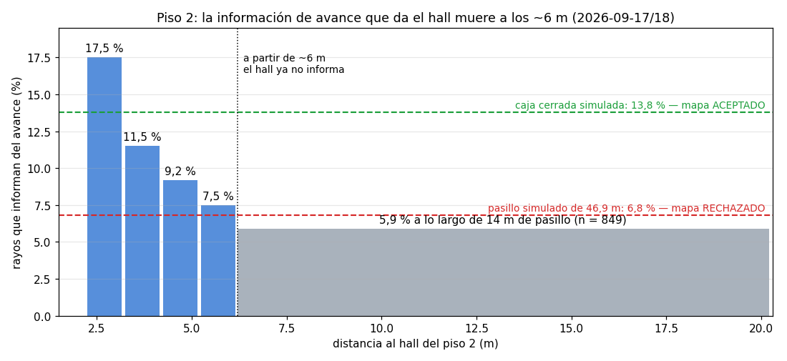

# Informe de avance de la semana 23

Universidad Santo Tomás · Facultad de Ingeniería Electrónica · Grupo de Estudio y Desarrollo en Robótica (GED)

Sistema colaborativo de robots móviles para asistencia de orientación en entornos interiores con múltiples pisos

Realizado por: Santiago Hernández Ávila y Jonny Alejandro Mejía León

Dirigido por: Ing. Armando Mateus Rojas, Msc.; Ing. Nestor Ivan Ospina, Msc.; Ing. Oscar Mauricio Gélvez Lizarazo, Msc.

Semana 23: 14 al 20 de septiembre de 2026. Fase 5: integración del sistema y realización de pruebas.

> Versión en Markdown para leer en el repositorio. La versión para compilar es
> [`Entregable_semana_23.tex`](Entregable_semana_23.tex), en Overleaf, donde está el logotipo de la
> portada.

---

## 1. Introducción

Este informe presenta el avance de la semana 23 del cronograma (14 al 20 de septiembre de 2026),
dentro de la fase 5, integración del sistema y realización de pruebas.

En esta semana se cerró la implementación. El 18 de septiembre se congeló el código con la etiqueta
`v0.4-implementacion-congelada` (hito H7 del cronograma), y desde entonces no se añade
funcionalidad nueva. En esa fecha estaban completos los objetivos específicos 1 (arquitectura
funcional) y 3 (interfaz humano–robot). Al objetivo 4 (evaluación experimental) solo le faltaba la
demostración física, que depende de la plataforma del objetivo 2.

El 14 de septiembre llegó el segundo vehículo, y ese mismo día se verificó la comunicación entre
los dos (requisito RF-15), con lo que el objetivo 2 avanzó por primera vez en cuatro semanas
(sección 4). Se verificó también la cancelación de misiones (RF-29), el último requisito pendiente
del objetivo 3 (sección 3). Por último, se midió la información de avance en los pasillos reales de
los dos pisos. En ninguno alcanza para que el vehículo construya el mapa mientras recorre el
pasillo, así que la única ruta crítica que queda es publicar la odometría del vehículo (sección 5).

De las tres partes del criterio de cierre de la semana se cumplieron dos. La corrida física completa
no se realizó (sección 10).

## 2. Objetivos de la semana

El cronograma fija para esta semana el siguiente criterio de cierre:

> *El sistema corre de extremo a extremo en simulación y se ejecuta al menos una corrida física
> completa. Repositorio etiquetado.*

Las actividades planificadas eran cuatro: verificación del funcionamiento general y corrección de
fallas, ensayo del protocolo con los vehículos reales, congelación del código y emisión del informe
de la semana 22. El criterio se cumplió en dos de sus tres partes; la corrida física completa no se
realizó, y en la sección 10 se declara como no cumplida.

## 3. Cancelación de misiones y verificación de RF-29

La interfaz tenía un botón para cancelar la misión desde el 2 de septiembre, pero no tenía efecto.
En ROS 2, un servidor de acciones rechaza por defecto las solicitudes de cancelación si no se le
programa una función que las atienda, y el coordinador no la tenía. Jonny Mejía corrigió el defecto
el fin de semana anterior. Además, programó que una misión cancelada devuelva el vehículo a la
escalera de su piso, que es el punto de transferencia, en lugar de dejarlo detenido en mitad del
pasillo.

Con esa corrección se redactó el requisito RF-29 (el usuario cancela una misión en curso y el
vehículo regresa al punto de transferencia de su piso) y se verificó con dos corridas:

| Corrida | Resultado |
|---|---|
| Con cancelación | El registro marca el estado `CANCELANDO` y la misión cierra como `FALLIDA`. El vehículo termina a 0,121 m de la escalera; el criterio es 0,25 m. |
| De control, sin cancelación | Ninguna marca de cancelación; la misión cierra como `COMPLETADA`. |

En la corrida con cancelación, la orden de cancelar se envía cuando la odometría indica que el
vehículo se ha alejado más de 8 m, y no después de un tiempo fijo. El vehículo parte a 1,4 m de la
escalera, así que una cancelación temprana cumpliría el criterio de regreso sin que el vehículo se
hubiera desplazado.

La ejecución de la prueba mostró un error en el criterio de verificación. El criterio pedía
comprobar que el registro de la misión incluyera el motivo «Cancelada por el usuario», pero ese
texto se envía en la respuesta de la acción de ROS 2 y no queda guardado en el registro. El criterio
se corrigió antes de dar el requisito por verificado.

## 4. Llegada del segundo vehículo y verificación de RF-15

El 14 de septiembre el codirector entregó el segundo vehículo (`amss-jgm9`), que estaba en
intervención técnica desde agosto (riesgo R11). Ese mismo día se midió la comunicación entre los
dos vehículos para el requisito RF-15, con los límites fijados antes de la medición:

| Magnitud | Medido | Límite |
|---|---|---|
| Mensajes recibidos | 600 de 600 (0 % de pérdida) | 0 % de pérdida |
| Tiempo de ida y vuelta, mediana | 7,61 ms | 100 ms |
| Tiempo de ida y vuelta, percentil 95 | 20,76 ms | 250 ms |

La mediana queda 13 veces por debajo del límite, así que la red no restringe la publicación del
estado del sistema, que se hace a 2 Hz. Con esta medición se verificó RF-15, se cerró el riesgo R11
después de 31 días abierto y el avance del objetivo 2 pasó del 55 al 65 %.

Durante la prueba se encontraron dos problemas que el guion no preveía. El cortafuegos de los
vehículos bloqueaba el tráfico entre ellos en los dos sentidos: la prueba de conectividad (`ping`)
respondía, pero ninguno veía los nodos del otro. Por eso RF-15 no pudo verificarse durante un mes,
aunque solo una de las dos causas era la falta del segundo vehículo. Además, el servidor DHCP asigna
una dirección IP distinta en cada sesión, así que desde entonces cada vehículo se identifica por su
nombre de equipo y su dirección MAC.

## 5. Información de avance en los pasillos reales

El vehículo no tiene codificadores en las ruedas, así que su odometría se estima con rf2o, un paquete
que compara barridos consecutivos del LiDAR. Para que rf2o detecte el avance, parte de los rayos
deben incidir sobre superficies orientadas hacia la dirección de marcha, porque solo esos rayos
cambian de longitud cuando el vehículo avanza. En un pasillo recto de paredes uniformes casi todos
los rayos caen sobre las paredes laterales, y el avance no se registra.

La información de avance es la fracción de rayos de un barrido que inciden sobre superficies
orientadas hacia la marcha, es decir, cuya normal forma menos de 45° con la dirección de avance. Se
calcula con la herramienta `medir_informacion_avance.py`. Como referencia, en una caja cerrada
simulada, cuyo mapa se construyó correctamente, vale 13,8 %, y en el pasillo simulado, cuyo mapa
falló, 6,8 %. En los pasillos reales se midió:

| Entorno | Información de avance |
|---|---|
| Pasillo real del piso 1 | 5,1 % (mediana de 700 barridos) |
| Pasillo real del piso 2 | 5,9 % (mediana de 849 barridos) |

Antes de medir el piso 2 se registró una predicción de entre 8 y 14 %, porque su pasillo tiene el
doble de discontinuidades en las paredes que el del piso 1 (cuatro frente a dos). La medición no la
confirmó. La Figura 1 muestra la razón: la información que aporta el hall cae a partir de unos 6 m
de distancia, y no a los 10 a 12 m del alcance del sensor, como se había supuesto.

*Figura 1. Información de avance en el pasillo del piso 2 según la distancia al hall: 17,5 % a
2,2 m y 5,9 % a partir de 6,2 m. El umbral coincide con el medido en la semana 22 con otro método.*

Este resultado no impide navegar el edificio. La campaña de evaluación en simulación, sobre el modelo
de esos mismos pasillos, alcanzó un 86,7 % de éxito con el mapa conocido de antemano. Lo que el
pasillo no permite es que el vehículo construya el mapa mientras lo recorre.

Al revisar una corrida del piso 2 que no pudo usarse se encontró, además, que el LiDAR está montado
girado 180°, con lo que su sector ciego de 60° queda hacia delante.

## 6. Respuesta de tracción del vehículo (RF-14)

El 17 de septiembre se midió por primera vez, sobre el vehículo, cómo se convierten las órdenes de
velocidad de ROS 2 (tópico `/cmd_vel`) en potencia del motor. La medición corresponde al requisito
RF-14, según el cual cada vehículo se comanda desde ROS 2 sin pasar por la interfaz web del
fabricante. Se encontraron dos defectos. El primero es una banda muerta: toda orden inferior a
0,40 m/s produce potencia cero. El segundo es que el nodo que convierte las órdenes aplica después un
reescalado que reduce los tres niveles de potencia a 0,4247, 0,6242 y 0,7341 (en una escala de 0 a
1). En la misma sesión se recalibró la dirección, que nunca se había centrado.

Durante la sesión ocurrió un incidente de seguridad: una sola orden de tracción movió los dos
vehículos. Los dos están en la misma red de ROS 2 y el tópico de las órdenes de servo no lleva
espacio de nombres (un prefijo como `/robot1` que distinga a cada vehículo), así que ambos recibieron
la orden. Es el pendiente de espacios de nombres del objetivo 2, ahora con consecuencias físicas.
Desde entonces, en las pruebas de campo solo se enciende un vehículo.

## 7. Congelación del código y plan del trabajo restante

El 18 de septiembre se congeló el código con la etiqueta `v0.4-implementacion-congelada` y se publicó
`MAPA_TRABAJO_RESTANTE.md`, que reúne en un solo documento el trabajo pendiente hasta la
sustentación. Según ese análisis, el proyecto tiene una sola ruta crítica: publicar en el vehículo
real la transformada `odom → base_link`, es decir, la estimación de la posición del vehículo respecto
a su punto de partida. Los seis requisitos que siguen abiertos dependen todos de la plataforma física.

## 8. Otros avances

El 16 de septiembre se cerró el riesgo R14 (dos criterios del protocolo experimental no podían dar un
resultado negativo) con sus siete acciones. Dos de ellas se ejecutaron de forma distinta a como
estaban enunciadas, con la razón documentada. Una de las acciones preveía regenerar los registros de
las misiones a partir de las grabaciones de datos de ROS (*rosbag*). Se comprobó que hacerlo
reescribía la información de procedencia de los 44 registros, así que no se regeneró ninguno. La
misma comprobación mostró que la regeneración es reproducible: los 44 registros se obtienen de nuevo
a partir de las grabaciones sin que cambie ningún veredicto.

Desde esta semana, el repositorio guarda la fuente LaTeX de cada entregable en lugar del PDF, que se
compila en Overleaf.

Se documentó en `GUIA_ARRANQUE.md` la secuencia completa de arranque del sistema, que hasta entonces
solo conocían los dos integrantes del equipo, para que otra persona pueda ejecutarla.

El 19 de septiembre se escribió el capítulo de resultados de la campaña en simulación, previsto para
la semana 24. Los cuatro fallos de la campaña tienen la misma forma. Nav2 informa que llegó a la
meta, pero la posición real del vehículo en el simulador queda entre 0,269 y 0,345 m de ella, por
fuera de la tolerancia de 0,25 m. El capítulo atribuye el error a la estimación de la posición: el
presupuesto de error del protocolo le asigna 88 mm, y en esas cuatro corridas hizo falta entre 1,35
y 2,22 veces esa cantidad. El capítulo registra también dos limitaciones. Los criterios de llegada
(C1) y de cierre de la misión (C2) no son independientes en este tipo de fallo, porque el coordinador
declara fallida la misión con el mismo umbral de 0,25 m. Y tres misiones se ejecutaron dos veces sin
que quedara registrado el motivo.

## 9. Aporte a los objetivos específicos

| Actividad | Objetivo | Aporte |
|---|---|---|
| Cancelación de misiones (RF-29) | OE3 | Último requisito del objetivo 3; con él quedan verificados sus seis requisitos |
| Comunicación entre los dos vehículos (RF-15) | OE2 | Primer requisito verificado sobre los vehículos reales; cierra el riesgo R11 |
| Información de avance en los dos pisos | OE2 | Descarta, con mediciones, que el vehículo construya el mapa del pasillo real recorriéndolo |
| Respuesta de tracción del vehículo | OE2 | Reduce lo pendiente de RF-14 a una medición concreta |
| Cierre de R14 y reproducibilidad de los registros | OE4 | Los resultados de la campaña pueden regenerarse a partir de sus datos |
| Capítulo de resultados | OE4 | Identifica el modo de fallo de la campaña y lo cuantifica |

| Objetivo | Avance | Aporte de la semana | Pendiente |
|---|---|---|---|
| OE1 | 100 % | — | — |
| OE2 | 55 % → 65 % | RF-15 verificado; pasillos de los dos pisos medidos | La odometría sobre el vehículo real |
| OE3 | 90 % → 100 % | RF-29 verificado | — |
| OE4 | 85 % | Capítulo de resultados escrito; R14 cerrado | RF-27, la demostración física |

El promedio simple del avance de los cuatro objetivos es 87,5 %, frente al 71,9 % que corresponde al
calendario (semana 23 de 32). Están verificados 29 de los 36 requisitos.

Esta diferencia no representa un margen de tiempo. Todo lo pendiente depende de la plataforma
física, y su avance no depende solo de las horas de trabajo.

## 10. Estado del cronograma y trabajo previsto

| Parte del criterio de cierre | Estado | Evidencia |
|---|---|---|
| El sistema funciona de extremo a extremo en simulación | Cumplida | Corridas de RF-29 del 14 de septiembre; misión operada desde un teléfono en la semana 22 |
| Al menos una corrida física completa | No cumplida | La primera navegación sobre el vehículo real fue el 24 de septiembre, en la semana 24 |
| Repositorio etiquetado | Cumplida | Etiqueta `v0.4-implementacion-congelada`, 18 de septiembre |

De las cuatro actividades planificadas se ejecutaron tres: la verificación y corrección de fallas, la
congelación del código y la emisión del informe de la semana 22. El ensayo del protocolo con los
vehículos reales no se hizo porque el vehículo aún no publicaba su odometría. Se realizaron además
cuatro actividades no planificadas: la medición de la comunicación con el segundo vehículo, la
medición de los pasillos de los dos pisos, la medición de la respuesta de tracción y el capítulo de
resultados.

Para la semana 24 se prevé decidir si se intenta la demostración física con los vehículos reales
(decisión GO/NO-GO) y publicar la odometría en el vehículo, que es la ruta crítica. También se
consolidará el conjunto de datos de la campaña y se emitirá este informe.

## 11. Conclusiones

1. El código quedó congelado el 18 de septiembre con los objetivos 1 y 3 completos. Lo pendiente de
   los objetivos 2 y 4 depende de la plataforma física.
2. El requisito de comunicación entre vehículos (RF-15) se verificó el mismo día en que llegó el
   segundo vehículo: latencia mediana de 7,61 ms frente a un límite de 100 ms, sin pérdida de
   mensajes.
3. El objetivo 3 quedó completo con la verificación de la cancelación de misiones (RF-29): el vehículo
   regresó a 0,121 m de la escalera, dentro del criterio de 0,25 m.
4. La información de avance en los pasillos reales es de 5,1 % en el piso 1 y 5,9 % en el piso 2,
   por debajo del 6,8 % del pasillo simulado cuyo mapa falló. Queda descartado que el vehículo
   construya el mapa del pasillo recorriéndolo, y la única ruta crítica es publicar su odometría.
5. La corrida física completa que exigía el criterio de cierre no se realizó, y esa parte del
   criterio se declara no cumplida.

## Anexo. Evidencia citada

| Documento | Qué respalda |
|---|---|
| `Documentos/Evidencia/registros/S23_RF29_cancelada.json` y `…_control.json` | Sección 3, RF-29 |
| `Documentos/Evidencia/registros/S23_RF15_carroA_carroB.json` | Sección 4, RF-15 |
| `Documentos/Evidencia/S23_informacion_avance_piso1.md` y `…_piso2.md` | Sección 5 |
| `Documentos/Evidencia/S23_campo_traccion_RF14.md` | Sección 6 |
| `Documentos/historial/MAPA_TRABAJO_RESTANTE.md` | Sección 7 |
| `Documentos/Evidencia/S23_reproducibilidad_de_los_registros.md` | Sección 8, reproducibilidad de los 44 registros |
| `Documentos/GUIA_ARRANQUE.md` | Sección 8, arranque del sistema |
| `Documentos/RESULTADOS_OE4_SIMULACION.md` | Sección 8, capítulo de resultados |
