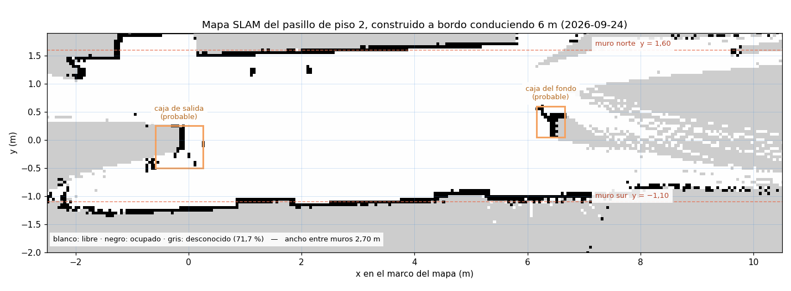
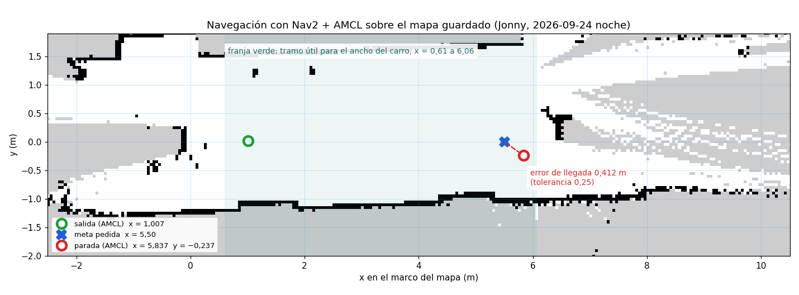
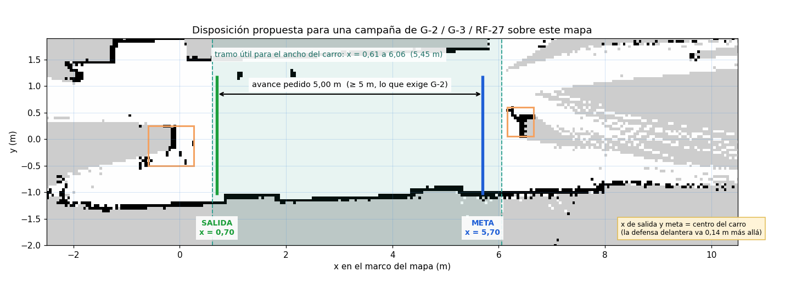

# Informe de avance de la semana 24

Universidad Santo Tomás · Facultad de Ingeniería Electrónica · Grupo de Estudio y Desarrollo en Robótica (GED)

Sistema colaborativo de robots móviles para asistencia de orientación en entornos interiores con múltiples pisos

Realizado por: Santiago Hernández Ávila y Jonny Alejandro Mejía León

Dirigido por: Ing. Armando Mateus Rojas, Msc.; Ing. Nestor Ivan Ospina, Msc.; Ing. Oscar Mauricio Gélvez Lizarazo, Msc.

Semana 24: 21 al 27 de septiembre de 2026, con corte el viernes 25. Fase 5: integración del sistema y realización de pruebas.

> Versión en Markdown para leer en el repositorio. La versión para compilar es
> [`Entregable_semana_24.tex`](Entregable_semana_24.tex), en Overleaf, donde está el logotipo de la
> portada.

---

## 1. Introducción

Este informe presenta el avance de la semana 24 del cronograma (21 al 27 de septiembre de 2026, con
corte el viernes 25), dentro de la fase 5, integración del sistema y realización de pruebas.

El cronograma reservaba esta semana para la campaña experimental en simulación, que se adelantó a la
semana 21. Lo que quedaba de ella (consolidar los datos y escribir los resultados) se completó
(sección 2). La mayor parte del trabajo de la semana se hizo sobre el vehículo real. La semana
comenzó con la decisión de intentar la demostración física y terminó con Nav2, el sistema de
navegación de ROS 2, guiando al vehículo de forma autónoma sobre un mapa construido por el propio
vehículo.

El acta de la decisión (sección 3) fija seis compuertas: condiciones verificables, cada una con su
fecha, que deben cumplirse para continuar con la demostración física. Su estado al cierre de la
semana es el siguiente:

| Compuerta | Qué exige | Estado |
|---|---|---|
| G-1, actuación | El vehículo responde a las órdenes de dirección y tracción | Alcanzada el 22 de septiembre |
| G-4, coexistencia | Los dos vehículos y el coordinador en la misma red, sin conflicto de nombres | Alcanzada el 22 de septiembre |
| G-2, odometría | Error de hasta 10 % sobre un recorrido medido de al menos 5 m | Pendiente. Se midió sobre 3 m; falta la medición de 5 m con flexómetro |
| G-3, navegación de un vehículo | Un recorrido de punto a punto con Nav2, con la llegada verificada | Pendiente. Hubo una navegación completa, con parada a 0,412 m de la meta y tolerancia de 0,25 m |
| G-5, protocolo completo | Una misión con relevo entre los dos vehículos | Pendiente |
| G-6, RF-27 | Entre 5 y 10 misiones con el protocolo completo | Pendiente; requiere G-5 |

G-2 y G-3 deben alcanzarse antes del primer corte de evaluación (C-1), el viernes 2 de octubre.

## 2. Objetivos de la semana

El cronograma fija para esta semana el siguiente criterio de cierre:

> *30 corridas registradas y conjunto de datos versionado en el repositorio.*

El criterio se cumplió. Las 30 corridas se hicieron en la semana 21, y la consolidación del 21 de
septiembre comprobó que una persona externa, con solo el repositorio, puede reproducir las cifras
publicadas a partir de los registros. El capítulo de resultados se escribió por adelantado, el 19 de
septiembre.

El viernes 25 se abrió una reserva sobre esa campaña (riesgo R15). El mapa con el que se ejecutó
marcaba como libre el espacio no explorado, por el umbral de celda libre de 0,25 que tiene su archivo
de configuración desde el 12 de agosto. Esto no invalida por sí solo el resultado, porque los cuatro
fallos se debieron a la precisión de la llegada y no a la trayectoria. Queda por decidir si se
comprueba sobre las grabaciones de la campaña o se declara como limitación del estudio.

## 3. Decisión de intentar la demostración física

El 21 de septiembre, después de tres semanas abierta, se tomó la decisión GO/NO-GO: la demostración
física se intentará con los dos vehículos reales. El acta de la decisión fija seis compuertas, cada
una con su criterio de fallo y su fecha, escritos antes de intentarlas. Si una compuerta no se alcanza
en su fecha, el acta indica cómo se reduce el alcance de la demostración.

El mismo día se cerró el riesgo R6 (discrepancias entre los informes y el repositorio) con una fe de
erratas del informe de la semana 15. Como ese informe solo existe en PDF, se publicó la fe de erratas
en lugar de reescribirlo.

## 4. Causa de la falta de comunicación con el segundo vehículo

Durante tres semanas el segundo vehículo pareció averiado: sus servicios no respondían y no
reaccionaba a las órdenes de movimiento. La causa no estaba en el hardware. El software del
fabricante se ejecuta con el usuario administrador del sistema (*root*). La capa de comunicaciones
de ROS 2 intercambia los datos entre procesos del mismo equipo a través de memoria compartida, y solo
ese usuario tiene acceso a ella. Los programas lanzados con un usuario normal detectaban los nodos del
fabricante, pero no podían intercambiar mensajes con ellos, y ningún error lo advertía. Lo mismo
ocurre con el LiDAR: un programa sin privilegios de administrador no recibió ningún barrido en 20 s.
Al ejecutar los programas como administrador, el vehículo respondió con normalidad.

Con esa corrección, el 22 de septiembre se alcanzaron dos compuertas. En G-1 (actuación) se comprobó
que la dirección gira a los dos lados de forma proporcional, que la tracción funciona en los dos
sentidos y que el vehículo se detiene en menos de un segundo al retirar la orden. En G-4
(coexistencia) se comprobó que los dos vehículos y el coordinador funcionan en la misma red sin
conflicto de nombres.

También se verificó en los vehículos la primera mitad del requisito RF-16, según el cual el mismo
código fuente se instala en la simulación y en los vehículos. Se comprobó con su suma de
verificación (md5) que los 22 archivos del coordinador son idénticos en el repositorio y en los dos
vehículos. Además, compilan sin advertencias tanto en ROS 2 Humble, que usa el portátil, como en
Jazzy, que usan los vehículos.

## 5. Interferencia entre las grabaciones de los dos vehículos

El 23 de septiembre se comprobó que, con los dos vehículos encendidos, la grabación de datos de uno
recoge también los barridos del LiDAR del otro, intercalados con los propios, sin que el archivo
muestre ninguna anomalía. Tras cuatro comprobaciones independientes, se retiraron las cinco
grabaciones de la salida de campo del 28 de agosto. Como no existe una comprobación en vivo que
detecte la mezcla, se adoptó una regla de operación: en campo se enciende un solo vehículo, y cada
grabación se revisa después de hecha.

El mismo día se ensayó el guion de campo sobre el vehículo y aparecieron tres defectos que no
producían ningún mensaje de error. El más grave: al interrumpir una orden enviada por red, el proceso
de grabación seguía activo en el vehículo, sin control.

## 6. Integración de la navegación en el vehículo real

El 24 de septiembre se integró la cadena de navegación en el vehículo en siete pasos, y cada uno se
comprobó antes de pasar al siguiente.

### 6.1 Odometría (pasos 1 a 3)

Se incorporó al repositorio la posición del LiDAR sobre el vehículo (la transformada entre el cuerpo
del vehículo y el sensor) y se puso en marcha rf2o, el paquete que estima la odometría a partir de
barridos consecutivos del LiDAR. Con el vehículo `amss-jgm9` desplazado manualmente, se midieron tres
recorridos de 3,00 m con flexómetro:

| Pasada | Odometría / flexómetro |
|---|---|
| 1 | 0,963 |
| 2 | 1,019 |
| 3 | 0,966 |

La razón media es 0,982, con una desviación estándar de 0,032, y las tres pasadas quedan dentro del
±10 %. Esta medición todavía no cumple G-2, que exige un recorrido de 5 m, y se hizo en un lugar con
paredes u objetos en los cuatro lados, lo que favorece a la odometría láser.

### 6.2 Mapas construidos a bordo (pasos 4 y 5)

Por primera vez se ejecutó SLAM (construcción del mapa y localización simultáneas) a bordo del
vehículo. En un cuarto de 1,60 × 0,76 m, medido con flexómetro, el mapa dio 1,50 × 0,80 m y
1,60 × 0,95 m en dos corridas. Un extintor colocado como obstáculo apareció como una mancha aislada
de 0,25 × 0,15 m.

### 6.3 Mapa del pasillo del piso 2

El vehículo avanzó en línea recta por el pasillo del piso 2, comandado por un programa que lo detiene
cuando la odometría indica la distancia pedida, 6,00 m. La odometría registró 6,093 m y 6,032 m en
las dos pasadas, y en reposo derivó entre 1 y 25 mm. Con esos recorridos se construyó el mapa de la
Figura 1.

*Figura 1. Mapa del pasillo del piso 2 construido a bordo, de 447 × 108 celdas de 5 cm. El pasillo
mide 2,70 m entre muros; los dos objetos aislados son, con alta probabilidad, las cajas que
delimitaban el tramo.*

### 6.4 Navegación con Nav2 (pasos 6 y 7)

La noche del 24 de septiembre, Jonny Mejía cargó ese mapa en el vehículo y Nav2 lo guió de forma
autónoma hasta la meta (Figura 2). Para localizar el vehículo sobre el mapa, Nav2 usó AMCL, un método
de localización basado en un filtro de partículas.

*Figura 2. Navegación con Nav2 y AMCL sobre el mapa guardado: salida en x = 1,007 m hacia una meta
en x = 5,50 m, avance de 4,837 m y parada a 0,412 m de la meta.*

La grabación muestra que el movimiento lo produjo Nav2. La trayectoria planificada se fue acortando a
medida que el vehículo avanzaba (de 59 a 7 puntos), la dirección corrigió el rumbo cuando el vehículo
se desviaba y las órdenes de velocidad salieron del planificador.

El vehículo se detuvo a 0,412 m de la meta, por encima de la tolerancia de 0,25 m. La causa es la
banda muerta del controlador de tracción: las órdenes de velocidad inferiores a 0,40 m/s no mueven el
vehículo, por lo que la velocidad mínima de aproximación de Nav2 se fijó en 0,40 m/s. Sin una fase de
aproximación lenta, el vehículo sobrepasa la meta.

El avance de 4,837 m es el que registró la odometría; no se midió con flexómetro, así que esta
navegación no sirve todavía para la compuerta G-2.

## 7. Preparación de las pruebas de G-2 y G-3 y aislamiento entre vehículos

El 25 de septiembre quedó preparada la sesión de pruebas de las compuertas G-2 y G-3, documentada en
`GUIA_CAMPANA_NAV2_HARDWARE.md` para que cualquier persona con el repositorio pueda ejecutarla. La
sesión consiste en tres corridas de 5 m, medidas con flexómetro, sobre el mapa del pasillo del piso 2
(Figura 3). Con ellas se cierra G-2 y se evalúa G-3. Estas corridas, con un solo vehículo, no cuentan
para RF-27, que exige el protocolo completo con los dos vehículos y el relevo entre pisos.

*Figura 3. Disposición de la sesión de pruebas sobre el mapa. El tramo útil para el ancho del vehículo
mide 5,45 m, suficiente para las corridas de 5 m que pide G-2 sin volver a mapear.*

El principal obstáculo para operar el sistema completo es que, con los dos vehículos encendidos, una
orden de movimiento llega a los dos y la odometría de cada uno recibe también el LiDAR del otro.
Ocurre porque los tópicos que publica el software del fabricante no llevan espacio de nombres. La
solución diseñada asigna a cada vehículo una partición de comunicaciones propia para esos tópicos, de
modo que cada vehículo solo intercambia esos mensajes con los procesos de su misma partición. No
requiere modificar el software de AWS. El mecanismo pasó 9 de 9 pruebas en el portátil y se confirmará
en los vehículos el lunes 28 de septiembre (`DISENO_AISLAMIENTO_DOS_CARROS.md`).

El programa que ejecuta cada corrida se ensayó contra Nav2 en simulación, con los vehículos apagados.
En el ensayo se observó que la posición estimada por AMCL puede ir hasta 25 cm atrasada cuando el
vehículo se detiene; al forzar su actualización, AMCL y la odometría coinciden con una diferencia de
1,7 cm.

En paralelo, Jonny Mejía escribió `GUION_NAVEGACION_USTA.md`, una alternativa que navega el edificio
sobre el mapa del modelo de Gazebo, después de validar el modelo contra el edificio con flexómetro con
una tolerancia del 2 %. Las dos guías usan el mismo procedimiento de arranque,
`nav2_mapa_guardado.sh`.

Cada corrida puede revisarse después en RViz, la herramienta de visualización de ROS, a partir de su
grabación. Verla en vivo desde el portátil no es posible: el portátil usa ROS 2 Humble y los vehículos
Jazzy, y aunque se detectan entre sí, no intercambian datos, como se comprobó experimentalmente.

## 8. Aporte a los objetivos específicos

| Actividad | Objetivo | Aporte |
|---|---|---|
| Acta GO/NO-GO | OE2, OE4 | Define qué se intentará y en qué condiciones se reduce el alcance, antes de empezar |
| Causa de la falta de comunicación con el vehículo | OE2 | Explica tres semanas de fallos y permite avanzar en lo demás |
| G-1 y G-4 | OE2 | Actuación y coexistencia de los dos vehículos, verificadas |
| Odometría medida sobre 3 m | OE2 | Primera evidencia física de RF-13 |
| SLAM y Nav2 sobre el vehículo | OE2, OE4 | Primera navegación autónoma sobre el vehículo real |
| Sesión de pruebas y diseño del aislamiento | OE2, OE4 | Deja G-2 y G-3 listas para medirse antes del corte y resuelve en diseño la interferencia entre vehículos |
| Consolidación de datos | OE4 | Cumple el criterio de cierre de la semana |

| Objetivo | Avance | Aporte de la semana | Pendiente |
|---|---|---|---|
| OE1 | 100 % | — | — |
| OE2 | 65 %, sin cambio | G-1, G-4, odometría, SLAM y Nav2 sobre el vehículo | Ninguno de sus cinco requisitos parciales se completó |
| OE3 | 100 % | — | — |
| OE4 | 85 %, sin cambio | Datos consolidados | RF-27, que requiere el sistema completo, y la decisión sobre R15 |

El promedio simple del avance de los cuatro objetivos se mantiene en 87,5 %, frente al 75,0 % que
corresponde al calendario (semana 24 de 32). Siguen verificados 29 de los 36 requisitos, los mismos
que la semana anterior.

El avance del objetivo 2 no cambia, aunque fue el que más trabajo recibió. El porcentaje de cada
objetivo sube cuando se verifica un requisito completo, y ninguno de los cinco requisitos parciales
del objetivo 2 se completó esta semana. Todos tienen ahora evidencia sobre el vehículo, pero a cada
uno le falta una parte: la medición sobre 5 m, el espacio de nombres o la segunda mitad de su
criterio. Lo que sí cambió es el riesgo: ya se comprobó que el vehículo real puede navegar de forma
autónoma.

## 9. Estado del cronograma y trabajo previsto

| Parte del criterio de cierre | Estado | Evidencia |
|---|---|---|
| 30 corridas registradas | Cumplida | Semana 21; 30 registros validados |
| Conjunto de datos versionado | Cumplida | Consolidación del 21 de septiembre: las métricas se regeneran a partir de los registros |

Se cumplieron las tres actividades planificadas: consolidar los datos, escribir el capítulo de
resultados (adelantado a la semana 23) y emitir el informe de la semana 23. El trabajo sobre el
vehículo real no estaba planificado para esta semana. El cronograma lo situaba en la semana 25, y lo
realizado es la preparación que permite ejecutarlo.

El plan detallado de la semana 25 está en `PLAN_S25.md` y comprende:

- la sesión de pruebas de G-2 y G-3, antes del corte C-1 del viernes 2 de octubre;
- la instalación del aislamiento entre los dos vehículos y de la configuración con espacios de
  nombres;
- la validación del modelo del edificio con flexómetro y la medición de la red entre pisos;
- la solicitud por escrito a los directores para que definan el sitio de la etapa 3 del protocolo (la
  demostración física con relevo), el número de repeticiones de RF-27 y la tolerancia de llegada.

La misión completa con los dos vehículos (G-5) está prevista para la semana
26 y la campaña de RF-27 para la semana 27, con cierre de datos el 16 de octubre.

## 10. Conclusiones

1. En la misma semana en que se decidió intentar la demostración física, Nav2 guió al vehículo real
   de forma autónoma sobre un mapa construido por el propio vehículo.
2. Los fallos de comunicación con el vehículo, que venían de tres semanas atrás, tenían una sola
   causa: los permisos de usuario de los procesos. Corregida esa causa, el 22 de septiembre se
   alcanzaron las compuertas G-1 y G-4.
3. La odometría del vehículo quedó dentro del ±10 % en las tres pasadas de 3 m (razón media 0,982).
   Falta la medición sobre 5 m con flexómetro que exige la compuerta G-2.
4. Nav2 guía al vehículo, pero la parada queda a 0,412 m de la meta, por encima de la tolerancia de
   0,25 m, a causa de la banda muerta de la tracción. Los directores deben decidir la tolerancia de
   llegada antes de la campaña.
5. La sesión de pruebas de G-2 y G-3 está documentada y ensayada en simulación. La interferencia entre
   los dos vehículos, que impide operar el sistema completo, tiene una solución diseñada y probada en
   el portátil (9 de 9 pruebas), pendiente de confirmar en los vehículos.

## Anexo. Evidencia citada

| Documento | Qué respalda |
|---|---|
| `Documentos/ACTA_GO_NOGO.md` | Sección 3 y compuertas |
| `Documentos/Evidencia/S24_fe_de_erratas_S15.md` | Sección 3, cierre de R6 |
| `Documentos/Evidencia/S24_sonda_actuacion_amss_ez9n.md` | Sección 4, G-1 |
| `Documentos/Evidencia/S24_compuerta_G4_dos_en_el_grafo.md` | Sección 4, G-4 |
| `Documentos/Evidencia/S24_RF16_compilacion_jazzy_hardware.md` | Sección 4, RF-16 |
| `Documentos/Evidencia/S24_dos_carros_listos.md` | Sección 5 |
| `Documentos/Evidencia/S24_peldano2_odometria_hardware.md` | Sección 6.1, odometría |
| `Documentos/Evidencia/S24_mapas_cuarto_extintor.md` | Sección 6.2, SLAM |
| `Documentos/Evidencia/S24_mapeo_6m_hardware.md` | Sección 6.3, mapa del pasillo |
| `Documentos/Evidencia/S24_nav2_navegacion_mapa_guardado.md` | Sección 6.4, Nav2 |
| `Documentos/Evidencia/S24_consolidacion_datos_oe4.md` | Sección 2 |
| `Documentos/historial/GUIA_CAMPANA_NAV2_HARDWARE.md` y `GUION_NAVEGACION_USTA.md` | Sección 7 |
| `Documentos/DISENO_AISLAMIENTO_DOS_CARROS.md` y `PLAN_S25.md` | Secciones 7 y 9 |
