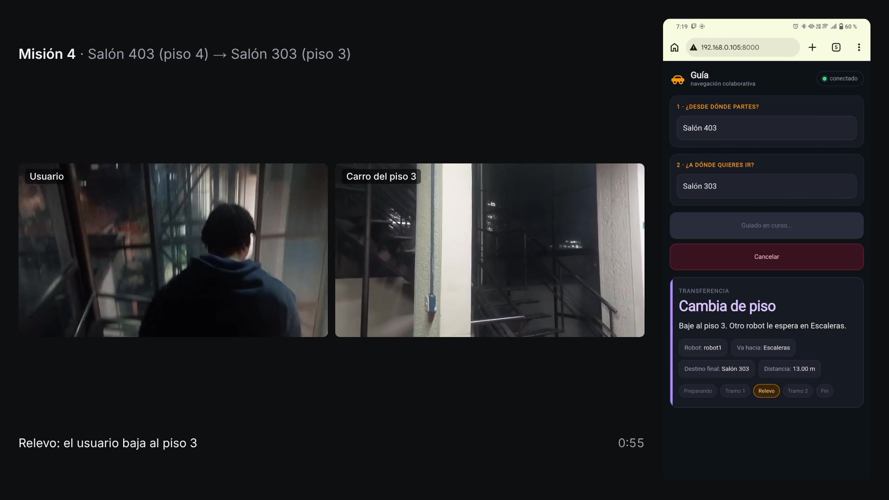

# Informe de avance de la semana 28

Universidad Santo Tomás · Facultad de Ingeniería Electrónica · Grupo de Estudio y Desarrollo en Robótica (GED)

Sistema colaborativo de robots móviles para asistencia de orientación en entornos interiores con múltiples pisos

Realizado por: Santiago Hernández Ávila y Jonny Alejandro Mejía León

Dirigido por: Ing. Armando Mateus Rojas, Msc.

Semana 28: 19 al 25 de octubre de 2026, con corte adelantado al martes 20. Fase 6: análisis y escritura.

> Versión en Markdown para leer en el repositorio. La versión para compilar es
> [`Entregable_semana_28.tex`](Entregable_semana_28.tex).

---

## 1. Introducción

Este informe presenta el avance de la semana 28 del cronograma (19 al 25 de octubre de 2026), la
primera después del cierre de la toma de datos. El corte se adelantó al martes 20 y cubre los dos
primeros días de la semana.

El trabajo fue de escritura y de documentación de la campaña del 16 de octubre. El documento final
quedó con los resultados del sistema completo sobre los dos vehículos, las conclusiones de los cuatro
objetivos y un recorrido del trabajo desde la plataforma DonkeyCar que proponía el anteproyecto. Se
editó el video de la campaña, con la pantalla del teléfono del usuario sincronizada con lo que veía. Al
sincronizarlo se encontró un dato equivocado del informe anterior, que se corrige en la sección 6.

Quedan dos pendientes de la semana. Uno es la restricción RNF-03 (operación en condiciones
controladas), cuya observación de las personas en el pasillo se está registrando con los videos. El
otro es la prueba en un teléfono de los ajustes de la página, prevista para el jueves 23.

## 2. Objetivos de la semana

El cronograma fija para esta semana el siguiente criterio de cierre:

> *Sustentación realizada; observaciones del jurado registradas por escrito.*

El criterio no se cumplió al corte: la sustentación no se ha realizado y su fecha la fija la
Universidad, en esta semana o en la siguiente. La otra actividad de la semana, los ensayos de la
demostración en vivo, tampoco se hizo. Lo que el cronograma sitúa en la semana 29, definir la
estructura del documento final e iniciar su redacción, ya está hecho (sección 4).

## 3. Los dos vehículos con el código vigente

El 19 de octubre se copiaron a los dos vehículos los cambios del 18 de octubre: los textos de la página
y del coordinador con tildes, y los puntos de interés de nombre repetido con su piso («Ascensor (piso
3)»). Los dos quedaron con los 28 archivos de coordinación iguales a los del repositorio, y la prueba
del coordinador con vehículos simulados pasó 19 de 19 escenarios dentro de cada uno. Se comprobó, sin
mover los vehículos, que la página se sirve sin copias guardadas en el navegador y que el catálogo
muestra el piso de los ascensores.

## 4. Documento final

El documento compila en el equipo del proyecto: 91 páginas, sin errores ni referencias sin resolver.

### 4.1 Resultados del sistema completo

El capítulo 4 tiene una sección nueva con la misión con relevo y
la campaña de nueve misiones: la tabla de cada misión, la figura con la duración de cada etapa y el
criterio de conteo de los intentos. Al descomponer cada misión en etapas apareció que el intervalo del
relevo (del final del primer tramo al primer movimiento del segundo vehículo), con mediana de 1,22 s,
junta dos situaciones. En cinco misiones el segundo vehículo tuvo que ir a su escalera y arrancó en
menos de 1,3 s. En las otras cuatro ya estaba allí, y el intervalo, de 12,9 a 27,5 s, mide sobre todo
cuánto tardó la persona en confirmar. Para la persona, el tiempo entre llegar a la escalera de un piso y
empezar el guiado en el otro tuvo una mediana de 24,8 s, de 18,0 a 29,5 s. Los vehículos hicieron 24
medias vueltas en las nueve misiones. Se añadió como limitación que la llegada se verificó con la
localización del propio vehículo y no con una medida externa.

### 4.2 Conclusiones, trabajos futuros y resumen

Quedaron cerrados con la campaña. Los trabajos futuros
suman una medida externa de la llegada y la estabilidad de la navegación en sesiones largas.

### 4.3 Recorrido del trabajo

El capítulo 3 cuenta ahora el trabajo en el orden en que se hizo. Empieza
por el simulador y el modelo del DonkeyCar, con sus limitaciones. Sigue con el paso al modelo de AWS
DeepRacer y su migración a ROS 2 Humble, los primeros entornos con el seguidor de paredes, la
integración en simulación y el trabajo con los vehículos. La fuente es `CRONOLOGIA.md`, que reúne semana a semana los entregables
10 a 27 y los 391 cambios del repositorio.

### 4.4 Decisiones del equipo

El antecedente que el anteproyecto atribuía a Parra Buitrago (2021) no se
incluye, porque no se encontró la referencia completa. El marco legal queda con las dos políticas
CONPES, la norma NTC 1486 y el alcance de la operación.

## 5. Video de la campaña

El 16 de octubre el equipo grabó el video en primera persona (POV) de quien hacía de usuario en cada
misión y la pantalla de su teléfono durante toda la sesión. En las misiones 4, 5 y 9 grabó además el
vehículo del otro piso mientras iba a su escalera. Con ese material se editó un video de 12 min 40 s, a tiempo real y sin audio, con el POV a la
izquierda y la pantalla del teléfono a la derecha en el mismo instante. En los relevos de las misiones
4, 5 y 9 se ven los dos POV lado a lado (figura 1).

*Figura 1. Relevo de la misión 4: el usuario baja por la escalera del piso 4 mientras el vehículo del piso
3 va a su escalera; el teléfono muestra «Cambia de piso».*

La pantalla del teléfono se sincronizó con el coordinador por el momento en que la página muestra
«Hemos llegado» en las diez llegadas registradas: el desfase es de 616,6 s, con ±0,3 s de dispersión.
Cada POV se ubicó por la hora de fin de su archivo y por el teléfono visible dentro del video. Cuatro
videos tenían la escalera recortada; se sincronizaron por partes, con la pulsación de «Pedir guía» y la
media vuelta del vehículo como referencias. El montaje se guardó también como proyecto de Shotcut, para
retocarlo a mano. Los videos no se versionan en el repositorio. El método y los desfases están en
`S28_video_campana.md`.

## 6. Correcciones a informes anteriores

| Informe | Dato publicado | Dato correcto | Evidencia |
|---|---|---|---|
| Semana 27, sección 6 | La misión 10 no se cuenta porque «el portátil se apagó por batería 18 s después de pedirla» | El portátil se apagó unos 30 s después de pedirla, con el vehículo `amss-jgm9` ya en su escalera | `S27_campana_rf27.md`, resultado 4; `S28_video_campana.md` |

La cifra de 18 s salía del final de la grabación de datos, que pierde su último bloque cuando el
grabador se corta de golpe. La pantalla del teléfono, sincronizada, muestra la página en «Cambia de
piso» a los 28,6 s y sin conexión con el coordinador a los 30,2 s. La misión sigue fuera del conteo.

## 7. Aporte a los objetivos específicos

| Actividad | Objetivo | Aporte |
|---|---|---|
| Vehículos con el código vigente | OE2, OE3 | Los dos vehículos ejecutan la versión de la página y del coordinador que usará la demostración |
| Resultados del sistema completo | OE4 | La campaña con los vehículos queda escrita en el documento final, con su limitación de medida |
| Video de la campaña | OE3, OE4 | Evidencia visual de las nueve misiones, con la interfaz del usuario sincronizada |

| Objetivo | Avance | Aporte de la semana | Pendiente |
|---|---|---|---|
| OE1 | 100 % | — | — |
| OE2 | 100 % | Vehículos con el código vigente | — |
| OE3 | 100 % | — | Prueba de los ajustes de la página en un teléfono, el jueves 23 |
| OE4 | 100 % | Resultados escritos en el documento final | — |

El promedio de los cuatro objetivos sigue en 100 %, frente al 87,5 % del calendario (semana 28 de 32).
De la matriz de requisitos queda parcial RNF-03, la operación en condiciones controladas, que pide
registrar como observación las personas que pasaron durante las pruebas. Los videos muestran personas
en el pasillo en algunas misiones, y la observación se está registrando misión por misión.

## 8. Estado del cronograma y trabajo previsto

| Parte del criterio de cierre | Estado | Evidencia |
|---|---|---|
| Sustentación realizada | Pendiente de la fecha de la Universidad | — |
| Observaciones del jurado registradas | Pendiente de la sustentación | — |

Para el resto de la semana el equipo prevé:

1. Registrar con los videos las personas en el pasillo durante la campaña y cerrar RNF-03.
2. Probar el jueves 23, con un teléfono y los vehículos, los ajustes de la página.
3. Incorporar las observaciones del jurado al documento final cuando se realice la sustentación.

## 9. Conclusiones

1. El documento final tiene redactados los resultados del sistema completo con los dos vehículos y las
   conclusiones de los cuatro objetivos, y compila sin errores en 91 páginas.
2. El intervalo del relevo en los vehículos mide la reacción del sistema solo cuando el segundo vehículo
   tiene que ir a su escalera; cuando ya está en ella, mide la confirmación de la persona.
3. El video de la campaña muestra las nueve misiones con la interfaz del usuario sincronizada a ±0,3 s
   con el coordinador.
4. El dato de la misión 10 publicado en la semana 27 estaba equivocado: el portátil se apagó unos 30 s
   después de la solicitud, no a los 18 s.

## Anexo. Evidencia citada

| Documento | Qué respalda |
|---|---|
| `Documentos/DocumentoFinal/main.pdf` y `capitulos/` | Sección 4 |
| `Documentos/DocumentoFinal/CRONOLOGIA.md` | Recorrido del trabajo (sección 4) |
| `Documentos/DocumentoFinal/PENDIENTES.md` | Decisiones del equipo (sección 4) |
| `Documentos/Evidencia/S27_campana_rf27.md` | Campaña y corrección de la misión 10 (secciones 4 y 6) |
| `Documentos/Evidencia/campo_20261016/registros/` | Marcas de etapa de cada misión (secciones 4 y 5) |
| `Documentos/Evidencia/S28_video_campana.md` | Video y sincronización (secciones 5 y 6) |
| `Documentos/REQUISITOS.md` | Sección 7 |
| `Documentos/CRONOGRAMA_S17_S32.md` | Secciones 2 y 8 |
