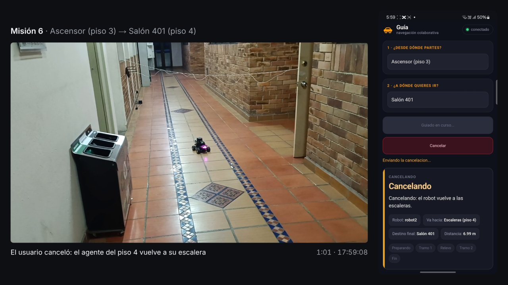

# Informe de avance de la semana 29

Universidad Santo Tomás · Facultad de Ingeniería Electrónica · Grupo de Estudio y Desarrollo en Robótica (GED)

Sistema colaborativo de robots móviles para asistencia de orientación en entornos interiores con múltiples pisos

Realizado por: Santiago Hernández Ávila y Jonny Alejandro Mejía León

Dirigido por: Ing. Armando Mateus Rojas, Msc.

Semana 29: 26 de octubre al 1 de noviembre de 2026. Fase 6: análisis y escritura.

> Versión en Markdown para leer en el repositorio. La versión para compilar es
> [`Entregable_semana_29.tex`](Entregable_semana_29.tex).

---

## 1. Introducción

Este informe presenta el avance de la semana 29 del cronograma (26 de octubre al 1 de noviembre de 2026).
Cubre también lo hecho después del corte adelantado de la semana 28, cerrado el martes 20 de octubre, porque
ahí quedaron las pruebas del 23 de octubre.

En esas pruebas se verificaron, con un teléfono y los dos vehículos, los ajustes de la página y la cancelación
de misiones. Las dos misiones de los ajustes se completaron con relevo, y en las seis cancelaciones hechas
después de corregir la media vuelta el vehículo volvió a su escalera dentro de la tolerancia. Al sincronizar el
video de esas pruebas se midió que la página mostró la llegada hasta 46,0 s después que el coordinador, lo que
corrige la explicación que daba la evidencia de esa sesión (sección 3.3). El documento final se recortó de 94 a
77 páginas, dentro del rango de 60 a 80 que pide el director, y se revisó con las anotaciones de los autores.
Los 36 requisitos de la matriz quedaron verificados.

Quedan pendientes las autoridades académicas del documento y dejar la versión recortada como la vigente.

## 2. Objetivos de la semana

El cronograma fija para esta semana dos actividades, sin criterio de cierre propio: la sustentación, si la fecha
se corría a esta ventana, y definir la estructura del documento final e iniciar su redacción.

La sustentación no se realizó. La Universidad fijó las presustentaciones del 2 al 6 de noviembre, la entrega del
documento final el 13 de noviembre y las sustentaciones en la primera semana de diciembre. La estructura y la
redacción del documento estaban hechas desde la semana 28; esta semana se recortó y se revisó (sección 4).

De lo previsto en el informe anterior, los ajustes de la página se probaron el 23 de octubre y la restricción
RNF-03 (operación en condiciones controladas) se cerró el 27 de octubre (sección 8).

## 3. Pruebas del 23 de octubre con los dos vehículos

Se corrieron 18 misiones en los pisos 3 y 4 del edificio Catalayud, con un vehículo por piso. El detalle está en
`S28_campo_pagina_cancelacion.md` y los registros del coordinador, en `campo_20261023/`.

### 3.1 Ajustes de la página

En una misión de bajada (Salón 403 → Salón 303) y una de subida (Salón 301 → Salón 401), el equipo vio en el
teléfono el título de la confirmación según el sentido del cambio de piso. Las dos se completaron con relevo, en
69,4 s y 99,3 s.

### 3.2 Cancelación y media vuelta

Tras cada cancelación o tramo fallido, el programa del vehículo rechazaba la media vuelta. Nav2 guarda varios
minutos las metas terminadas, y con una cancelada o abortada en la lista el vehículo se declaraba en error. Sin la
media vuelta, Nav2 intentaba girar solo en el pasillo y oscilaba: una misión abortó y un regreso a la escalera
falló tras tres intentos. Se corrigió el mismo día, para que la media vuelta se rechace solo con una meta en curso,
y se copió a los dos vehículos. Las pruebas automáticas pasan: 50 de 50 del programa del vehículo y 19 de 19 del
coordinador con vehículos simulados. Antes de la corrección se rechazaron 8 de 15 medias vueltas; después, ninguna
de 10.

Después de la corrección se cancelaron seis misiones, una o más en cada etapa, y en las seis el vehículo volvió a su
escalera dentro de la tolerancia de 0,5 m:

| Misión | Etapa al cancelar | Distancia a su escalera |
|---|---|---|
| Salón 302 → Salón 402 | Primer tramo, yendo a recoger | 0,173 m (segundo intento; el primero, 0,578 m) |
| Salón 303 → Ascensor (piso 3) | Primer tramo | 0,337 m |
| Escalera (piso 3) → Salón 402 | Transferencia | 0,074 m |
| Escalera (piso 3) → Salón 401 | Esperando confirmación | 0,302 m |
| Salón 401 → Salón 303 | Segundo tramo | 0,337 m |
| Ascensor (piso 3) → Salón 401 | Segundo tramo | 0,328 m |

### 3.3 Retraso de la página frente al coordinador

El equipo notó lenta la confirmación de la llegada. En el coordinador, del último movimiento del vehículo a la marca
de misión completada pasaron 2,03 s y 2,27 s, por la espera de 1,5 s antes de verificar. La evidencia de la sesión
atribuía la lentitud a esa espera. Las grabaciones de la pantalla del teléfono muestran que la demora estaba en la
página:

| Solicitud | Misión | Marca del coordinador | En la página | Retraso |
|---|---|---|---|---|
| 17:18:08 | Salón 403 → Salón 303, completada | 17:19:16,97 | 17:20:02,98 | 46,00 s |
| 17:20:56 | Salón 301 → Salón 401, completada | 17:22:35,70 | 17:23:11,36 | 35,66 s |
| 17:33:17 | Salón 302 → Salón 402, cancelada | 17:36:02,65 | 17:36:13,11 | 10,47 s |
| Desde las 17:54 | Ocho misiones grabadas | | | De −0,04 a 2,00 s |

La causa no se estableció y no se intentó reproducir. Durante el retraso la página indicaba «conectado», y las
etapas anteriores de esas misiones habían llegado a tiempo. El requisito RF-18 (la interfaz muestra el estado de la
misión) no fija un límite de tiempo, así que su estado no cambia. El retraso queda como observación en la evidencia, corregida
con la tabla de las once misiones grabadas, y por decisión de los autores no se declara como limitación en el documento
final.

## 4. Documento final

El documento compila en el equipo del proyecto, sin errores ni referencias sin resolver: la versión vigente
(`main.tex`) tiene 94 páginas y la recortada (`main_recorte.tex`), 77.

### 4.1 Versión recortada

El director pide entre 60 y 80 páginas. La versión recortada se armó en paralela, para poder compararla, y reduce el
marco referencial, el desarrollo, los resultados, las conclusiones y los trabajos futuros.

### 4.2 Revisión con las anotaciones de los autores

La revisión del 27 de octubre dejó una sola palabra para los robots del proyecto, «agente», y los edificios con su
nombre: Gregorio (pisos 2 y 3) y Catalayud (pisos 3 y 4), con el cambio de edificio explicado. El texto quedó
impersonal, con menos remisiones a otras secciones y con fechas y medidas exactas. Se añadieron figuras de los nodos,
del planificador, de la instrumentación y del error de llegada en simulación, y el contrato de interfaces pasó a una
tabla. Las conclusiones se reescribieron y los trabajos futuros quedaron en cinco líneas.

La bibliografía pasó de 61 a 42 referencias. El anexo A reúne los ocho videos del proyecto, con enlace y código QR, y
el anexo B, el repositorio y el sitio. La pregunta problema quedó con su texto oficial, y el documento nombra a un
solo director y la línea de Robótica e Inteligencia Computacional.

### 4.3 Preliminares

De la lista de abreviaturas salieron cinco siglas que el documento no usa (GUI, ICONTEC, MRS, NTC y QoS), y AMCL quedó
solo en esa lista. Las etiquetas del mapa del piso 4 se rehicieron, porque la palabra «salón» salía con un carácter
ilegible. Falta completar los nombres de las autoridades académicas, que hay que tomar de la fuente oficial de la
Universidad.

## 5. Video de las pruebas

Con 14 clips de cámara y 4 grabaciones de la pantalla del teléfono se editó un video de 8 min 21 s, a tiempo real y
sin audio. A la izquierda va la cámara del usuario y a la derecha la pantalla, en el mismo instante (figura 1). Muestra
las dos misiones de los ajustes de la página y cinco de las seis cancelaciones; la sexta no quedó en cámara. El video
no incluye las cancelaciones anteriores a la corrección de la media vuelta. Se publicó en YouTube el 1 de noviembre
(<https://youtu.be/31oNn04qLoU>) y es el video 8 del anexo A.

*Figura 1. Misión 6 del video: el vehículo del piso 4 vuelve a su escalera y el teléfono muestra «Cancelando».*

Las grabaciones de pantalla no traen hora. Se ubicaron alineando los cambios de título del panel con las marcas del
coordinador, y se comprobaron con el reloj del teléfono: el minuto de la barra de estado cambia entre 0,03 y 0,18 s
después del segundo 0. La hora del nombre de cada clip de cámara es la de pulsar grabar, y el primer cuadro llega
entre 1,48 y 1,75 s después. Por eso cada clip se ubicó con un cambio del panel visible en el teléfono o, si no se
veía, con el centro de esa banda. Los cortes de pantalla coinciden con las grabaciones originales con 0,025 s de
diferencia o menos. El método y las horas de cada clip están en `S29_video_pagina_cancelacion.md`.

## 6. Repositorio y simulación

El 24 de octubre se ordenó el repositorio: `ESTADO.md` quedó en una pantalla y su bitácora completa pasó a
`Documentos/historial/`, junto con 25 planes, hojas y guías de sesiones pasadas. Los mundos y modelos de Gazebo pasaron
a `simulacion/`, y el README quedó en 98 líneas.

El 26 de octubre se corrió en el portátil la simulación de dos robots, después de las dos actualizaciones de ROS
recibidas desde septiembre: 3 de 3 misiones con relevo, con las llegadas dentro de la tolerancia de 0,25 m. La causa de
la falla del 6 de octubre en el otro equipo no se aisló, así que la simulación debe correrse en el equipo que se vaya a
usar antes de mostrarla.

## 7. Presentación para la presustentación (fuera del cronograma)

La propuesta de presentación está en `Documentos/Presentacion/Presustentacion.pptx`, con la plantilla de la presentación
del anteproyecto: 39 diapositivas y notas del orador que suman 17 min 20 s. Falta la revisión de los autores.

## 8. Correcciones a informes anteriores

| Informe | Dato publicado | Dato correcto | Evidencia |
|---|---|---|---|
| Semana 28, sección 7 | «Los videos muestran personas en el pasillo en algunas misiones, y la observación se está registrando misión por misión» | Los autores confirmaron que en la campaña solo estuvieron en el pasillo ellos dos, que hicieron de usuario, sin personas ajenas que anotar. RNF-03 quedó verificado el 27 de octubre | `REQUISITOS.md` |

## 9. Aporte a los objetivos específicos

| Actividad | Objetivo | Aporte |
|---|---|---|
| Pruebas del 23 de octubre | OE3 | Ajustes de la página y cancelación probados en un teléfono con los dos vehículos |
| Corrección de la media vuelta | OE2 | La maniobra se ejecuta también después de una cancelación |
| Documento final | OE4 | Resultados y conclusiones en la versión recortada y revisada |
| Video de las pruebas | OE3 | Evidencia visual de los ajustes y de cinco cancelaciones, con la pantalla sincronizada |

| Objetivo | Avance | Aporte de la semana | Pendiente |
|---|---|---|---|
| OE1 | 100 % | — | — |
| OE2 | 100 % | Corrección de la media vuelta | — |
| OE3 | 100 % | Ajustes y cancelación probados en los vehículos | — |
| OE4 | 100 % | Documento recortado y revisado | — |

El promedio de los cuatro objetivos sigue en 100 %, frente al 90,6 % del calendario (semana 29 de 32). Los 36 requisitos
de la matriz están verificados.

## 10. Estado del cronograma y trabajo previsto

| Actividad de la semana | Estado | Evidencia |
|---|---|---|
| Sustentación, si la fecha se corría a esta ventana | No se realizó: las sustentaciones son en la primera semana de diciembre | — |
| Definir la estructura del documento final e iniciar la redacción | Hecho desde la semana 28 | Documento final |

Para las semanas 30 y 31, cuyo criterio de cierre es el borrador completo entregado al director, el equipo prevé:

1. Completar las autoridades académicas y dejar la versión recortada como la vigente.
2. Corregir el nombre de la etapa de cancelación en el registro de misión, actualizar los comentarios con rutas viejas
   en los dos vehículos y reconstruir la imagen del coordinador.
3. Incorporar las observaciones de la presustentación.

## 11. Conclusiones

1. Los ajustes de la página funcionaron con el teléfono y los dos vehículos, en una misión de bajada y una de subida
   completadas con relevo.
2. La cancelación funciona en los vehículos: en las seis cancelaciones hechas después de corregir la media vuelta, el
   vehículo volvió a su escalera, a entre 0,074 y 0,337 m, dentro de la tolerancia de 0,5 m. Las medias vueltas
   rechazadas pasaron de 8 de 15 a 0 de 10.
3. La página mostró el final de tres misiones entre 10,47 y 46,00 s después que el coordinador, todas antes de las
   17:54, y de las ocho siguientes con 2,00 s o menos. La causa no se estableció.
4. La versión recortada del documento tiene 77 páginas, dentro del rango que pide el director, y los 36 requisitos están
   verificados.

## Anexo. Evidencia citada

| Documento | Qué respalda |
|---|---|
| `Documentos/Evidencia/S28_campo_pagina_cancelacion.md` | Pruebas del 23 de octubre y retraso de la página (sección 3) |
| `Documentos/Evidencia/campo_20261023/` | Registros del coordinador y datos de sincronía (secciones 3 y 5) |
| `Documentos/Evidencia/S29_video_pagina_cancelacion.md` | Video y sincronización (sección 5) |
| `Documentos/Evidencia/S29_simulacion_relevo_portatil.md` | Simulación en el portátil (sección 6) |
| `Documentos/DocumentoFinal/main_recorte.tex` y `capitulos_recorte/` | Sección 4 |
| `Documentos/DocumentoFinal/CRONOLOGIA.md` | Recorrido del trabajo |
| `Documentos/Presentacion/Presustentacion.pptx` | Sección 7 |
| `Documentos/REQUISITOS.md` | Secciones 8 y 9 |
| `Documentos/CRONOGRAMA_S17_S32.md` | Secciones 2 y 10 |
