# Evidencia

Índice de todo lo que esta carpeta contiene: qué muestra cada archivo, de cuándo es y qué
afirmación sostiene.

Existe porque una captura sin pie de foto no es evidencia. A los seis meses nadie recuerda
qué demostraba, y ante un jurado no se puede citar lo que no se puede explicar. Diez de
estas imágenes llevaban meses en el repositorio sin que ningún documento las mencionara:
estaban guardadas, no documentadas. La diferencia importa.

**La regla:** toda evidencia nueva entra con su fila en este índice, en el mismo commit.

---

## Semana 12 — el vehículo aparece, obedece y publica odometría (abril 2026)

Primera validación del stack en simulación: que el modelo cargue, que el LiDAR emita y que
el lazo `/cmd_vel` → movimiento → `/odom` esté cerrado.

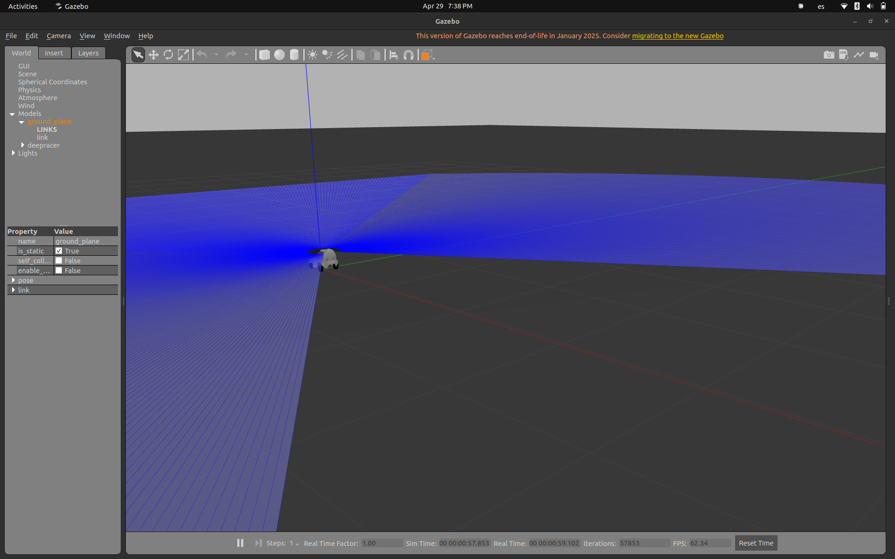

`gazebo_spawn.png` — el vehículo instanciado sobre el plano de suelo, con el abanico azul
del LiDAR desplegado. Sostiene que el modelo carga con su geometría y que el plugin del
sensor está activo, no solo declarado.

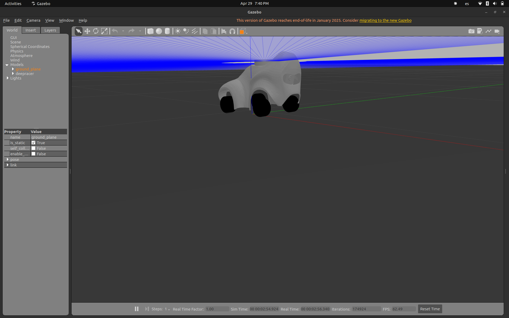

`S12_gazebo_lidar_vehiculo.png` — la misma escena de cerca: se distingue el chasis y los
rayos saliendo del sensor. Es la que muestra que el LiDAR está montado donde debe, no en el
origen del mundo.

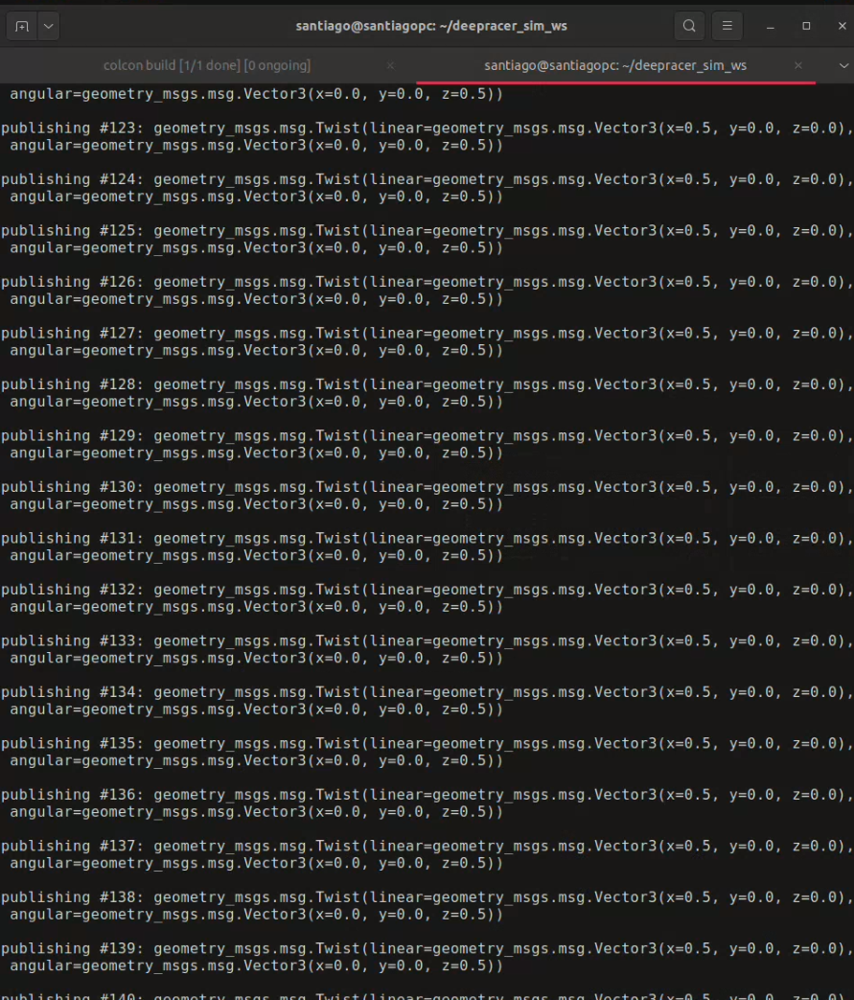

`cmdvel_publish.png` — `ros2 topic pub /cmd_vel geometry_msgs/msg/Twist` en repetición. El
lado del mando: se está ordenando movimiento.

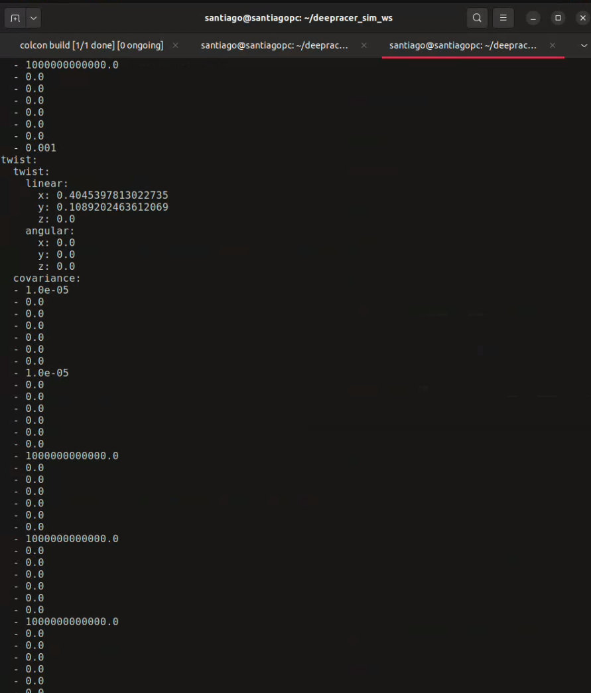

`odom_echo.png` — `ros2 topic echo /odom` con `twist.linear.x = 0.4045 m/s` y
`y = 0.1089 m/s`. El lado de la respuesta. Las dos juntas cierran el lazo: se ordena y el
simulador contesta con movimiento medido, que es lo que ninguna de las dos prueba por
separado.

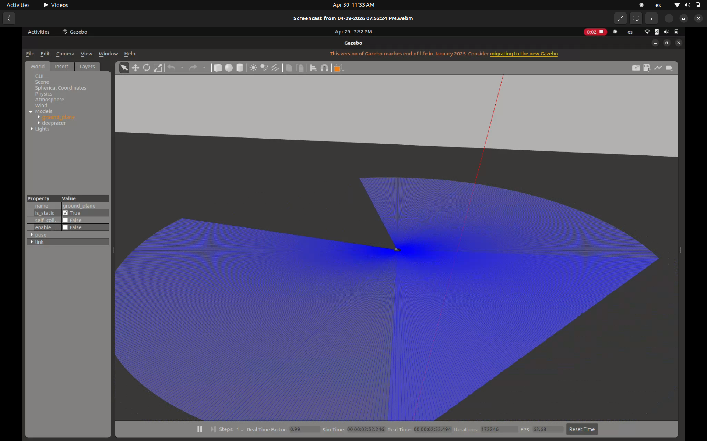

`S12_lidar_screencast.png` — el barrido del LiDAR en movimiento. **Es una foto de un
reproductor de vídeo**, no una captura directa de Gazebo: procede del screencast
`04-29-2026 07:52:24 PM.webm`, que no está versionado. Se conserva porque el barrido
dinámico no se aprecia en una imagen fija, pero conviene saber que es una copia de segunda
mano.

---

## Semana 13 — wall-follower en el pasillo (mayo 2026)

Inicio de la Fase 4: modelado del entorno y primer controlador reactivo.

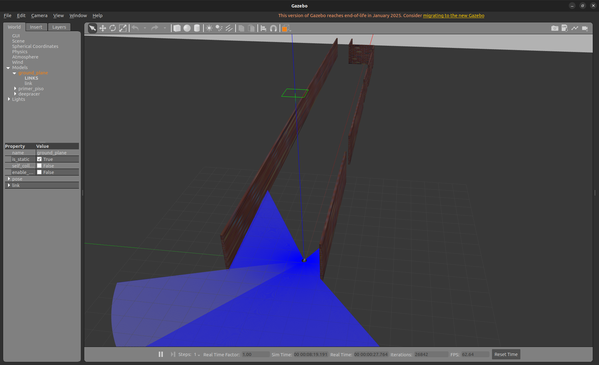

`deepracer_pasillo.png` — el vehículo dentro del pasillo modelado, con el LiDAR chocando
contra las paredes. Sostiene que el mundo propio del proyecto carga y que el sensor lo ve.

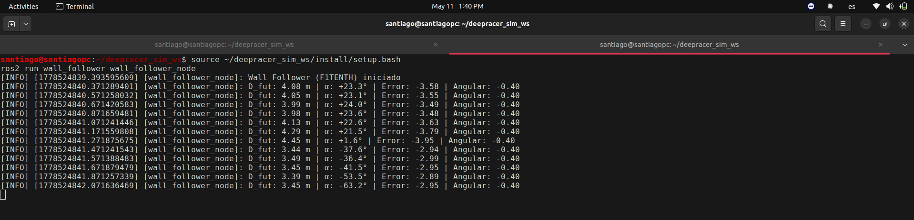

`logs_convergencia.png` — el nodo `wall_follower` (técnica F1TENTH de dos rayos) imprimiendo
`D_fut`, error y consigna angular en cada iteración. Es la evidencia numérica del
comportamiento descrito en el entregable S13: converge parcialmente en pasillo amplio y es
inestable en el pasillo estrecho por el radio mínimo de giro Ackermann. Ese resultado es el
que llevó a abandonar el wall-follower puro y pasar a navegación basada en mapa.

---

## Semana 14 — validación del stack de sensores (mayo 2026)

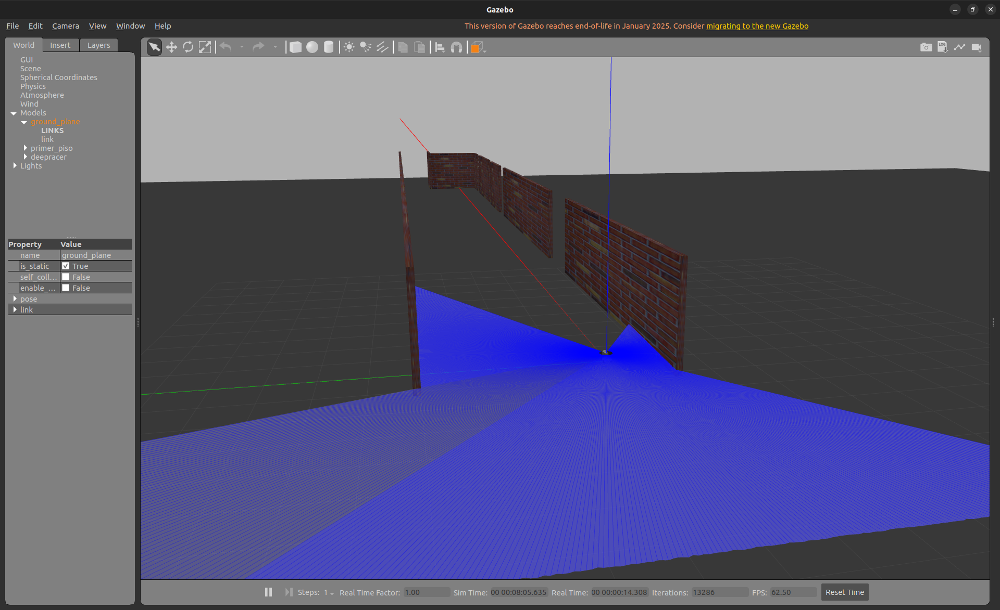

`deepracer_primer_piso.png` — el vehículo en el modelo del primer piso USTA, con las paredes
de ladrillo y el barrido del LiDAR sobre ellas.

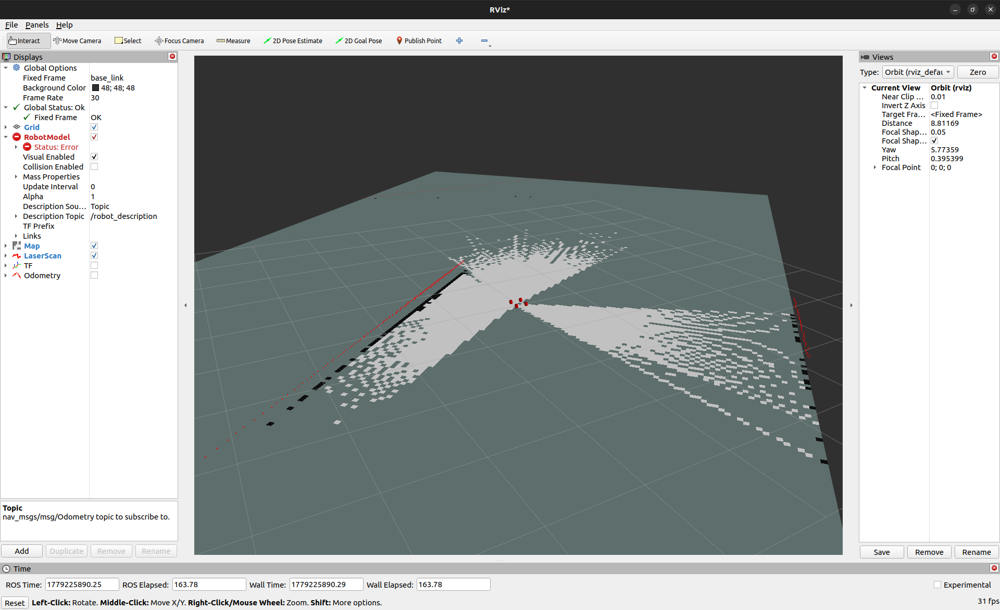

`rviz_configuracion.png` — RViz con el `LaserScan` dibujado como nube de puntos, marco fijo
`base_link`. Sostiene que el `/scan` llega a RViz con marco válido.

> Vale la pena mirar el panel *Displays* de esta captura: `RobotModel` aparece **en rojo**
> mientras el `LaserScan` se dibuja bien. Coincide con el defecto que se explicó mucho
> después, en el [hallazgo colateral nº2 de S17](S17_nav2_namespaces.md): las URIs
> `package://meshes/...` estaban sin nombre de paquete, así que RViz no encontraba las
> mallas aunque Gazebo sí. Si es el mismo, llevaba visible en pantalla desde mayo. Una
> captura archivada y no leída no avisa de nada.

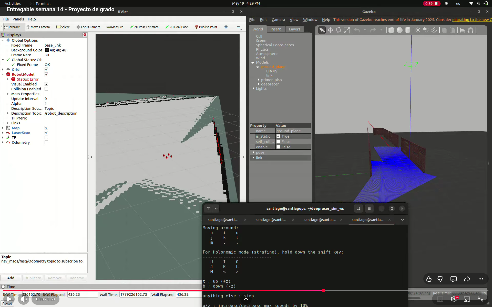

`rviz_teleoperacion.png` — las tres ventanas a la vez: RViz, Gazebo y
`teleop_twist_keyboard`. Sostiene que el operador manda por teclado y el efecto se ve
simultáneamente en el simulador y en la visualización, es decir, que los tres procesos
comparten el mismo estado.

---

## Semana 17 — dos robots aislados por espacio de nombres (agosto 2026)

Estas ya estaban citadas desde sus informes; se listan para que el índice esté completo.

| Archivo | Qué muestra | Informe que la cita |
|---|---|---|
| `S17_dos_gazebo_lado_a_lado.png` | Dos simuladores independientes en paralelo | [`PLAN_S17_S18.md`](../PLAN_S17_S18.md) |
| `S17_dos_objetivos_succeeded.png` | Los dos robots alcanzando objetivos distintos | [`PLAN_S17_S18.md`](../PLAN_S17_S18.md) |
| `S17_gazebo_robot1_modelo.png` | `robot1` con geometría en Gazebo | [`S17_nav2_namespaces.md`](S17_nav2_namespaces.md) |
| `S17_rviz_robot1_robotmodel.png` | El mismo modelo en RViz con `TF Prefix: robot1` | [`S17_nav2_namespaces.md`](S17_nav2_namespaces.md) |

Las dos últimas van juntas a propósito: eran las dos mitades del conflicto de una sola URI
sirviendo a dos resolvedores distintos. La configuración con la que se tomó la de RViz está
versionada en `Robot/aws-deepracer/deepracer_description/rviz/nav2_robot1_view.rviz`.

## Semana 18 — entorno de dos niveles

| Archivo | Qué muestra | Informe que la cita |
|---|---|---|
| `S18_gazebo_dos_niveles.png` | Las dos plantas separadas 3,0 m en vertical | [`S18_entorno_dos_niveles.md`](S18_entorno_dos_niveles.md) |

## Semana 19 — spike de hardware, pregunta 4 (agosto 2026)

Sin capturas: el spike es documental por diseño —compara fuentes oficiales y el propio
repositorio, sin encender ningún vehículo— y su evidencia son los archivos que compara, no una
pantalla. Los comandos que lo reproducen están en el §1 del informe.

| Archivo | Qué sostiene | Dónde se cita |
|---|---|---|
| [`S19_spike_p4_humble_jazzy.md`](S19_spike_p4_humble_jazzy.md) | Que `nav2_msgs/NavigateToPose` **difiere** entre Humble y Jazzy, y que por tanto un coordinador Humble no manda a un robot Jazzy | [`ESTADO.md`](../../ESTADO.md) §4 (R8), [`REQUISITOS.md`](../REQUISITOS.md) §3 (RF-16) |

## Semana 19 — spike de hardware, preguntas 1 y 2 (agosto 2026)

Primera evidencia tomada sobre el **vehículo físico** y sobre el **LiDAR real**, no sobre la
simulación. Sin capturas: los resultados son numéricos y salen de una herramienta versionada, así
que se pueden volver a producir en vez de mirarse.

Cubre la condición 1 de cierre de [`PLAN_S19.md`](../PLAN_S19.md), que es quien reparte el §S19
del cronograma entre los dos últimos días de la semana.

| Archivo | Qué sostiene | Dónde se cita |
|---|---|---|
| [`S19_spike_p1_p2_hardware.md`](S19_spike_p1_p2_hardware.md) | Que el LiDAR real repite la misma pared con 2,8 mm de dispersión y que el vehículo obedece a `/ctrl_pkg/servo_msg` de forma proporcional en dirección y tracción — luego la cuantización binaria es defecto **nuestro**, reparable | [`ESTADO.md`](../../ESTADO.md) §2 (OE2), §4 (R8, R11) |
| [`../../herramientas/verificar_lidar.py`](../../herramientas/verificar_lidar.py) | La herramienta que produce la medida: halla superficies por su **forma** (RANSAC secuencial), sin recibir nunca la distancia esperada | ídem, §1 |

**La herramienta es la evidencia, y por eso se versiona.** Su docstring conserva los dos métodos
descartados —tomar el mínimo del barrido, que habría dado 83 % de error contra el propio soporte del
sensor, y buscar lecturas «cerca de 1 m», que es circular—. Esa parte no se puede reconstruir
después: un resultado se puede volver a medir, pero el razonamiento por el que se descartó una
alternativa se pierde si no se escribe cuando ocurre.

**Lo que no se versiona:** la sesión de terminal contra el vehículo. Las cifras del informe proceden
de esa sesión y son reproducibles con el vehículo delante, no desde el repositorio.

## Semana 19 — la maniobra de retorno y el defecto de conversión de `cmd_vel` (agosto 2026)

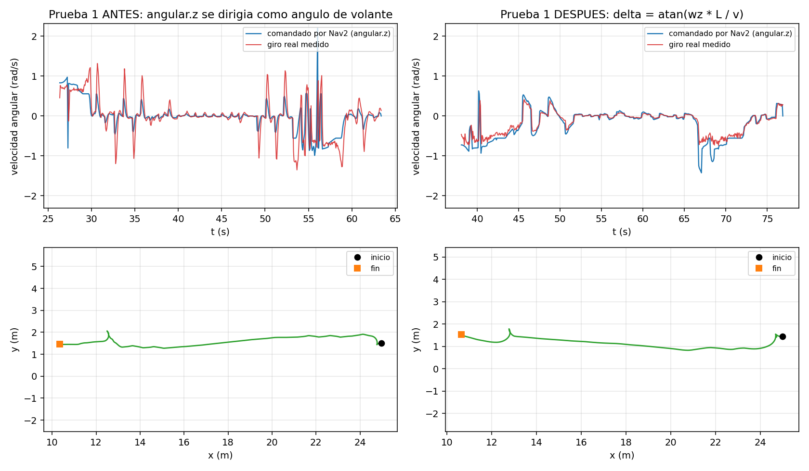

`S19_seguimiento_antes_despues.png` — la misma maniobra de retorno, antes (izquierda) y después
(derecha) de corregir la conversión de `angular.z`. **Fila superior:** en azul lo que Nav2 pide y
en rojo lo que el vehículo hace. A la izquierda el rojo se pasa del azul de forma sistemática y
entre t = 50 s y t = 58 s entra en una oscilación que no está en el comando; a la derecha lo
sigue. Es el mismo hecho que la tabla del informe cifra como RMS 0,298 → 0,111 rad/s, pero
visible sin leer números. **Fila inferior:** la trayectoria de cada corrida. Están para descartar
la objeción de que se comparan recorridos distintos: los dos son la misma travesía del pasillo
con el volteo al extremo este.

Las dos gráficas salen de `herramientas/graficar_seguimiento.py` sobre los bags de las corridas.
**Los bags no están versionados** —viven en `/tmp` y son efímeros—, así que esta figura no se
puede regenerar a partir del repositorio: hay que volver a grabar las corridas con el
procedimiento del informe. Se conservan la herramienta y su salida, no los datos crudos.

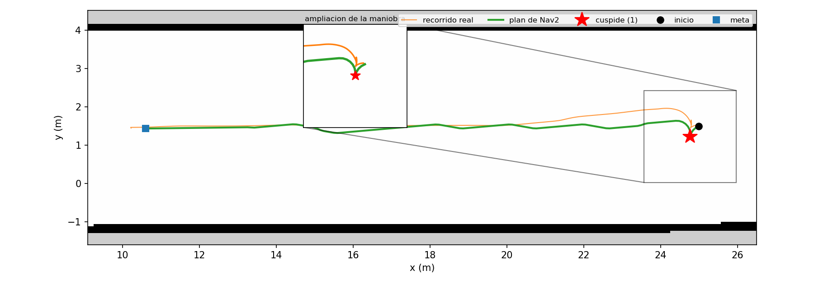

`S19_plan_maniobra_cuspide.png` — el plan de Nav2 (verde), el recorrido real (naranja) y la
cúspide (estrella) sobre el mapa del pasillo. **La ampliación es la figura**: a escala del
pasillo entero la maniobra ocupa un metro de dieciséis. Sostiene que el planificador *propuso*
la maniobra de volteo y que el vehículo la *ejecutó* — las dos cosas, que es lo que una captura
de RViz no distingue. Sale de `herramientas/graficar_plan.py` sobre el bag, no de una pantalla:
por eso se puede volver a dibujar y comprobar.

| Archivo | Qué sostiene | Dónde se cita |
|---|---|---|
| `S19_seguimiento_antes_despues.png` | Que el vehículo obedecía mal el giro comandado, y que tras la corrección lo sigue | [`S19_conversion_cmdvel_ackermann.md`](S19_conversion_cmdvel_ackermann.md) |
| `S19_plan_maniobra_cuspide.png` | Que la maniobra de volteo se planifica y se ejecuta | [`S19_conversion_cmdvel_ackermann.md`](S19_conversion_cmdvel_ackermann.md) §Resultado 3 |
| `S19_metricas_maniobra.png` | La salida de `analizar_maniobra.py` sobre la corrida de evidencia: RMS 0,082 rad/s, por debajo del criterio de 0,15 | ídem |
| `S19_rviz_maniobra_completada.png` | El montaje de la corrida —RViz con mapa, huella y plan junto a Gazebo— y el panel de Nav2 dando la meta por alcanzada | ídem |
| `S19_llegada_abortada_rumbo.png` | Una llegada **abortada** peleando por cerrar el rumbo: el defecto del verificador de meta contra la restricción Ackermann | ídem, §Resultado 3 |
| `S19_llegada_cancelada_rumbo.png` | El mismo defecto en su forma extrema: 80 cúspides de maniobra en el sitio hasta que se cancela | ídem |
| [`S19_conversion_cmdvel_ackermann.md`](S19_conversion_cmdvel_ackermann.md) | Que `angular.z` se interpretaba como ángulo de volante y no como velocidad angular, con una ganancia que variaba por un factor de 4 según la velocidad | [`ESTADO.md`](../../ESTADO.md) §4 (R2) |

**Vídeo de la maniobra:** <https://youtu.be/6SABSgCxVEw>. Pesa 153 MB, así que no se versiona;
queda alojado en YouTube. Es el único artefacto de S19 que **no se puede auditar desde el
repositorio** —si el enlace muere, la evidencia se pierde—, y por eso las tres figuras de arriba
están hechas para no depender de él: todas se regeneran desde el bag con herramientas
versionadas.

**Las capturas de RViz exigen lanzarlo aparte.** `nav_amcl_demo_sim.launch.py` **no arranca
RViz**; hay que abrirlo con `ros2 run rviz2 rviz2 -d install/deepracer_bringup/share/deepracer_bringup/config/nav2_default_view.rviz --ros-args -p use_sim_time:=true`
y encender a mano **RobotModel** y **Amcl Particle Swarm**, que vienen apagados en el `.rviz`.
Sin eso no se ve ni el vehículo ni la nube de partículas.

## Semana 19 — el LiDAR original del kit Evo (agosto 2026)

Segunda sesión sobre el **vehículo físico**, con el sensor que trae el kit de fábrica en vez del
LiDAR externo del 19-ago. Sin capturas: todo son salidas de `systemctl`, `lsusb` y
`ros2 topic echo`, que se pegan mejor en texto de las que se fotografían.

**Los dos informes de hardware de S19 no se contradicen: hablan de sensores distintos.** El del
19-ago caracteriza un **YDLidar G4** conectado por fuera; este caracteriza el **RPLIDAR A1M8-R5**
que venía en el kit. Leerlos como si fueran el mismo aparato hace parecer que uno de los dos
midió mal.

| Archivo | Qué sostiene | Dónde se cita |
|---|---|---|
| [`S19_lidar_original_evo.md`](S19_lidar_original_evo.md) | Que el LiDAR **no bloquea S20**: de las tres capas que el spike culpaba, solo falla una —el lanzador pide `rplidar_node` y lo instalado se llama `rplidar_composition`—, y que el sensor real publica 360 muestras a 1,000° sobre 360°, no lo que dice la URDF | [`ESTADO.md`](../../ESTADO.md) §4 (R8), [`S19_spike_p1_p2_hardware.md`](S19_spike_p1_p2_hardware.md) §4.1 y §5 |

**Lo que este informe invalida del anterior.** El punto 1 del backlog del spike —«instalar un
driver YDLidar para Jazzy», marcado como bloqueante de S20— apuntaba a un sensor que no es el del
carro. El punto 5, la corrección de la URDF, apuntaba a los números del G4. Ambos quedan
reescritos en el §10 del informe nuevo. Se deja el original sin tachar: **el error de
identificación es parte de lo que hay que poder sustentar**, no ruido a limpiar.

**Lo que no queda demostrado.** Las dos cámaras aparecen enumeradas en USB, pero **no** se
comprobó que publiquen en ROS. Está anotado como tal en el §7, no como pendiente menor: una
cámara que enumera y no publica se ve idéntica a una que funciona, hasta que se mira el tópico.

**Lo que no se versiona:** la sesión de terminal. Las cifras son reproducibles con el vehículo
delante y los comandos del informe, no desde el repositorio.

## Semana 20 — los dos agentes a la vez, y el marco que lo impedía (agosto 2026)

| Archivo | Qué sostiene | Dónde se cita |
|---|---|---|
| [`S20_marco_map_prefijado.md`](S20_marco_map_prefijado.md) | Que `map` se prefija con el namespace, como pedía el §3 del contrato, y que no hacerlo dejaba las misiones del coordinador en `ABORTED` sin nombrar nunca al marco | [`ESTADO.md`](../../ESTADO.md) §bitácora (2026-08-24), los tres launch de `deepracer_bringup` |
| [`S20_hito_h3_dos_agentes.md`](S20_hito_h3_dos_agentes.md) | Que los dos agentes navegan en simultáneo, cada uno en su piso, con 0,281 m y 0,143 m de error contra `/odom`, y que el `/odom` cruzado venía del demonio de `ros2cli` | [`ESTADO.md`](../../ESTADO.md) §bitácora (2026-08-25), cronograma act. 15 e hito H3 |
| [`S20_rutas_largas_y_concurrencia.md`](S20_rutas_largas_y_concurrencia.md) | Que `robot2` queda medido con la configuración nueva —0,124 m en 90,81 m— y que la concurrencia tampoco degrada a 84 y 90 m, veinte veces la escala de H3; y que el RTF bajo carga sigue sin medirse | [`ESTADO.md`](../../ESTADO.md) §bitácora (2026-08-27), §3.3 y §5 de [`PROTOCOLO_EXPERIMENTAL.md`](../PROTOCOLO_EXPERIMENTAL.md) |

**Los dos primeros van en este orden y no en el cronológico:** el primero es requisito del segundo.
Mientras `map` estuvo sin prefijar, ninguna misión del coordinador podía completarse, así que el
hito no era alcanzable aunque todo lo demás estuviera en su sitio. El tercero repite la pregunta del
segundo a la escala de la campaña: H3 la respondió sobre 1,7 m, y las rutas reales son de 90.

## Semana 25 — los pisos 3 y 4, levantados con flexómetro (octubre 2026)

El sitio de pruebas de los vehículos desde el 5-oct. Primero se midió el pasillo y después se
modeló, al revés que en los pisos 1 y 2; el porqué está en
[`GUIA_PISOS_3_Y_4.md`](../GUIA_PISOS_3_Y_4.md).

`S25_plano_piso4_flexometro.png` — el plano del piso 4 que dibuja el generador a partir del
levantamiento del 2-oct: cotas de cada tramo de la pared oeste, vanos de los salones 401 a 403 en
rojo, y ascensor y escalera en azul. Sostiene que el modelo sale de medidas y no de un plano
supuesto. **Las cotas del dibujo son las buenas** —suman 25,615 m, como la pared oeste del
generador—, **pero el subtítulo no**: dice «este 25,77 m · cierre 16 cm (0,6 %)», y ninguna versión
de `generar_piso_desde_medidas.py` da eso. Las cuatro versiones del 2-oct dan este 25,534 m y cierre
de 8,1 cm (0,32 %), que son las cifras de la guía. Se citan las del generador.

`S25_mapa_piso3_anotado.png` y `S25_mapa_piso4_anotado.png` — el mapa de navegación de cada piso
con los elementos del levantamiento marcados sobre las paredes: salones, *lockers*, ascensor,
papelera y escalera, y en el piso 3 además un muro y un saliente, con sus cotas. Sostienen que el
mapa reproduce la geometría medida. No son los destinos del catálogo: esos van desplazados hacia el
centro del pasillo. El del piso 3 lleva en el encabezado su cierre, 15,9 cm (0,62 %), que coincide
con el generador.

## Documentos de planificación en PDF

`CRONOGRAMA_ACTIVIDADES_PG2.pdf` — el cronograma de las semanas 17 a 32 (Proyecto de Grado 2,
Fase 5), en 11 páginas, generado el 5-ago-2026. Es la versión en PDF de la planificación de esa
fecha; la que se mantiene al día es [`CRONOGRAMA_S17_S32.md`](../CRONOGRAMA_S17_S32.md).

## Diagrama

| Archivo | Qué muestra | Dónde se cita |
|---|---|---|
| `arquitectura.png` | Arquitectura del sistema | [`ESTADO.md`](../../ESTADO.md) |

---

## Registros de terminal

En `logs/`, en texto plano para poder buscarlos y compararlos entre corridas. Las rutas
absolutas van redactadas como `<repo>` para que no dependan de la máquina.

| Archivo | Qué registra |
|---|---|
| `S17_aislamiento_mando.txt` | Que mandar a `robot1` no mueve a `robot2` |
| `S17_controladores_robot1.txt` | Los 7 controladores de `robot1` en estado `active` |
| `S17_topicos_dominio0.txt` | Tópicos visibles en `ROS_DOMAIN_ID=0` |
| `S17_topicos_dominio2.txt` | Tópicos visibles en `ROS_DOMAIN_ID=2` |
| `S19_maniobra_metricas.txt` | Las cuatro corridas de la maniobra de retorno, antes y después de corregir la conversión de `cmd_vel` |
| `S22_RF08_estado_2hz.txt` | RF-08 -- Cada agente publica su estado en /<ns>/estado a 2 Hz |
| `S22_jazzy_round_trip.txt` | Tarea 5 de S22 -- coordinacion_msgs corre sobre la tarjeta del carro, bajo Jazzy |
| `S23_RF15_carroB_portatil.txt` | RF-15, pareja 2 -- carro B (Jazzy) emisor  ->  portatil (Humble) eco |
| `S26_simulacion_tf_robot1.txt` | Simulacion de dos robots tras la actualizacion de ROS del 2026-10-06 -- extractos de consola |

Los dos últimos van en pareja: por separado no dicen nada, juntos demuestran que los dos
dominios no se ven entre sí.

## Informes

Los `.md` de esta carpeta son el análisis, no la evidencia: explican qué se hizo, qué falló
y por qué. `S17_nav2_namespaces.md`, `S17_aplicacion_contrato.md`, `S17_dos_simuladores.md`,
`S17_linea_base.md`, `S18_entorno_dos_niveles.md`, `S19_spike_p4_humble_jazzy.md`,
`S19_spike_p1_p2_hardware.md`, `S19_conversion_cmdvel_ackermann.md`,
`S19_lidar_original_evo.md`, `S20_marco_map_prefijado.md`, `S20_hito_h3_dos_agentes.md` y
`S20_rutas_largas_y_concurrencia.md`.

Desde la semana 20, cada informe con el título que le puso su autor, que es la afirmación
que el propio documento sostiene:

**Semana 20**

- [`S20_asignacion_por_nivel.md`](S20_asignacion_por_nivel.md) — Asignación del agente por nivel — primera ejecución completa de RF-25
- [`S20_frente_b_hardware.md`](S20_frente_b_hardware.md) — Frente B — el vehículo real: sensado bajo la pila, odometría láser, mapa del laboratorio y teleoperación

**Semana 21**

- [`S21_banco_tiempo_asignacion.md`](S21_banco_tiempo_asignacion.md) — Banco del tiempo de asignación (RF-22) — la cifra que el bag no puede dar
- [`S21_bloqueo_dominios.md`](S21_bloqueo_dominios.md) — El bloqueo de dominios DDS: no es estructural, y hay dos salidas medidas
- [`S21_preparacion_G2.md`](S21_preparacion_G2.md) — G2, tres días antes: lo que habría quemado la mañana del viernes
- [`S21_relevo_ejecutado.md`](S21_relevo_ejecutado.md) — El relevo entre pisos, ejecutado — el aporte declarado deja de ser un plan

**Semana 22**

- [`S22_R12_85_cuspides.md`](S22_R12_85_cuspides.md) — R12 — La misión de 85 cúspides, explicada
- [`S22_RF28_confirmacion.md`](S22_RF28_confirmacion.md) — RF-28 — Confirmación del usuario en la transición entre pisos
- [`S22_barrido_criterios_infalsables.md`](S22_barrido_criterios_infalsables.md) — Barrido del protocolo: qué criterios no pueden fallar
- [`S22_mapeo_pasillo_fallido.md`](S22_mapeo_pasillo_fallido.md) — El mapa del pasillo no sale, y la causa no es cómo se mueve el carro

**Semana 23**

- [`S23_campo_traccion_RF14.md`](S23_campo_traccion_RF14.md) — La escala de tracción, medida sobre el carro: dos defectos en vez de uno
- [`S23_informacion_avance_piso1.md`](S23_informacion_avance_piso1.md) — El pasillo real no le da a rf2o de dónde sacar el avance: 5,1 % medido
- [`S23_informacion_avance_piso2.md`](S23_informacion_avance_piso2.md) — El piso 2 tampoco: 5,9 % medido, y la predicción que lo esperaba mejor falló
- [`S23_reproducibilidad_de_los_registros.md`](S23_reproducibilidad_de_los_registros.md) — Los 46 registros se rehacen desde los bags y dan lo mismo

**Semana 24**

- [`S24_RF16_compilacion_jazzy_hardware.md`](S24_RF16_compilacion_jazzy_hardware.md) — RF-16 sobre hardware: el mismo código fuente compila y corre en Humble y en Jazzy
- [`S24_actuacion_bloqueada_servo.md`](S24_actuacion_bloqueada_servo.md) — RF-11 no se mide por `/cmd_vel`: el vehículo no tiene ese tópico, y `servo_pkg` dejó de atender
- [`S24_analisis_previo_RF11.md`](S24_analisis_previo_RF11.md) — RF-11 · análisis previo al campo: la cadena `/cmd_vel` no puede mover el carro a las velocidades que Nav2 tiene configuradas
- [`S24_campo_traccion_ez9n.md`](S24_campo_traccion_ez9n.md) — S24 · la rampa de tracción sobre el `amss-ez9n`: trece corridas, y el control que las invalida como velocidad
- [`S24_compuerta_G4_dos_en_el_grafo.md`](S24_compuerta_G4_dos_en_el_grafo.md) — Compuerta G-4: los dos vehículos y el coordinador en el mismo grafo
- [`S24_consolidacion_datos_oe4.md`](S24_consolidacion_datos_oe4.md) — El conjunto de datos de OE4, consolidado: 30 corridas que regeneran sus propias métricas
- [`S24_desempate_camara_vehiculo.md`](S24_desempate_camara_vehiculo.md) — La tarjeta sí publica imagen, pero a 160 × 120 y sin calibrar
- [`S24_dos_carros_listos.md`](S24_dos_carros_listos.md) — S24 — Dejar los dos carros listos para la pasada de odometría
- [`S24_fe_de_erratas_S15.md`](S24_fe_de_erratas_S15.md) — Fe de erratas del informe de la semana 15, y cierre del riesgo R6
- [`S24_mapas_cuarto_extintor.md`](S24_mapas_cuarto_extintor.md) — S24 · Los tres mapas del cuarto sobre hardware, y la medida que se sale del cuarto
- [`S24_mapeo_6m_hardware.md`](S24_mapeo_6m_hardware.md) — El vehículo se conduce solo seis metros y construye el mapa mientras lo hace
- [`S24_nav2_navegacion_mapa_guardado.md`](S24_nav2_navegacion_mapa_guardado.md) — Peldaños 6 y 7: Nav2 navega el vehículo sobre un mapa guardado
- [`S24_peldano2_odometria_hardware.md`](S24_peldano2_odometria_hardware.md) — Peldaño 2 sobre hardware: la odometría publica Y mide
- [`S24_sonda_actuacion_amss_ez9n.md`](S24_sonda_actuacion_amss_ez9n.md) — Sonda de actuación sobre `amss-ez9n`: ¿la avería del nodo de servos es de un vehículo o de la plataforma?
- [`S24_tf_hardware_peldano_1.md`](S24_tf_hardware_peldano_1.md) — El vehículo publica TF por primera vez: `base_link → laser` medido contra flexómetro

**Semana 25**

- [`S25_aislamiento_dos_carros.md`](S25_aislamiento_dos_carros.md) — Aislamiento de los dos vehículos (bloque A, 28 de septiembre)
- [`S25_campana_c1_deepy.md`](S25_campana_c1_deepy.md) — Sesión de compuertas G-2 y G-3 con `amss-ez9n` (29 de septiembre, noche)
- [`S25_ensayo_laboratorio.md`](S25_ensayo_laboratorio.md) — Ensayo de B0 con `amss-jgm9` (29 de septiembre)
- [`S25_pasillo_piso2_amss-jgm9.md`](S25_pasillo_piso2_amss-jgm9.md) — Sesión de G-2 y G-3 con `amss-jgm9` en el piso 2 (30 de septiembre, noche)
- [`S25_pisos34_campo.md`](S25_pisos34_campo.md) — Primera sesión en los pisos 3 y 4 (2 de octubre)

**Semana 26**

- [`S26_bucle_capa2_y_red_dos_AP.md`](S26_bucle_capa2_y_red_dos_AP.md) — Bucle de capa 2 y red con dos puntos de acceso (7 de octubre)
- [`S26_integracion_imu_vehiculos.md`](S26_integracion_imu_vehiculos.md) — Integración de la IMU en los dos vehículos y ensayo del coordinador (5 de octubre, noche)
- [`S26_laboratorio_carga_dos_vehiculos.md`](S26_laboratorio_carga_dos_vehiculos.md) — Carga y ajustes del sistema completo con los dos vehículos en el laboratorio (9 de octubre, noche)
- [`S26_piso3_deepy_y_saturacion.md`](S26_piso3_deepy_y_saturacion.md) — Piso 3 con deepy, primeras medias vueltas del agente e intento de G-5 (8 de octubre, tarde)
- [`S26_piso4_cadena_media_vuelta.md`](S26_piso4_cadena_media_vuelta.md) — Cadena del piso 4 con racey y media vuelta en la salida (7 de octubre, tarde)
- [`S26_pruebas_imu.md`](S26_pruebas_imu.md) — Pruebas de la IMU en los dos vehículos (5 de octubre)
- [`S26_red_5ghz_regulatorio.md`](S26_red_5ghz_regulatorio.md) — La WiFi de los dos vehículos no podía transmitir en 5 GHz (5 de octubre)
- [`S26_simulacion_tras_actualizacion_ros.md`](S26_simulacion_tras_actualizacion_ros.md) — La simulación de dos robots después de la actualización de ROS del 6 de octubre

**Semana 27**

- [`CAPTURAS_POR_FASE.md`](CAPTURAS_POR_FASE.md) — Capturas del proyecto, por fase (recuperadas el 15 de octubre)
- [`S27_campana_rf27.md`](S27_campana_rf27.md) — Campaña del sistema completo con los dos vehículos en los pisos 3 y 4: G-5 y G-6 (16 de octubre)
- [`campo_20261016/`](campo_20261016/) — Datos de campo del 16 de octubre sin las grabaciones: registros del coordinador, carga, logs y notas
- [`datos_20261008_deepy/`](datos_20261008_deepy/) — Hoja de las corridas del 8 de octubre en el piso 3 con deepy

---

## Capturas recuperadas el 15 de octubre de 2026

Capturas de pantalla del portátil, de abril a octubre, que no habían entrado al repositorio. El
catálogo [`CAPTURAS_POR_FASE.md`](CAPTURAS_POR_FASE.md) las muestra por fase, con el lugar del
documento final donde servirían.

| Archivo | Qué muestra | Informe que la cita |
|---|---|---|
| `S10_donkeycar_simulador.jpg` | Simulador de DonkeyCar con su interfaz web de conducción | [`CAPTURAS_POR_FASE.md`](CAPTURAS_POR_FASE.md) |
| `S11_urdf_donkeycar_rviz.png` | Primer modelo URDF del DonkeyCar en RViz | [`CAPTURAS_POR_FASE.md`](CAPTURAS_POR_FASE.md) |
| `S11_arbol_tf_donkeycar.png` | Árbol de transformaciones (view_frames) del modelo del DonkeyCar | [`CAPTURAS_POR_FASE.md`](CAPTURAS_POR_FASE.md) |
| `S11_urdf_donkeycar_ruedas.png` | Modelo del DonkeyCar con ruedas y dirección en RViz | [`CAPTURAS_POR_FASE.md`](CAPTURAS_POR_FASE.md) |
| `S11_f1tenth_gym_rviz.png` | Simulador F1TENTH (gym_ros) en RViz, evaluado como alternativa | [`CAPTURAS_POR_FASE.md`](CAPTURAS_POR_FASE.md) |
| `S11_cronograma_semestre1.png` | Cronograma por fases del primer semestre (febrero a junio) | [`CAPTURAS_POR_FASE.md`](CAPTURAS_POR_FASE.md) |
| `S12_sim_car_gazebo.png` | Vehículo de prueba en un entorno de pasillos en Gazebo | [`CAPTURAS_POR_FASE.md`](CAPTURAS_POR_FASE.md) |
| `S13_building_editor_pasillo.png` | Editor de edificios de Gazebo con el primer muro del pasillo | [`CAPTURAS_POR_FASE.md`](CAPTURAS_POR_FASE.md) |
| `S13_pasillo_usta_lidar.png` | Modelo del pasillo USTA con el barrido del LiDAR del vehículo | [`CAPTURAS_POR_FASE.md`](CAPTURAS_POR_FASE.md) |
| `S13_pasillo_usta_deepracer.png` | DeepRacer en el pasillo USTA simulado, con su LiDAR | [`CAPTURAS_POR_FASE.md`](CAPTURAS_POR_FASE.md) |
| `S13_pasillo_grande_lidar.jpg` | Pasillo grande (15 x 5 m) con texturas y el LiDAR del vehículo | [`CAPTURAS_POR_FASE.md`](CAPTURAS_POR_FASE.md) |
| `S13_primer_piso_gazebo.jpg` | Primer piso con muros de ladrillo y el vehículo en Gazebo | [`CAPTURAS_POR_FASE.md`](CAPTURAS_POR_FASE.md) |
| `S15_carla_control_manual.jpg` | Simulador CARLA con control manual, evaluado como alternativa | [`CAPTURAS_POR_FASE.md`](CAPTURAS_POR_FASE.md) |
| `S15_carla_trayectoria.png` | Trayectoria de un vehículo en CARLA trazada desde Python | [`CAPTURAS_POR_FASE.md`](CAPTURAS_POR_FASE.md) |
| `S16_portatil_especificaciones.png` | Características del portátil de desarrollo (Ubuntu 22.04.5, Ryzen 5 PRO 5650U, 16 GB) | [`CAPTURAS_POR_FASE.md`](CAPTURAS_POR_FASE.md) |
| `S17_gazebo_primer_piso_v2.png` | Mundo primer_piso_v2 en Gazebo para el simulador multi-robot | [`CAPTURAS_POR_FASE.md`](CAPTURAS_POR_FASE.md) |
| `S17_lsusb_lidar_cp210x.png` | lsusb con el puente CP210x del LiDAR conectado | [`CAPTURAS_POR_FASE.md`](CAPTURAS_POR_FASE.md) |
| `S17_raspberry_pi_imager.png` | Grabación de Ubuntu Server 24.04 con Raspberry Pi Imager, antes de saber que la tarjeta es Intel | [`CAPTURAS_POR_FASE.md`](CAPTURAS_POR_FASE.md) |
| `S18_rviz_nav2_mapa.png` | RViz con el mapa y Nav2 en la simulación | [`CAPTURAS_POR_FASE.md`](CAPTURAS_POR_FASE.md) |
| `S18_rviz_costmap.jpg` | Mapa de costos de Nav2 alrededor del vehículo simulado | [`CAPTURAS_POR_FASE.md`](CAPTURAS_POR_FASE.md) |
| `S18_rviz_robot1_espacio_nombres.png` | robot1 en RViz con sus marcos con prefijo y su mapa de costos | [`CAPTURAS_POR_FASE.md`](CAPTURAS_POR_FASE.md) |
| `S18_gazebo_dos_robots.png` | Dos vehículos en el mismo mundo de Gazebo | [`CAPTURAS_POR_FASE.md`](CAPTURAS_POR_FASE.md) |
| `S18_navigate_to_pose_dos_robots.png` | Metas NavigateToPose a robot1 y robot2 terminadas en SUCCEEDED | [`CAPTURAS_POR_FASE.md`](CAPTURAS_POR_FASE.md) |
| `S18_cmd_vel_odom_dos_robots.png` | cmd_vel y odom de robot1 y robot2 por separado | [`CAPTURAS_POR_FASE.md`](CAPTURAS_POR_FASE.md) |
| `S18_gazebo_pasillo_lidar.png` | Pasillo con muros de ladrillo y el LiDAR del vehículo | [`CAPTURAS_POR_FASE.md`](CAPTURAS_POR_FASE.md) |
| `S19_rviz_gazebo_maniobra.jpg` | Maniobra en RViz y Gazebo a la vez | [`CAPTURAS_POR_FASE.md`](CAPTURAS_POR_FASE.md) |
| `S19_servo_ctrl_amss_ez9n.png` | Órdenes de servo publicadas en amss-ez9n desde ROS 2 | [`CAPTURAS_POR_FASE.md`](CAPTURAS_POR_FASE.md) |
| `S19_barrido_throttle_amss_ez9n.png` | Barrido de tracción en amss-ez9n para encontrar el umbral de arranque | [`CAPTURAS_POR_FASE.md`](CAPTURAS_POR_FASE.md) |
| `S19_ufw_multicast_portatil_carro.png` | Reglas de ufw y prueba de multidifusión entre el portátil y el vehículo | [`CAPTURAS_POR_FASE.md`](CAPTURAS_POR_FASE.md) |
| `S19_ros2_portatil_carro.png` | Mensajes de ROS 2 entre el portátil y el vehículo en los dos sentidos | [`CAPTURAS_POR_FASE.md`](CAPTURAS_POR_FASE.md) |
| `S19_mundo_definitivo_gazebo.png` | Vista superior del mundo de dos pisos en Gazebo | [`CAPTURAS_POR_FASE.md`](CAPTURAS_POR_FASE.md) |
| `S19_gazebo_mundo_por_nivel.png` | Un mundo de Gazebo por nivel, uno para cada robot | [`CAPTURAS_POR_FASE.md`](CAPTURAS_POR_FASE.md) |
| `S20_gazebo_robot_pasillo.png` | Vehículo en el pasillo simulado con su LiDAR | [`CAPTURAS_POR_FASE.md`](CAPTURAS_POR_FASE.md) |
| `S20_cargador_bateria.png` | Cargador de balance de la batería de tracción del vehículo | [`CAPTURAS_POR_FASE.md`](CAPTURAS_POR_FASE.md) |
| `S20_mision_relevo_simulacion.png` | Misión con relevo en los dos mundos, terminada con exito: true y un relevo | [`CAPTURAS_POR_FASE.md`](CAPTURAS_POR_FASE.md) |
| `S22_intervalo_wilson.png` | Cálculo del intervalo de Wilson de la tasa de éxito (26 de 30) | [`CAPTURAS_POR_FASE.md`](CAPTURAS_POR_FASE.md) |
| `S22_cronograma_gantt.png` | Cronograma en Gantt de los dos semestres con el estado de cada actividad | [`CAPTURAS_POR_FASE.md`](CAPTURAS_POR_FASE.md) |
| `S22_hri_mision_sigueme.png` | Interfaz web durante una misión: tramo 1, «Sígueme» | [`CAPTURAS_POR_FASE.md`](CAPTURAS_POR_FASE.md) |
| `S22_hri_confirmacion_piso.png` | Interfaz web pidiendo confirmar el cambio de piso («¿Ya subió?») | [`CAPTURAS_POR_FASE.md`](CAPTURAS_POR_FASE.md) |
| `S22_hri_camino_bloqueado.png` | Interfaz web con una misión fallida y su motivo («Camino bloqueado») | [`CAPTURAS_POR_FASE.md`](CAPTURAS_POR_FASE.md) |
| `S23_gazebo_pasillo_superior.png` | Vista superior del pasillo simulado con el LiDAR | [`CAPTURAS_POR_FASE.md`](CAPTURAS_POR_FASE.md) |
| `S24_rviz_mapa_cuarto.png` | Mapa del cuarto construido por el vehículo, en RViz | [`CAPTURAS_POR_FASE.md`](CAPTURAS_POR_FASE.md) |
| `S25_fiberhome_red_deepracer.png` | Red DEEPRACER-PRO configurada en el punto de acceso del piso | [`CAPTURAS_POR_FASE.md`](CAPTURAS_POR_FASE.md) |
| `S25_fiberhome_5ghz.png` | Ajustes de 5 GHz del punto de acceso | [`CAPTURAS_POR_FASE.md`](CAPTURAS_POR_FASE.md) |

---

## Lo que no se puede rastrear

**Los entregables de las semanas 10 a 15 existen únicamente como PDF compilado**: no se conserva
su fuente LaTeX. Del 17 en adelante sí (`Entregable_semana_17.tex` … `Entregable_semana_22.tex`,
más `Cronograma_S17_S32.tex`).

Consecuencia concreta: las imágenes de S12, S13 y S14 de este índice fueron casi con certeza
a esos entregables, pero **no hay forma de comprobarlo** —no queda el `.tex` que las
incluía—, así que los pies de foto de arriba se escribieron mirando las imágenes, no
recuperando su contexto original. Si un jurado pide el origen de una figura de esos
entregables, la respuesta es que no se conserva.

Esto es lo que decidió la regla del **2026-09-16**: el entregable que el repositorio versiona es
**la fuente `.tex`**, y el PDF deja de ser condición para declararlo emitido. La compilación vive
en Overleaf —aquí no hay distribución TeX y el logotipo de la portada no está versionado—, así que
el PDF es un derivado que se produce fuera y se entrega desde allí. De las dos formas, **la que
hace falta para rastrear una figura o una cifra es la fuente**, que es justo lo que a las semanas
10–15 les falta.

No tiene arreglo retroactivo. Hacia adelante, la fuente `.tex` de cada entregable se
versiona junto al PDF. **El primero que cumple la regla desde el día uno es el de la semana 18**
(`Entregable_semana_18.tex`, compilado en Overleaf y devuelto al repositorio antes de publicar el
PDF): sus tres figuras están citadas por nombre en la fuente, así que su procedencia sí se puede
rastrear.

## Convención de nombres

`SNN_descripcion_corta.png`, con la semana delante. Ordena la carpeta cronológicamente y
dice de un vistazo a qué entrega pertenece cada archivo.

Las de S12 a S14 conservan su nombre original —renombrarlas rompería la trazabilidad con los
PDF ya entregados—, salvo dos que se llamaban `Screenshot from 2026-04-29 19-40-03.png` y
`Screenshot from 2026-04-30 11-33-07.png`. Esos nombres no decían nada y además llevaban
espacios y paréntesis, que es exactamente lo que rompió cuatro enlaces del repositorio en
agosto. Como no las citaba ningún documento, renombrarlas no rompió nada.

### Fotos de campo y videos (desde el 6 de octubre)

Las pruebas sobre los vehículos se defienden con lo que se vio en el pasillo, y eso no se puede
reconstruir después: lo que no se capturó el día de la prueba no existe. Para que esa evidencia
entre al repositorio igual que las capturas de pantalla:

- **Fotos**: en esta carpeta, `SNN_<prueba>_<id>_<que>.jpg`, por ejemplo
  `S26_G3_p4r_04_llegada.jpg`. En JPG y reducidas a unos 400 KB: una foto de teléfono pesa entre 3
  y 5 MB, y el repositorio no la olvida aunque después se borre. Cada foto se cita en su informe.
- **Videos**: **no se versionan** (regla de `.gitignore`). Se guardan en la carpeta compartida del
  equipo, y en el informe va un fotograma como `.jpg` con el enlace al video al pie.
- **Capturas de pantalla del PC** (RViz, terminal, interfaz web, teléfono): como hasta ahora,
  `SNN_descripcion_corta.png`.

Qué capturar en cada prueba de la semana 26 está en
[`HOJA_CAPTURA_S26.md`](../HOJA_CAPTURA_S26.md).
