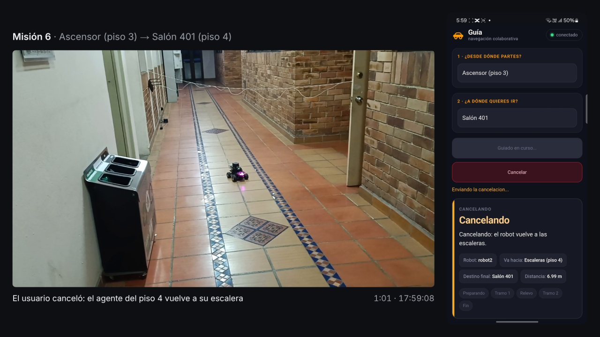

# Video de las pruebas del 23 de octubre, sincronizado con la pantalla del teléfono (29 de octubre)

Edición del material grabado el 23 de octubre por el equipo: 14 clips de cámara, en primera persona, de quien hizo de
usuario, y 4 grabaciones de la pantalla de su teléfono. Los videos no se versionan (`VIDEOS/` está en `.gitignore`);
quedan en la carpeta `VIDEOS/` del equipo. Las pruebas están en
[`S28_campo_pagina_cancelacion.md`](S28_campo_pagina_cancelacion.md).

## Resultado

- `VIDEOS/editado/pagina_y_cancelacion_23oct.mp4`: 8 min 21 s (500,9 s), 1920×1080, 30 fps, sin audio, a tiempo real.
  A la izquierda la cámara del usuario y a la derecha la pantalla del teléfono en el mismo instante; abajo, la etapa
  de la misión según las marcas del coordinador, el tiempo desde la solicitud y la hora.
- Publicado en YouTube el 1 de noviembre, no listado: <https://youtu.be/31oNn04qLoU>, con el título «Ajustes de la
  página y cancelación de misiones con dos agentes AWS DeepRacer — Evidencia Semana 28». Es el video 8 del anexo A del
  documento final.
- No incluye las cancelaciones anteriores al arreglo de la media vuelta, de las 17:33 y las 17:36 (decisión del
  equipo), ni la cancelación de las 18:06, que no quedó en cámara.
- Herramientas, fuera del repositorio, en `~/tesis_evidencia/video_23oct/`: `sincronizar_pantallas.py`,
  `barra_estado.py`, `retraso_pagina.py`, `preparar_23oct.py` (cortes por tramo), `verificar_cortes.py` y
  `generar.sh`. La composición `Octubre23` está en `~/tesis_evidencia/video_campana/remotion/src/Octubre23.jsx`. Los
  datos están en [`campo_20261023/sincronia/`](campo_20261023/sincronia/).

| Misión en el video | Inicio en el video | Solicitud | Recorrido | Qué muestra |
|---|---|---|---|---|
| 1 | 0:10 | 17:18:08 | Salón 403 → Salón 303 | Bajada completada con relevo |
| 2 | 1:52 | 17:20:56 | Salón 301 → Salón 401 | Subida completada con relevo |
| 3 | 4:07 | 17:54:21 | Salón 302 → Salón 402 | Cancelada en el tramo 1; vuelve al segundo intento (0,578 m y 0,173 m) |
| 4 | 4:43 | 17:55:48 | Salón 401 → Salón 303 | Cancelada en el tramo 2; vuelve a 0,337 m |
| 5 | 6:12 | 17:57:31 | Escaleras (piso 3) → Salón 401 | Cancelada en la espera de confirmación; queda a 0,302 m |
| 6 | 6:26 | 17:58:07 | Ascensor (piso 3) → Salón 401 | Cancelada en el tramo 2; vuelve a 0,328 m |
| 7 | 7:40 | 18:08:04 | Escaleras (piso 3) → Salón 402 | Cancelada en el relevo; llega a 0,074 m |

En las misiones 1 y 2, el texto de la llegada dice que la página la mostró 46 s y 36 s después del coordinador. Las
cifras están en `S28_campo_pagina_cancelacion.md`.

## Sincronización

1. Pantalla del teléfono contra el coordinador. Las grabaciones llegaron por WhatsApp y no traen hora. Se detectan los
   cambios de título del panel y se busca el desfase que mejor los alinea con las marcas de los 18 registros del día.
   El resultado se comprobó con el cambio de minuto de la barra de estado del teléfono, que cae entre 0,03 y 0,18 s
   después del segundo 0 (23 cambios de minuto). Estas grabaciones tienen cuadros solo cuando cambia algo, así que se
   leen en orden.

   | Grabación | Primer cuadro | Títulos que coinciden con una marca | Cambio de minuto (s después del segundo 0) |
   |---|---|---|---|
   | `VID-20261027-WA0010` | 17:17:59,625 | 4 de 22 | 0,03 a 0,08 |
   | `VID-20261027-WA0009` | 17:20:47,240 | 3 de 16 | 0,14 a 0,18 |
   | `VID-20261027-WA0008` | 17:33:14,967 | 5 de 10 | 0,07 a 0,08 |
   | `VID-20261027-WA0011` | 17:54:15,924 | 25 de 84 | 0,06 a 0,11 |

2. Cámara contra la pantalla. El nombre de cada clip da la hora en que se pulsó grabar, con resolución de un segundo, y
   no la del primer cuadro. Por eso cada clip se ubicó con un cambio del panel visible en el teléfono dentro de la
   cámara, comparado con la misma transición en la grabación de la pantalla. En los cinco clips medidos así desde su
   inicio, el primer cuadro llega entre 1,48 y 1,75 s después de la hora del nombre. Los clips sin el teléfono en
   cuadro usan el centro de esa banda, 1,62 s.

   | Clip (`VID20261023…`) | Tramo del clip (s) | Primer cuadro del tramo | Último cuadro | Cómo se ubicó |
   |---|---|---|---|---|
   | `171806` | 0 a 99,16 | 17:18:07,68 | 17:19:46,84 | Título «Baje con calma al piso 3» en t = 39,66 s |
   | `172046` | 0 a 57,62 | 17:20:47,49 | 17:21:45,11 | Título «Suba con calma al piso 4» en t = 47,95 s |
   | `172201` | 0 a 38,24 | 17:22:02,62 | 17:22:40,86 | Banda, comprobada con la media vuelta del vehículo (traza: t = 1,04 s) |
   | `172201` | 38,24 a 65,64 | 17:22:47,71 | 17:23:15,10 | Aparece «Iniciar guiado» en t = 61,90 s |
   | `175409` | 0 a 28,51 | 17:54:10,62 | 17:54:39,13 | Banda |
   | `175441` | 0 a 1,87 | 17:54:42,62 | 17:54:44,49 | Banda |
   | `175547` | 0 a 86,12 | 17:55:48,75 | 17:57:14,87 | Cortina de notificaciones y subida de brillo en t = 69,6 a 70,3 s |
   | `175731` | 0 a 10,63 | 17:57:32,73 | 17:57:43,36 | Aparece «Ya estoy en el piso 4» en t = 3,08 s |
   | `175759` | 0 a 32,25 | 17:58:00,62 | 17:58:32,87 | Banda |
   | `175759` | 32,25 a 69,40 | 17:58:50,41 | 17:59:27,56 | El panel pasa de naranja a azul en t = 33,10 s |
   | `180808` | 0 a 30,96 | 18:08:09,48 | 18:08:40,44 | Panel rojo de la cancelación en t = 29,08 s |

3. Pausas. Los clips `172201` y `175759` tienen una pausa de grabación que no deja hueco en sus marcas de tiempo: se
   ubicaron por el salto de la imagen (cuadros 1143 y 964) y cada parte se sincronizó por separado. El clip `172046`
   termina en una pausa, y por eso la hora de fin de su archivo queda 15 s después de su último cuadro.
4. Comprobación. `verificar_cortes.py` compara los cambios de color del panel en cada corte de pantalla con la grabación
   original: coinciden con 0,025 s de diferencia o menos en los 11 cortes. En la misión 6, la cámara y la pantalla
   pasan de naranja a azul con un cuadro de diferencia (33 ms).
5. El clip `175409` empieza 5,3 s antes que la grabación `WA0011`, así que esos primeros segundos de la pantalla van en
   negro, antes de la solicitud de la misión 3. Un primer montaje adelantaba esa pantalla 5,3 s; se detectó al revisar
   cuadros y se corrigió antes de publicar.

## Cuadros para el documento

Las capturas de la interfaz del documento final, de la presentación y del sitio son cuadros de estas grabaciones de pantalla,
recortados para quitar la barra del teléfono y la del navegador (3 de noviembre).

| Archivo en `DocumentoFinal/imagenes/` | Grabación | Segundo | Misión y etapa |
|---|---|---|---|
| `hri_catalogo.png` | `VID-20261027-WA0010.mp4` | 5 | Salón 403 → Salón 303, catálogo de destinos |
| `hri_seguimiento.png` | `VID-20261027-WA0010.mp4` | 35 | Salón 403 → Salón 303, primer tramo |
| `hri_confirmacion_piso.png` | `VID-20261027-WA0010.mp4` | 55 | Salón 403 → Salón 303, espera de confirmación |
| `hri_confirmacion_subida.png` | `VID-20261027-WA0009.mp4` | 60 | Salón 301 → Salón 401, espera de confirmación |
