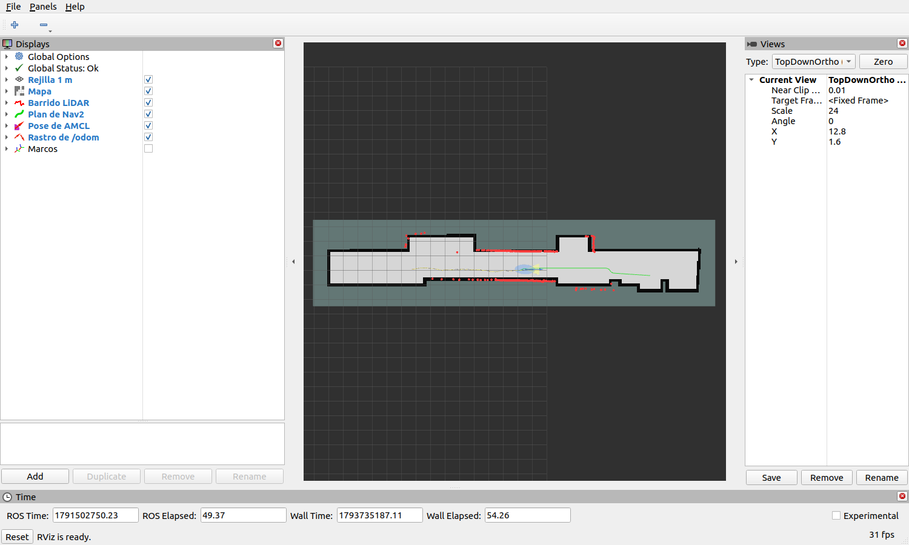

# Una misión grabada, vista en RViz en el portátil (3 de noviembre)

Los autores decidieron mostrar en la sesión con los jurados lo que ve un vehículo durante una misión. Se preparó el visor y se
probó con una grabación real. Falta grabar con la cadena completa, lo que queda para el ensayo.

## Resultado

`herramientas/ver_bag_rviz.sh` reproduce en el portátil la grabación de un vehículo en los pisos 3 y 4.

| | |
|---|---|
| Grabación | `~/tesis_evidencia/datos_8oct_deepy/campana_p3d_04`: deepy en el piso 3, 8 de octubre, 65,2 s, 3,5 MB |
| Orden | `ROBOT=robot1 herramientas/ver_bag_rviz.sh ~/tesis_evidencia/datos_8oct_deepy/campana_p3d_04` |
| Se vio | `Global Status: Ok`, el pasillo completo en el encuadre, el láser sobre las paredes del mapa, la pose de AMCL, el rastro de la odometría y el plan, que aparece desde el segundo 40,7 de la grabación, cuando el vehículo arranca |

Los colores de la vista son láser en rojo, plan en verde, pose de AMCL en azul y rastro de la odometría en amarillo.

## Cambios en el visor

- Reproduce en el dominio 77. Las grabaciones de campaña traen `/robotN/cmd_vel` y `/robotN/initialpose`, y en el dominio 0
  saldrían a la misma red que el coordinador y los vehículos.
- Con `ROBOT=robotN` la vista lee los tópicos de ese vehículo, usa `robotN/map` como marco fijo y encuadra los 27,7 m de pasillo
  de los mapas de los pisos 3 y 4.
- En ese modo oculta las flechas de las transformadas. La de `robot1/map` a `robot1/odom` va del origen del mapa a (22,51, -2,19),
  fuera del pasillo, y se veía como una línea de puntos que parecía un recorrido.

## Por qué no en vivo

Humble no decodifica el láser de Jazzy ([`S25_ensayo_laboratorio.md`](S25_ensayo_laboratorio.md)), y desde el 8 de octubre el
láser y las transformadas no salen de cada vehículo. La vía del puente de Foxglove está descrita y sin validar
([`GUIA_CAMPANA_NAV2_HARDWARE.md`](../historial/GUIA_CAMPANA_NAV2_HARDWARE.md), §6.2). En simulación sí se ve en vivo, con
`herramientas/robot.sh robot1 rviz`.

## Lo que queda para el ensayo

- Grabar en racey durante la misión 3, con la cadena completa y el coordinador en el portátil. Es una carga más sobre una tarjeta
  que navega entre el 68 y el 74 %. El criterio es que la misión se complete.
- Ver una grabación con `ROBOT=robot2`: esta prueba usó `robot1`.

Órdenes y criterios en [`GUION_SESION_JURADOS.md`](../GUION_SESION_JURADOS.md), secciones 3.2 y 5.
