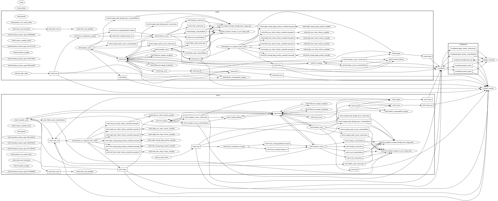

# Grafo real de nodos con todo corriendo (5 de noviembre)

Captura del grafo de ROS 2 con el generador de `rqt_graph`, para tener la evidencia junto al diagrama del documento, que está
dibujado a mano con `herramientas/figura_diagramas.py`. El grafo es demasiado grande para una página del documento: en una
página horizontal la letra quedaría en unos 2 puntos. Por eso el anexo C lo trae en una franja que se lee ampliándola en el PDF, y además como archivo aparte.

Archivos: [`S30_grafo_rqt.pdf`](S30_grafo_rqt.pdf), que se puede ampliar sin perder detalle, y
[`S30_grafo_rqt.png`](S30_grafo_rqt.png). Lista de nodos y tópicos en
[`logs/S30_grafo_rqt_nodos_topicos.txt`](logs/S30_grafo_rqt_nodos_topicos.txt). Los registros y la grabación de la misión están en
`~/tesis_evidencia/rqt_2026-11-05/`.

## Resultado

| Dato | Valor |
|---|---|
| Sitio | Simulación de los pisos 3 y 4 de Catalayud, un Gazebo por piso, sin ventanas |
| Modo del coordinador | `condicion:=hardware`, el camino de código de los vehículos |
| Corriendo | Las dos pilas, el coordinador, `rosbridge_websocket`, `rosapi`, la página y el grabador |
| Misión | Salón 301 → Salón 403, pedida y confirmada desde la página en el navegador del portátil |
| Cierre | Completada en 99,0 s, con 1 relevo |
| Momento de la captura | Segundo tramo de la misión, después de confirmar el cambio de piso |
| Nodos | 69: 32 por agente, más `coordinador`, `rosbridge_websocket`, `rosapi`, `rosapi_params` y `rosbag2_recorder` |

Se filtraron el nodo de la captura y el demonio de `ros2`, que no son parte del sistema. Vista usada: nodos y tópicos activos,
agrupados por espacio de nombres, con los filtros que `rqt_graph` trae para ocultar tópicos sin conexión.



## Por qué en simulación

Con los vehículos no se puede ver completo desde el portátil. Solo admite cuatro procesos de ROS durante una misión
([`coordinador_portatil.sh`](../../herramientas/coordinador_portatil.sh)), así que `rqt` ocuparía el lugar de uno de los que
necesita el sistema. Además, el láser, las transformadas y los nodos internos no salen de cada vehículo desde el 8 de octubre
([`S30_grabacion_en_rviz.md`](S30_grabacion_en_rviz.md)). No se probó una captura por vehículo desde su tarjeta.

## Frente al diagrama del documento

| | Diagrama del documento | Este grafo |
|---|---|---|
| Sistema | Vehículos en la campaña | Simulación |
| `agente`, `amcl`, `bt_navigator`, `behavior_server`, `planner_server`, `controller_server`, `map_server` | Sí | Sí |
| `rf2o_laser_odometry`, `imu_bmi160`, `ekf_filter_node`, `cmdvel_to_servo` | Sí | No: solo existen en los vehículos |
| Gazebo, controladores de ruedas y dirección, `robot_state_publisher` | No | Sí |
| `waypoint_follower`, gestores de ciclo de vida y mapas de costos | No | Sí |
| Servidor HTTP de la página | Sí | No: no es un nodo de ROS |

El diagrama muestra los nodos principales, no todos. El capítulo decía «todos los nodos» y se corrigió.

## Límites

- No sirve para medir: el grabador avisó un factor de tiempo real de 0,9866, por debajo de 0,99. La misión no entra en ninguna campaña.
- Esta es la segunda captura de la sesión. La primera, sin el grabador, quedó en `~/tesis_evidencia/rqt_2026-11-05/sin_grabador/`, con una
  misión completada en 108,0 s y 1 relevo.

## Cómo repetirla

1. Levantar el sistema como en la sección 8 de [`GUIA_PISOS_3_Y_4.md`](../GUIA_PISOS_3_Y_4.md), y el grabador con
   `herramientas/grabar_mision.sh NOMBRE robot1 robot2`.
2. Pedir una misión con relevo desde la página y confirmar el cambio de piso.
3. Durante el segundo tramo, con el workspace activado:

   ```bash
   python3 herramientas/capturar_grafo_rqt.py CARPETA && dot -Tpdf CARPETA/rqt_completo.dot -o CARPETA/rqt_completo.pdf
   ```

   Esperado: los `.dot` de las tres vistas y las listas de nodos y tópicos.
