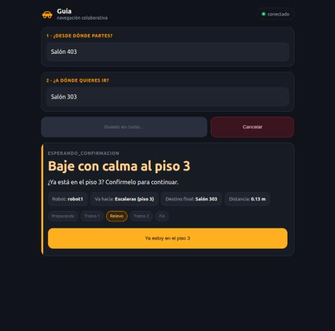

# Simulación en los pisos 3 y 4 de Catalayud (2 de noviembre)

Sesión en el portátil del equipo (AMD Ryzen 5 PRO 5650U), para saber si `piso3.world` y `piso4.world` sirven para correr
el sistema completo. Esos mundos salen del levantamiento con flexómetro desde el 2 de octubre, y no había registro de
una corrida con ellos. Cada robot corrió en su propio Gazebo, con el mapa de su piso y el catálogo de destinos de los
vehículos. Se levantó solo con parámetros, sin cambiar código ni configuración versionada; las órdenes están en
[`GUIA_PISOS_3_Y_4.md`](../GUIA_PISOS_3_Y_4.md), sección 8.

Extractos de consola: [`logs/S30_simulacion_catalayud.txt`](logs/S30_simulacion_catalayud.txt). Los registros completos y
el programa que pidió las misiones están en `~/tesis_evidencia/sim_catalayud_2026-11-02/`.

## Resultado

Trece misiones encadenadas, sin reubicar los robots: 10 completadas, 3 canceladas a propósito y ninguna fallida.

| Corrida | Misión | Resultado | Tiempo total | Relevos |
|---|---|---|---|---|
| Modo simulación, sin ventanas | Salón 403 → Salón 303 | Completada | 58,7 s | 1 |
| | Salón 301 → Salón 401 | Completada | 106,6 s | 1 |
| | Salón 403 → Salón 401 | Completada | 57,0 s | 0 |
| | Salón 401 → Salón 303 | Cancelada en el segundo tramo | 53,9 s | 1 |
| Modo vehículos, sin ventanas | Salón 403 → Salón 303 | Completada | 59,8 s | 1 |
| | Salón 301 → Salón 401 | Completada | 110,1 s | 1 |
| | Salón 403 → Salón 401 | Completada | 54,0 s | 0 |
| | Salón 401 → Salón 303 | Cancelada en el segundo tramo | 61,4 s | 1 |
| | Salón 403 → Salón 303, desde la página | Completada | 72,6 s | 1 |
| Modo vehículos, con ventanas, Santiago desde la página | Salón 301 → Salón 302 | Completada | 45,7 s | 0 |
| | Salón 301 → Escaleras (piso 3) | Cancelada | 37,1 s | 0 |
| | Escaleras (piso 3) → Salón 402 | Completada | 49,1 s | 1 |
| | Salón 303 → Salón 403 | Completada | 85,9 s | 1 |

Los dos modos son valores del parámetro `condicion` del coordinador:

| | Modo simulación (por defecto) | Modo vehículos (`condicion:=hardware`) |
|---|---|---|
| Media vuelta | La planifica Nav2, con marcha atrás | Maniobra propia del agente, pedida por el coordinador |
| Llegada | Contra `/odom`, tolerancia de 0,25 m | Contra la pose del agente en el mapa, 1,5 s después de la meta, tolerancia de 0,5 m |
| Llegadas verificadas | 14, entre 0,067 y 0,206 m | 28, entre 0,100 y 0,167 m |

En modo vehículos se hicieron 18 medias vueltas del agente: 17 en un tiempo, de 162 a 164 grados, y una en tres. En esa,
el mapa y el LiDAR cortaron la maniobra: reversa de 11 grados, a 0,08 m del mapa; avance de 24 grados, a 0,09 m del
LiDAR; y reversa de 117 grados.

## La página

Es la primera corrida registrada de la página con simulación desde los ajustes del 18 al 23 de octubre. Mostró el título
de la confirmación según el sentido, «Baje con calma al piso 3», y el botón «Ya estoy en el piso 3». Santiago canceló
una misión con su botón. En la misión de 72,6 s, cada cambio de etapa apareció en la página a 0,01 s o menos de la marca
del coordinador, sin el retraso medido el 23 de octubre
([`S28_campo_pagina_cancelacion.md`](S28_campo_pagina_cancelacion.md)). La página se abrió en el navegador del portátil.
No se probó desde un teléfono.

## Estado de las pilas

| Dato | Sin ventanas | Con ventanas |
|---|---|---|
| Compuerta (`esperar_nav2.sh`) | `LISTA` en las dos | `LISTA` en las dos |
| Error de localización de robot1 | 0,019 m y 0,7 grados | 0,052 m y 7,7 grados |
| Error de localización de robot2 | 0,025 m y 6,9 grados | 0,039 m y 3,8 grados |
| Factor de tiempo real de robot1 y robot2 | 1,00 y 1,00 | 1,00 y 0,94 |

El factor de tiempo real se leyó con `gz stats` una sola vez en cada caso, durante 3 a 4 s, y con ventanas está por
debajo del 0,99 que pide la campaña (RNF-06).

## Incidencias

- En el primer arranque, robot1 se quedó en el bloqueo del gestor de ciclo de vida que describe el §3 de
  [`RUNBOOK_CAMPANA.md`](../RUNBOOK_CAMPANA.md). Se resolvió relanzando solo ese robot.
- `POSE_INICIAL` sigue apuntando al edificio Gregorio. Por eso `robot.sh` imprime «piso 1, mapa
  mundo_definitivo_piso1.yaml» aunque cargue el mapa del piso 3, y `verificar_condicion_inicial.py` informa un desvío
  de 41 a 47 m frente a la tabla de spawn. Las dos cosas son informativas: el registro de `map_server` muestra
  `piso3.pgm` y `piso4.pgm`, y el error de localización está dentro de los 0,15 m y 10 grados del criterio.

## Lo que esto dice y lo que no

- El mismo coordinador corre en Gazebo con la media vuelta y la llegada de los vehículos, y con sus mapas y destinos.
  Antes de esta sesión, la media vuelta del agente y la llegada con su pose solo habían corrido en los vehículos y,
  con robots falsos, en las pruebas del coordinador.
- Es una comprobación de funcionamiento, no una campaña: no se grabó con `grabar_mision.sh` ni se compusieron registros,
  y en las primeras ocho misiones las solicitudes y las confirmaciones las mandó un programa. No entra en las tasas de
  éxito de la campaña de 30 misiones, que se hizo en Gregorio, y no cambia el estado de ningún requisito.
- Gazebo no reproduce la odometría real (láser e IMU), la banda muerta, lo que el vehículo rueda al parar, el radio de
  giro de cada uno ni la red entre pisos. Por eso no anticipa los fallos de campo. Nav2 no abortó aquí en la salida del
  piso 4, de 2,5 m de ancho, como sí lo hizo en el vehículo. La llegada más lejana fue de 0,206 m, frente a los 0,52 m que
  hicieron fallar una misión el 23 de octubre.
