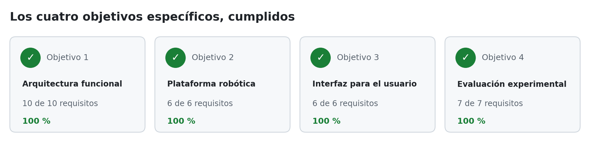

# Estado del proyecto

Tablero corto del avance. El proyecto cumplió sus cuatro objetivos específicos. Se actualiza los viernes en la noche, con el corte de la semana. La bitácora
completa hasta el 24 de octubre de 2026 (lecturas de avance, decisiones, riesgos cerrados y discrepancias)
está en [`Documentos/historial/ESTADO_bitacora.md`](Documentos/historial/ESTADO_bitacora.md), y el
recorrido semana a semana en [`CRONOLOGIA.md`](Documentos/DocumentoFinal/CRONOLOGIA.md).

| | |
|---|---|
| **Semana en curso** | S29 (26 de octubre al 1 de noviembre de 2026), fase 6: análisis y escritura |
| **Fecha de corte** | 2026-11-01 (domingo). Pruebas del 23 de octubre registradas, con la corrección del retraso de la página; documento recortado y revisado, sin siglas de más y con el mapa del piso 4 corregido; video de las pruebas publicado y en el anexo A |
| **Último entregable formal** | Semana 29 ([`Entregable_semana_29.tex`](Documentos/Entregables/Entregable_semana_29.tex) y su versión [`.md`](Documentos/Entregables/Entregable_semana_29.md)) |
| **Documento final** | Compila en el portátil, sin errores ([`DocumentoFinal/`](Documentos/DocumentoFinal/)): la versión definitiva (`main.pdf`) tiene 79 páginas, también con la dedicatoria de Jonny, que va en la misma página que la de Santiago. El director pide entre 60 y 80 |

## Objetivos específicos

<picture>
  <source media="(prefers-color-scheme: dark)" srcset="sitio/paginas/img/readme_objetivos_oscuro.png">
  
</picture>

| Objetivo | Evidencia principal |
|---|---|
| OE1 · Arquitectura funcional | Coordinación y relevo en simulación y con los vehículos |
| OE2 · Plataforma con dos vehículos | Locomoción, sensado, odometría y red medidos en campo |
| OE3 · Interfaz web | Confirmación de cambio de piso y cancelación, probadas en teléfono con los vehículos |
| OE4 · Evaluación | 30 misiones en simulación y 9 de 9 con los vehículos ([`S27_campana_rf27.md`](Documentos/Evidencia/S27_campana_rf27.md)) |

Matriz completa en [`REQUISITOS.md`](Documentos/REQUISITOS.md): los 36 requisitos verificados. RNF-03 (operación en condiciones controladas) se cerró el 27 de octubre: en la campaña solo estuvieron en el pasillo los dos autores, que hicieron de usuario.

## Pendiente

1. Documento final: faltan los nombres de las autoridades académicas, que hay que tomar de la fuente oficial de la Universidad, y la dedicatoria de Jonny. La versión recortada ya es la definitiva.
2. Presustentación (2 a 6 de noviembre, fuera del cronograma; día sin confirmar): la propuesta de presentación está en [`Presustentacion.pptx`](Documentos/Presentacion/Presustentacion.pptx), con la plantilla de la presentación del anteproyecto: 39 diapositivas y notas del orador que suman 17 min 20 s. Se arma con `python3 herramientas/presentacion_sustentacion.py` y falta la revisión de los autores. La tarjeta de acceso del jurado, con los códigos QR de la red y de la página, se genera ese día con `python3 herramientas/tarjeta_jurado.py`, con el portátil ya en la red `DEEPRACER` (pide la clave al ejecutarse).
3. Registro de misión: la etapa de cancelación sale como `8` y no como `CANCELANDO`.
4. Imagen `coordinador_jazzy` del portátil: reconstruirla con el agente nuevo.
5. Siete archivos de código copiados en los vehículos citan en comentarios la ruta vieja de planes ya
   movidos a `historial/`; se actualizan en los dos vehículos la próxima vez que estén encendidos.
