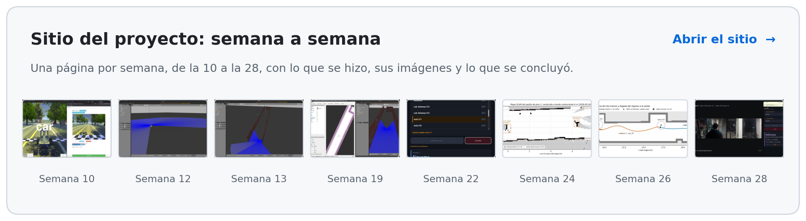
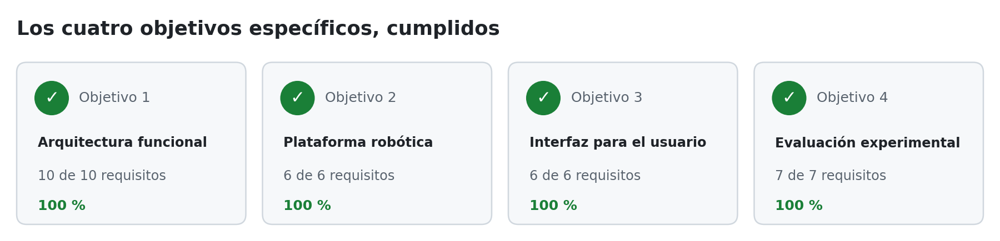
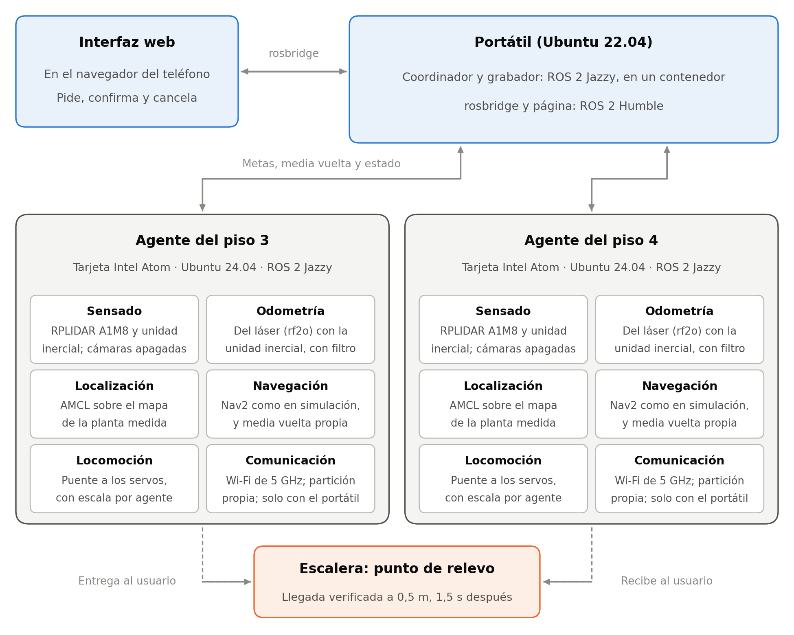

# Sistema colaborativo de robots móviles para asistencia de orientación en entornos interiores con múltiples pisos

Trabajo de grado · Ingeniería Electrónica · Universidad Santo Tomás · Grupo de Estudio y Desarrollo en
Robótica (GED)

Dos robots AWS DeepRacer guían a una persona entre los pisos de un edificio. La persona elige su destino
desde el navegador del teléfono y el robot de su piso la lleva hasta la escalera. Ella cambia de piso y lo
confirma en el teléfono, y el robot del otro piso la recibe y termina el recorrido. Un coordinador central
asigna los robots y organiza el relevo. El aporte del proyecto es esa coordinación entre agentes.

[](https://shdeza12.github.io/Collaborative-Mobile-Robot-System-for-Indoor-Navigation-Assistance-in-Multi-Level-Environments/)
[](https://youtu.be/X3BINGgNxiA)
[](Documentos/DocumentoFinal/main.pdf)
[](ESTADO.md)

<a href="https://shdeza12.github.io/Collaborative-Mobile-Robot-System-for-Indoor-Navigation-Assistance-in-Multi-Level-Environments/">
  <picture>
    <source media="(prefers-color-scheme: dark)" srcset="sitio/paginas/img/readme_sitio_oscuro.png">
    
  </picture>
</a>

## Objetivos

<picture>
  <source media="(prefers-color-scheme: dark)" srcset="sitio/paginas/img/readme_objetivos_oscuro.png">
  
</picture>

De los 36 requisitos del proyecto hay 35 verificados, cada uno con su prueba
([`REQUISITOS.md`](Documentos/REQUISITOS.md)). Queda parcial una restricción del alcance, operar en
condiciones controladas, a falta de anotar las personas que pasaron por el pasillo durante las pruebas.

## Resultados

| Prueba | Resultado |
|---|---|
| Campaña con los dos vehículos, pisos 3 y 4 (16 de octubre de 2026) | 9 de 9 misiones completadas con relevo entre pisos; duración mediana 87,6 s |
| Tiempo de respuesta, de la solicitud al primer movimiento | Mediana 0,87 s |
| Error de llegada, según la localización del vehículo | Mediana 0,23 m, con tolerancia de 0,5 m |
| Cancelación desde el teléfono con los vehículos (23 de octubre) | 6 de 6: el vehículo vuelve a su escalera, a 0,07–0,34 m |
| Campaña en simulación, 30 misiones sorteadas | 26 completadas; los 4 fallos fueron llegadas cortas |

El detalle está en el capítulo de resultados del documento final y en
[`Documentos/Evidencia/`](Documentos/Evidencia/README.md).

## Cómo funciona

La página del teléfono habla con el coordinador, que corre en un portátil; cada vehículo lleva su propia navegación y solo se comunica con el portátil. El relevo ocurre en la escalera, que la persona sube o baja por su cuenta.



## Estructura

```
Robot/aws-deepracer/   Paquetes ROS 2: coordinador y agentes, modelo del vehículo, lanzadores y mapas
interfaz_web/          Página del teléfono (HTML y JavaScript, sin dependencias externas)
herramientas/          Arranque, verificación, medición y análisis de las misiones
Documentos/            Documento final, entregables semanales, requisitos, guías y evidencia
sitio/                 Fuente del sitio en GitHub Pages
simulacion/            Mundos y modelos de Gazebo (pisos 1 y 2 en simulación; pisos 3 y 4 medidos)
ESTADO.md              Estado del proyecto y bitácora
```

## Probarlo en simulación

Requisitos: Ubuntu 22.04, ROS 2 Humble y Gazebo Classic 11.

```bash
git clone https://github.com/shdeza12/Collaborative-Mobile-Robot-System-for-Indoor-Navigation-Assistance-in-Multi-Level-Environments.git ~/Tesis && cd ~/Tesis
```

```bash
mkdir -p ~/deepracer_sim_ws/src && ln -s "$(pwd)/Robot/aws-deepracer" ~/deepracer_sim_ws/src/aws-deepracer
```

```bash
cd ~/deepracer_sim_ws && rosdep install --from-paths src --ignore-src -r -y && colcon build --symlink-install
```

Después hay que declarar dos variables de entorno y comprobar la instalación con
`herramientas/verificar_instalacion.sh`; los seis pasos completos, con lo que hay que esperar en cada
uno, están en [`Documentos/guia_instalacion.md`](Documentos/guia_instalacion.md). Con la instalación
verificada, cada robot se levanta con una orden:

```bash
herramientas/robot.sh robot1 nav2
```

```bash
herramientas/robot.sh robot2 nav2
```

En simulación hay un mundo por piso. El vigente es `mundo_definitivo_piso1.world`, y su par es
`mundo_definitivo_piso2.world`. La misión completa, con el coordinador y la página del teléfono, se
lanza con [`Documentos/GUIA_ARRANQUE.md`](Documentos/GUIA_ARRANQUE.md).

## Documentación

| Documento | Qué tiene |
|---|---|
| [`Documentos/DocumentoFinal/`](Documentos/DocumentoFinal/) | El documento final en LaTeX y su PDF |
| [`Documentos/REQUISITOS.md`](Documentos/REQUISITOS.md) | Los 36 requisitos, cada uno con su prueba y su estado |
| [`Documentos/PROTOCOLO_EXPERIMENTAL.md`](Documentos/PROTOCOLO_EXPERIMENTAL.md) | Cómo se midieron las cuatro métricas |
| [`Documentos/CONTRATO_INTERFACES.md`](Documentos/CONTRATO_INTERFACES.md) | Qué se comunica con qué, y en qué formato |
| [`Documentos/Entregables/`](Documentos/Entregables/) | Informes semanales, de la semana 10 a la 28 |
| [`Documentos/INDICE_GUIAS.md`](Documentos/INDICE_GUIAS.md) | Qué guía seguir para cada tarea, incluidos los vehículos reales |
| [`Robot/README.md`](Robot/README.md) | Los paquetes del robot y su migración de ROS 2 Foxy a Humble |

## Plataforma y licencia

El modelo del vehículo viene del proyecto abierto [AWS DeepRacer](https://github.com/aws-deepracer/aws-deepracer),
migrado de ROS 2 Foxy a Humble. Los vehículos reales usan su tarjeta original con Ubuntu 24.04 y ROS 2
Jazzy. El código de terceros conserva su licencia Apache 2.0, con sus archivos `LICENSE` y `NOTICE`.

## Autores

Santiago Hernández Ávila y Jonny Alejandro Mejía León.

Director: Ing. Armando Mateus Rojas, MSc. Grupo de Estudio y Desarrollo en Robótica (GED), línea de Robótica e Inteligencia Computacional.
