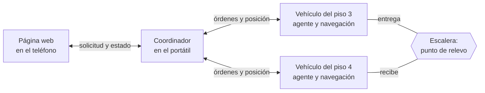
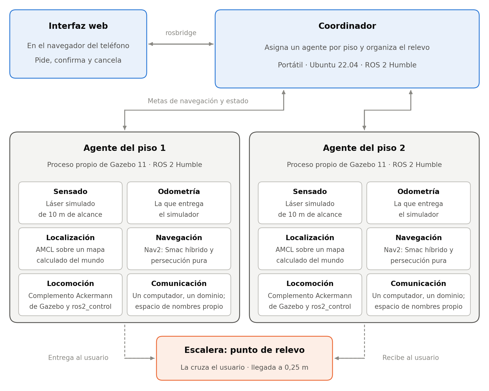
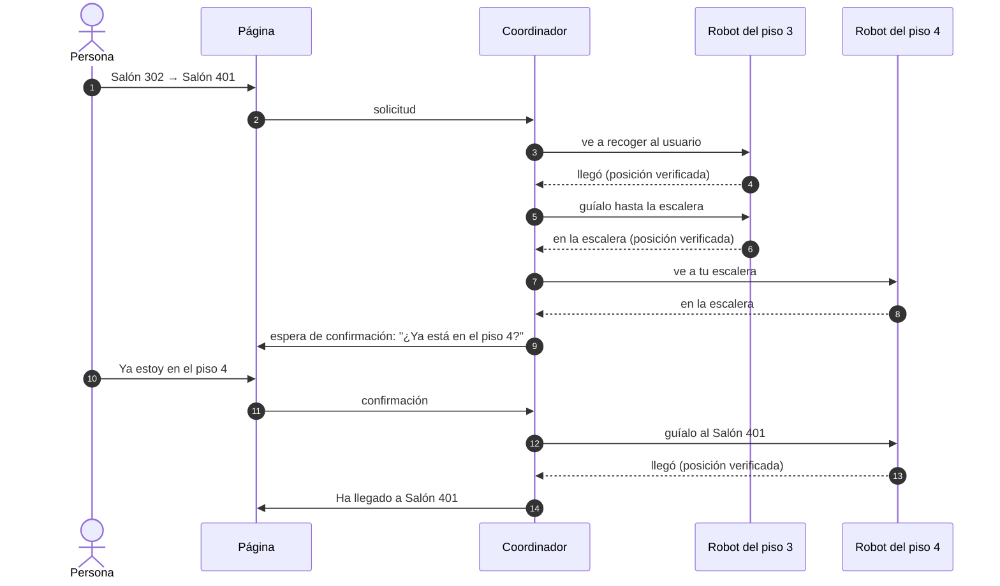
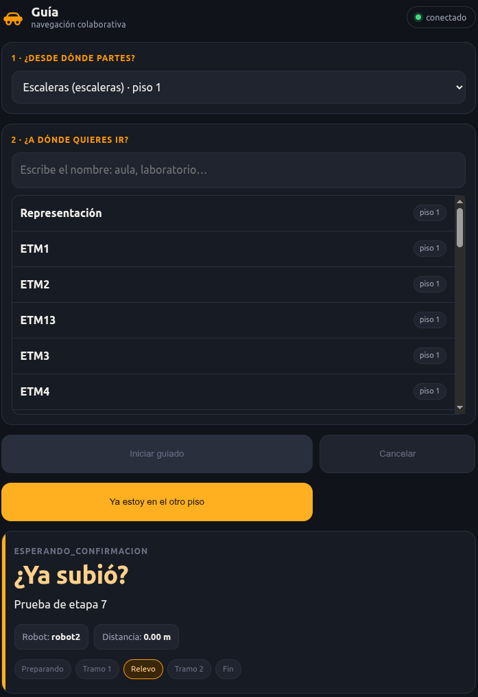

# Cómo funciona

## Las piezas del sistema

El sistema tiene tres piezas. Un **coordinador** decide y manda. Dos **agentes**, uno por vehículo y por piso, ejecutan. Y una **página web** es la vía por la que la persona pide el servicio. El coordinador corre en un computador portátil; cada vehículo lleva su propia navegación.

Tres reglas ordenan la comunicación:

- El coordinador manda a un vehículo solo con la acción de navegación de ROS 2 (o pidiéndole una media vuelta); nunca le envía velocidades.
- La página habla solo con el coordinador, nunca con los vehículos.
- El texto que lee la persona lo redacta el coordinador, y la página lo muestra tal cual. Así la lógica no se duplica en el navegador.

Los dos vehículos no se ven entre sí: cada uno solo se anuncia al portátil. Esta topología en estrella salió de una prueba fallida, cuando con los dos vehículos hablándose todo con todo las tarjetas se saturaron ([ver la decisión](proceso/decisiones.md#coordinador-en-el-portatil)).

## De la simulación a los vehículos

El sistema se construyó y se evaluó primero en simulación, y después se llevó a los dos vehículos. La estructura se mantuvo: un coordinador, un agente por piso, el relevo en la escalera y las mismas reglas de comunicación. También el código: el del coordinador, el planificador, los mensajes y la página es el mismo en los dos destinos. Lo que cambió fue cómo se implementa cada bloque.

=== "En simulación"

    

=== "En los vehículos"

    

| Parte | En simulación | En los vehículos | Por qué |
|---|---|---|---|
| Distribución de ROS 2 | Humble en todo | Jazzy en los vehículos y en el coordinador, dentro de un contenedor del portátil; Humble en la página y rosbridge | El software de la tarjeta original solo existe con Jazzy, y su acción de navegación no es compatible con la de Humble |
| Coordinador | En el portátil, junto a los simuladores | En el portátil, después de un intento en uno de los vehículos | Con el coordinador y las dos navegaciones encendidas, la tarjeta se saturó y Nav2 no arrancaba |
| Comunicación | Un solo computador y un dominio; un espacio de nombres por agente | Red inalámbrica con un punto de acceso por piso, una partición por vehículo y topología en estrella | Los tópicos del fabricante no llevan espacio de nombres, y unos cuarenta procesos anunciándose por la red saturaban las tarjetas |
| Locomoción | Complemento Ackermann de Gazebo | Puente de la orden de velocidad a los servos, con una escala por vehículo | La tracción real tiene banda muerta y funciona en lazo abierto |
| Sensado | Láser simulado de 10 m | Láser RPLIDAR y la unidad inercial de la tarjeta; cámaras apagadas | Las cámaras no se usan y cargaban la tarjeta |
| Odometría | La del simulador | La del láser, combinada con la unidad inercial | El vehículo no tiene codificadores en las ruedas, y con el láser solo el rumbo derivaba 5,9° por minuto |
| Mapa | Calculado del mundo simulado | Derivado de la planta medida con flexómetro | El mapeo con SLAM a bordo no funcionó en ningún pasillo |
| Escenario | Pisos 1 y 2 | Pisos 3 y 4 | El modelo del piso 2 no correspondía al edificio, y en sus pasillos uniformes el láser no veía el avance |
| Llegada | A 0,25 m | A 0,5 m, verificada 1,5 s después de que la navegación termina | Por la banda muerta el vehículo no alcanza la precisión de la simulación, y sigue rodando al terminar la navegación |
| Media vuelta | La planifica Nav2 | Maniobra propia del agente | En la salida del piso 4, de 2,5 m de ancho, la de Nav2 abortaba contra la pared |

## Una misión con relevo

Si el origen y el destino están en el mismo piso, la misión tiene dos tramos del mismo robot: ir a recoger a la persona y llevarla. Si están en pisos distintos, tiene cuatro, y el punto de encuentro es siempre la escalera.

El coordinador no confía en que la navegación diga «llegué». Espera 1,5 s a que el vehículo se detenga y compara su posición con el punto de destino; si queda a más de 0,5 m, la misión falla con ese motivo.

??? info "Las etapas de una misión"
    | Etapa | Qué pasa |
    |---|---|
    | Recibida | El coordinador aceptó la solicitud y todavía no asignó robot |
    | Primer tramo | El robot del piso de origen va a recoger a la persona y la guía |
    | Transferencia | El robot del otro piso va a su escalera |
    | Esperando confirmación | El sistema espera que la persona confirme que cambió de piso |
    | Segundo tramo | El robot del piso de destino la guía hasta el final |
    | Completada | Terminó con la llegada verificada |
    | Fallida | Terminó sin cumplirse, con el motivo en el texto |
    | Cancelando | La persona canceló y el robot vuelve a su escalera |

## La asignación de robots

Cada piso tiene un robot asignado, y esa correspondencia es configuración, no código. El coordinador elige el robot según el piso del origen y del destino. Con un solo robot posible por piso, un método de optimización como el húngaro devolvería la misma tabla, así que no hace falta. El método importa cuando haya dos o más robots por piso, y queda como trabajo futuro.

## La página del teléfono

Es una página web, no una aplicación: un visitante ocasional no va a instalar nada para preguntar por un salón. No usa bibliotecas externas, porque la red del edificio puede no tener internet.

<figure markdown>
{ width="320" }
<figcaption>Durante el guiado: el robot activo, hacia dónde va, la distancia y el paso de la misión.</figcaption>
</figure>
<figure markdown>
{ width="320" }
<figcaption>En el relevo: la página pide confirmar el cambio de piso. Si pasan 60 s avisa, y a los 120 s la misión falla.</figcaption>
</figure>

Dos funciones se añadieron al ver el sistema en uso, a pedido del director: la **confirmación del cambio de piso**, para que la misión no se dé por completada con la persona todavía en el piso equivocado, y la **cancelación**, que devuelve el robot activo a su escalera.
