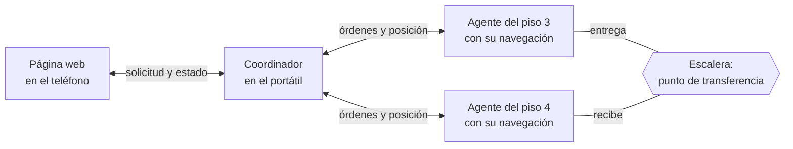
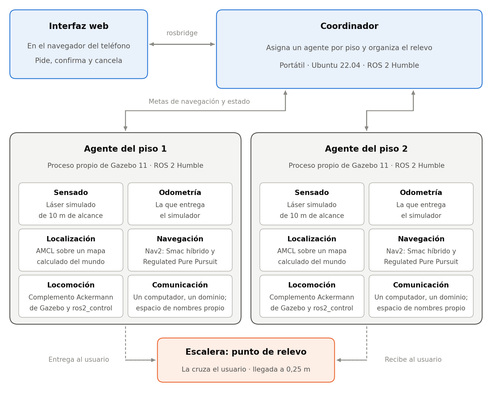
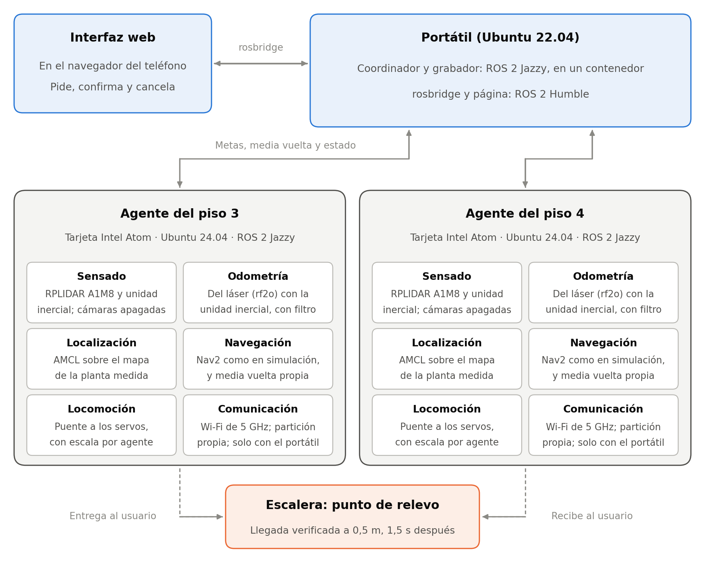
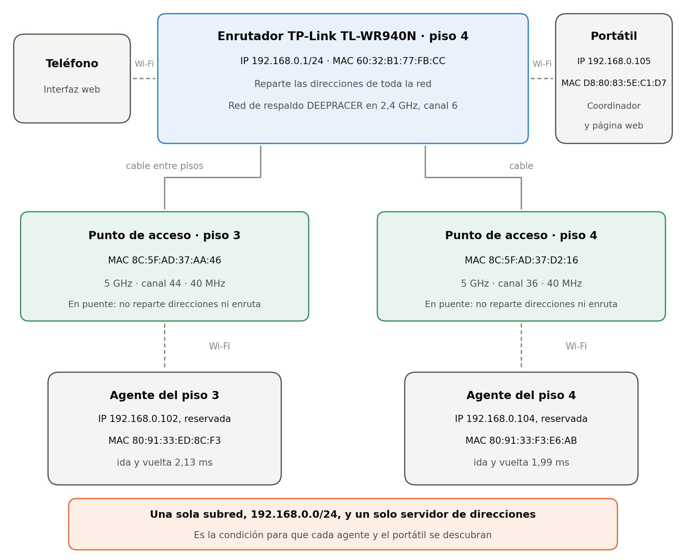
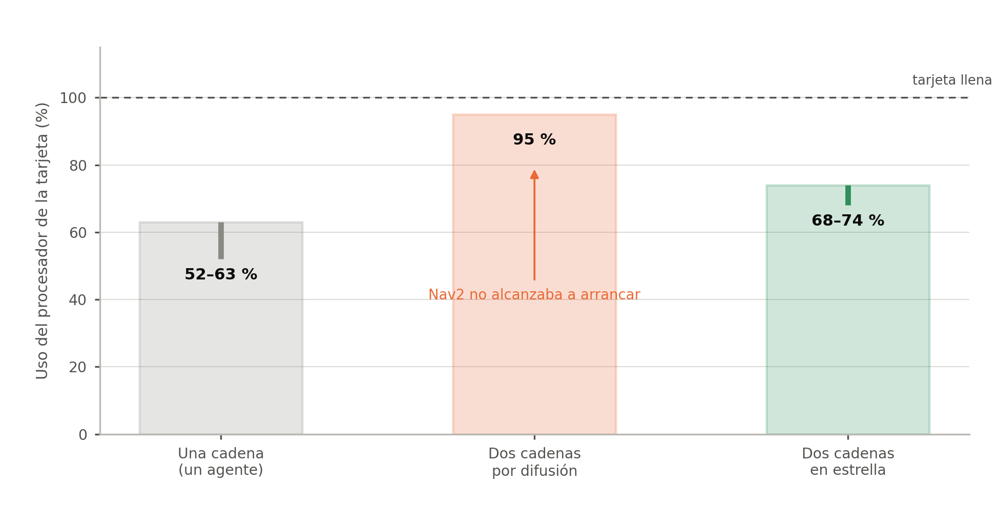
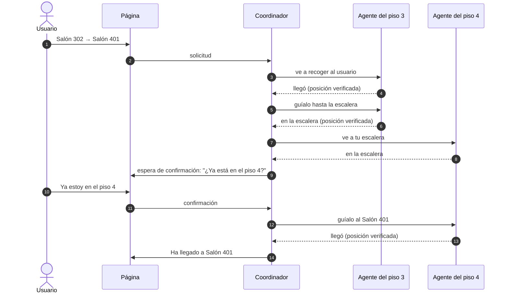
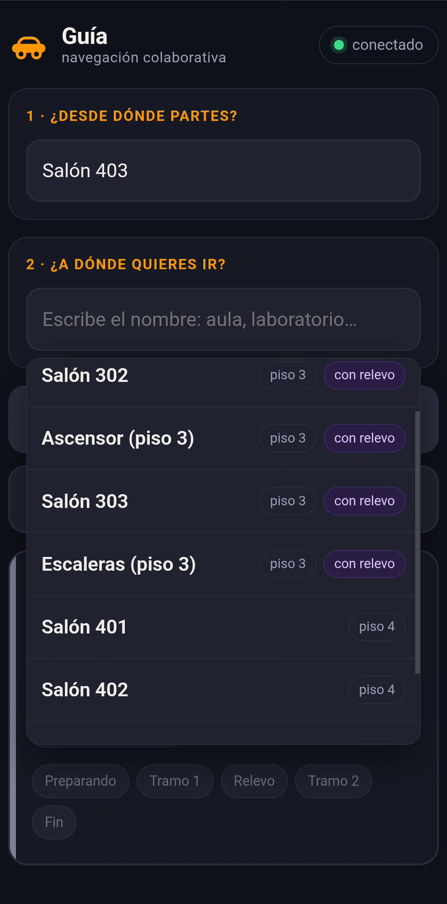
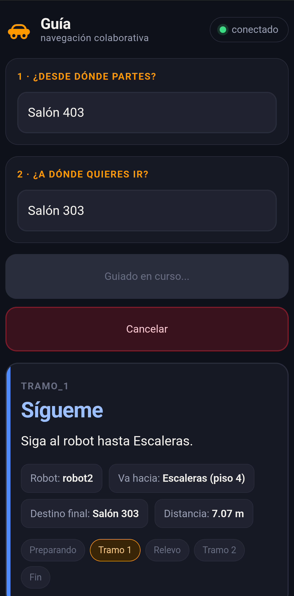
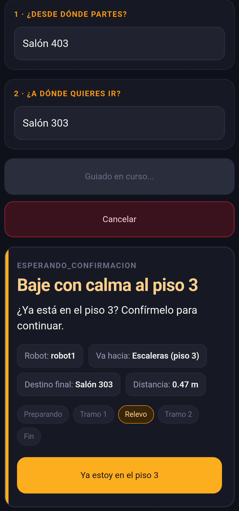
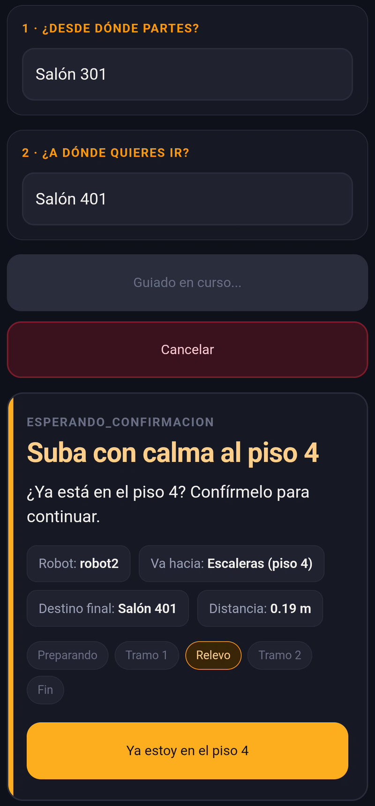

# Cómo funciona

## Las piezas del sistema

El sistema tiene tres piezas. Un **coordinador** decide y manda. Dos **agentes**, uno por piso, ejecutan. Y una **página web** es la vía por la que el usuario pide el servicio. El coordinador corre en un computador portátil; cada agente lleva su propia navegación.

Tres reglas ordenan la comunicación:

- El coordinador manda a un agente solo con la acción de navegación de ROS 2 (o pidiéndole una media vuelta); nunca le envía velocidades.
- La página habla solo con el coordinador, nunca con los agentes.
- El texto que lee el usuario lo redacta el coordinador, y la página lo muestra tal cual. Así la lógica no se duplica en el navegador.

Los dos agentes no se ven entre sí: cada uno solo se anuncia al portátil. Esta topología en estrella salió de una prueba fallida, cuando con los dos agentes hablándose todo con todo las tarjetas se saturaron ([ver la decisión](proceso/decisiones.md#coordinador-en-el-portatil)).

El grafo real, con el sistema completo en simulación y una misión con relevo en curso, tiene 69 nodos. Es muy grande para verlo aquí, así que está como [archivo aparte, que se puede ampliar :material-download:](https://github.com/shdeza12/Collaborative-Mobile-Robot-System-for-Indoor-Navigation-Assistance-in-Multi-Level-Environments/blob/main/Documentos/Evidencia/S30_grafo_rqt.pdf).

## De la simulación a los agentes físicos

El sistema se construyó y se evaluó primero en simulación, y después se llevó a los dos agentes físicos. La estructura se mantuvo: un coordinador, un agente por piso, el relevo en la escalera y las mismas reglas de comunicación. También el código: el del coordinador, el planificador, los mensajes y la página es el mismo en los dos destinos. Lo que cambió fue cómo se implementa cada bloque.

=== "En simulación"

    

=== "Con los agentes físicos"

    

| Parte | En simulación | Con los agentes físicos | Por qué |
|---|---|---|---|
| Distribución de ROS 2 | Humble en todo | Jazzy en los agentes y en el coordinador, dentro de un contenedor del portátil; Humble en la página y rosbridge | El software de la tarjeta original solo existe con Jazzy, y su acción de navegación no es compatible con la de Humble |
| Coordinador | En el portátil, junto a los simuladores | En el portátil, después de un intento en uno de los agentes | Con el coordinador y las dos navegaciones encendidas, la tarjeta se saturó y Nav2 no arrancaba |
| Comunicación | Un solo computador y un dominio; un espacio de nombres por agente | Red inalámbrica con un punto de acceso por piso, una partición por agente y topología en estrella | Los tópicos del fabricante no llevan espacio de nombres, y unos cuarenta procesos anunciándose por la red saturaban las tarjetas |
| Locomoción | Complemento Ackermann de Gazebo | Puente de la orden de velocidad a los servos, con una escala por agente | La tracción real tiene banda muerta y funciona en lazo abierto |
| Sensado | Láser simulado de 10 m | Láser RPLIDAR y la unidad inercial de la tarjeta; cámaras apagadas | Las cámaras no se usan y cargaban la tarjeta |
| Odometría | La del simulador | La del láser, combinada con la unidad inercial | El agente no tiene codificadores en las ruedas, y con el láser solo el rumbo derivaba 5,9° por minuto |
| Mapa | Calculado del mundo simulado | Derivado de la planta medida con flexómetro | El mapeo con SLAM a bordo no funcionó en ningún pasillo |
| Escenario | Pisos 1 y 2 | Pisos 3 y 4 | El mapa del piso 2 no correspondía al edificio, porque el mundo simulado estaba mal medido, y en sus pasillos uniformes el láser no veía el avance |
| Llegada | A 0,25 m | A 0,5 m, verificada 1,5 s después de que la navegación termina | Por la banda muerta el agente no alcanza la precisión de la simulación, y sigue rodando al terminar la navegación |
| Media vuelta | La planifica Nav2 | Maniobra propia del agente | En la salida del piso 4, de 2,5 m de ancho, la de Nav2 abortaba contra la pared |

!!! note "Los pisos 3 y 4, también en simulación"
    La columna «En simulación» describe la campaña de 30 misiones. Desde el 2 de noviembre de 2026 el sistema también corre en Gazebo en los pisos 3 y 4, con los mismos mapas y destinos que los agentes físicos, con la misma página, y con su media vuelta y su forma de verificar la llegada. Lo físico sigue sin reproducirse: la odometría real, la banda muerta, el radio de giro de cada agente y la red. [Ver la evidencia](https://github.com/shdeza12/Collaborative-Mobile-Robot-System-for-Indoor-Navigation-Assistance-in-Multi-Level-Environments/blob/main/Documentos/Evidencia/S30_simulacion_catalayud.md).

## La red entre los dos pisos

Los agentes se comunican por una red Wi-Fi propia, porque la de la universidad aísla a sus clientes entre sí y no los dejaría verse. Hay un punto de acceso de 5 GHz por piso, unidos por cable, y toda la instalación forma una sola subred. El portátil del coordinador y el teléfono del usuario también se conectan al punto de acceso de 5 GHz de su piso; la red de 2,4 GHz del enrutador queda solo como respaldo.

<figure markdown>

<figcaption>Montaje físico de la red en los pisos 3 y 4 de Catalayud, con las direcciones IP de los equipos y la ida y vuelta de cada agente contra el enrutador.</figcaption>
</figure>

El enrutador está en el piso 4, junto al punto de acceso de ese piso, y del piso 4 baja el cable al punto de acceso del piso 3. Las direcciones de los agentes están reservadas en el enrutador, y los puntos de acceso, que trabajan en puente, no tienen dirección propia. El teléfono recibe una dirección del enrutador al conectarse.

| Equipo | Conexión | Dirección IP |
|---|---|---|
| Enrutador TP-Link TL-WR940N | En el piso 4; cable a cada punto de acceso y red de respaldo a 2,4 GHz | `192.168.0.1/24`, fija |
| Punto de acceso del piso 3 | Cable entre pisos al enrutador; 5 GHz, canal 44 | — |
| Punto de acceso del piso 4 | Cable al enrutador, en el mismo piso; 5 GHz, canal 36 | — |
| Agente del piso 3 | Wi-Fi al punto de acceso de su piso | `192.168.0.102`, reservada en el enrutador |
| Agente del piso 4 | Wi-Fi al punto de acceso de su piso | `192.168.0.104`, reservada en el enrutador |
| Portátil | Wi-Fi al punto de acceso de su piso, en 5 GHz | `192.168.0.105`, asignada por el enrutador |
| Teléfono del usuario | Wi-Fi al punto de acceso de su piso, en 5 GHz | Asignada por el enrutador al conectarse |

Lo que más pesó en las tarjetas fue cuántos procesos se anunciaban por la red. Con los dos agentes anunciándose entre sí, la tarjeta llegó al 95 % y Nav2 no alcanzaba a arrancar. Con la topología en estrella, en la que cada agente se anuncia solo al portátil, el sistema completo usa entre el 68 % y el 74 %.

<figure markdown>

<figcaption>Uso del procesador de la tarjeta según cómo se descubren los procesos.</figcaption>
</figure>

El requisito de latencia se midió con los dos agentes en la misma sala, con una mediana de 5,99 ms. Con paquetes de red, entre los dos agentes en el mismo piso, la ida y vuelta fue de 3,75 ms. Con uno en cada piso, contra el enrutador, fue de 2,13 y 1,99 ms, sin pérdidas ni duplicados. [Ver la evidencia](https://github.com/shdeza12/Collaborative-Mobile-Robot-System-for-Indoor-Navigation-Assistance-in-Multi-Level-Environments/blob/main/Documentos/Evidencia/S26_red_campo_topologia_final.md).

## Lista de componentes

| Componente | Cant. | Descripción |
|---|---|---|
| **Agentes** | | |
| Chasis | 2 | AWS DeepRacer, escala 1:18, dirección Ackermann, motor de tracción con variador y servomotor de dirección |
| Tarjeta de cómputo | 2 | Tarjeta original, Intel Atom E3930 de dos núcleos, 4 GB de memoria; Ubuntu 24.04 y ROS 2 Jazzy |
| Láser | 2 | RPLIDAR A1M8-R5, por USB: 360°, 360 muestras por barrido, alcance de 0,15 a 12 m |
| Unidad inercial | 2 | Bosch BMI160 integrada en la tarjeta: giroscopio y acelerómetro |
| Cámaras | 2 pares | Estéreo; desactivadas, porque el sistema no las usa y cargaban la tarjeta |
| Batería de cómputo | 2 | Alimenta la tarjeta |
| Batería de tracción | 2 | Polímero de litio |
| **Coordinación e interacción** | | |
| Portátil | 1 | Ubuntu 22.04 y ROS 2 Humble (AMD Ryzen 5 PRO 5650U, 16 GB); el coordinador corre en un contenedor con Jazzy |
| Teléfono | 1 | Abre la interfaz web, conectado a la red de los agentes |
| **Red** | | |
| Enrutador | 1 | TP-Link TL-WR940N: reparte las direcciones y da un enlace de respaldo a 2,4 GHz |
| Puntos de acceso | 2 | FiberHome, uno por piso, en modo puente: 5 GHz, canal 44 en el piso 3 y canal 36 en el piso 4 |
| Cables de red | 2 | Del enrutador a cada punto de acceso, entre puertos LAN: uno en el mismo piso y otro entre pisos |
| **Medición** | | |
| Flexómetro | 1 | Levantamiento de las plantas y medida del avance y de la llegada en las pruebas de odometría y de navegación |

## Una misión con relevo

Si el origen y el destino están en el mismo piso, la misión tiene dos tramos del mismo agente: ir a recoger al usuario y llevarlo. Si están en pisos distintos, tiene cuatro, y el punto de encuentro es siempre la escalera.

El coordinador no confía en que la navegación diga «llegué». Espera 1,5 s a que el agente se detenga y compara su posición con el punto de destino; si queda a más de 0,5 m, la misión falla con ese motivo.

??? info "Las etapas de una misión"
    | Etapa | Qué pasa |
    |---|---|
    | Recibida | El coordinador aceptó la solicitud y todavía no asignó agente |
    | Primer tramo | El agente del piso de origen va a recoger al usuario y lo guía |
    | Transferencia | El agente del otro piso va a su escalera |
    | Esperando confirmación | El sistema espera que el usuario confirme que cambió de piso |
    | Segundo tramo | El agente del piso de destino lo guía hasta el final |
    | Completada | Terminó con la llegada verificada |
    | Fallida | Terminó sin cumplirse, con el motivo en el texto |
    | Cancelando | El usuario canceló y el agente vuelve a su escalera |

## La asignación de agentes

Cada piso tiene un agente asignado, y esa correspondencia es configuración, no código. El coordinador elige el agente según el piso del origen y del destino. Con un solo agente posible por piso, un método de optimización como el húngaro devolvería la misma tabla, así que no hace falta. El método importa cuando haya dos o más agentes por piso, y queda como trabajo futuro.

## La página del teléfono

Es una página web, no una aplicación: un usuario ocasional no va a instalar nada para preguntar por un salón. No usa bibliotecas externas, porque la red del edificio puede no tener internet.

<figure markdown>

<figcaption>El catálogo: cada destino muestra su piso y, si queda en el otro, la marca «con relevo».</figcaption>
</figure>

<figure markdown>

<figcaption>Durante el guiado: el agente activo, hacia dónde va, la distancia y el paso de la misión.</figcaption>
</figure>

<figure markdown>

<figcaption>En el relevo de bajada, la página pide confirmar la llegada al piso 3.</figcaption>
</figure>

<figure markdown>

<figcaption>En el de subida, al piso 4. Si pasan 60 s avisa, y a los 120 s la misión falla.</figcaption>
</figure>

Las capturas son de las pruebas del 23 de octubre con los dos agentes.

Dos funciones se añadieron al ver el sistema en uso, a pedido del director: la **confirmación del cambio de piso**, para que la misión no se dé por completada con el usuario todavía en el piso equivocado, y la **cancelación**, que devuelve el agente activo a su escalera.
