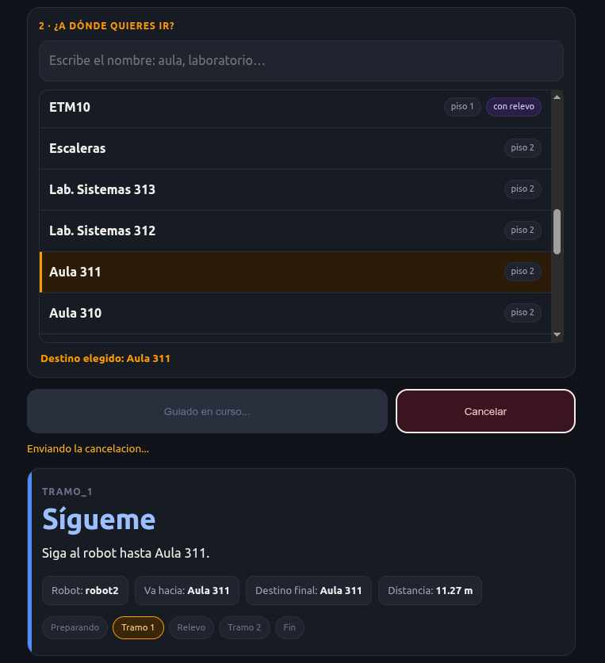

Proyecto de grado · Universidad Santo Tomás · 2026

# Dos robots que guían a una persona entre los pisos de un edificio

La persona pide su destino desde el teléfono. El robot de su piso la lleva hasta la escalera, y el robot del otro piso la recibe y termina el recorrido.

[Ver el proceso :material-timeline-text-outline:](proceso/index.md){ .md-button .md-button--primary }
[Ver los resultados :material-chart-box-outline:](resultados.md){ .md-button }
[Replicarlo :material-wrench-outline:](replicar.md){ .md-button }

<figure markdown>
{ width="380" }
<figcaption>La página del teléfono durante una misión.</figcaption>
</figure>

  

9 de 9

misiones con relevo completadas con los vehículos reales, en los pisos 3 y 4

  

26 de 30

misiones completadas en simulación; los 4 fallos fueron de precisión de llegada

  

0,87 s

mediana desde la solicitud hasta que el vehículo empieza a moverse

  

0,23 m

error de llegada mediano en los vehículos, según su localización

## Cómo funciona, en cuatro pasos

  
<strong>Pide su destino</strong>Desde el navegador del teléfono, sin instalar nada: elige dónde está y a dónde va.

  
<strong>El robot de su piso lo guía</strong>Va a recogerlo y lo lleva hasta la escalera.

  
<strong>Cambia de piso</strong>Sube o baja por su cuenta y lo confirma en el teléfono.

  
<strong>El otro robot termina</strong>El robot del piso de llegada ya lo espera en la escalera y lo lleva al destino.

[Ver la arquitectura y el relevo en detalle :material-arrow-right:](como-funciona.md)

## Cómo se llegó hasta aquí

El proyecto no salió en línea recta. Empezó con otra plataforma, en un simulador, con un seguidor de paredes que no funcionó, y llegó al edificio después de cambiar de piso, de computador de a bordo y de forma de medir. La sección [Proceso](proceso/index.md) cuenta ese camino con sus decisiones, sus errores y las pruebas que los resolvieron.

  
<strong>Simulación</strong>El vehículo en Gazebo, con su modelo de dirección tipo automóvil.

  
<strong>Coordinación</strong>El coordinador que asigna robots y organiza el relevo.

  
<strong>Interfaz</strong>La página web del teléfono.

  
<strong>Vehículos reales</strong>Dos AWS DeepRacer navegando el edificio.

  
<strong>Evaluación</strong>Treinta misiones en simulación y nueve con los vehículos.

