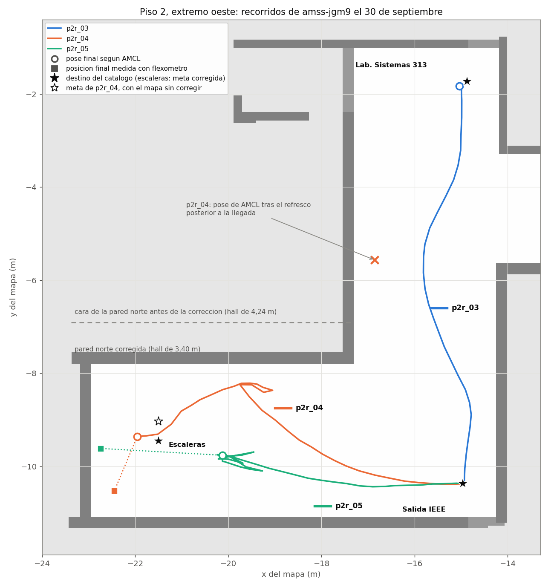
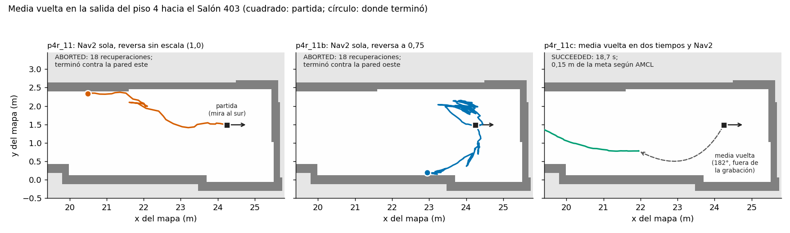
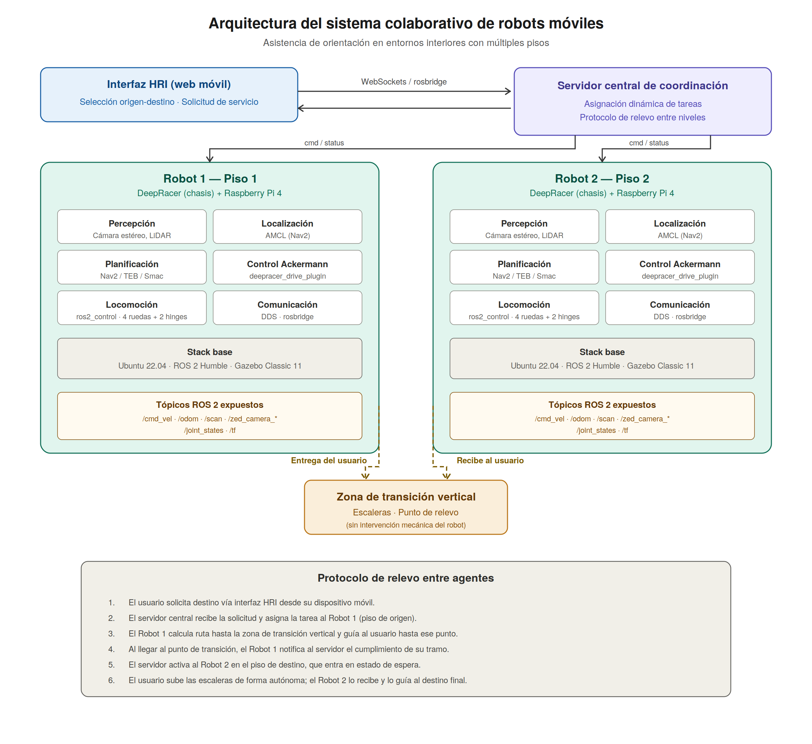

# Decisiones y cambios de rumbo

Varias decisiones del proyecto solo se entienden sabiendo qué se probó antes. Cada tarjeta muestra lo que había, lo que quedó y por qué se cambió.

## Plataforma y entorno

Marzo y abril

### De DonkeyCar a AWS DeepRacer

DonkeyCar, el vehículo del anteproyecto

→

Dos AWS DeepRacer de la universidad

<b>Por qué.</b> El ecosistema DonkeyCar no era compatible con ROS 2 reciente, su simulador no se integraba con ROS 2 y no había un modelo mantenido para Gazebo. El DeepRacer es la misma clase de vehículo (escala 1:18, dirección tipo automóvil), con modelo de simulación abierto. <b>Costo:</b> convivir con el software del fabricante.

Agosto

### Sin Raspberry Pi: la tarjeta original

Reemplazar el cómputo por una Raspberry Pi 4

→

Tarjeta original Intel, con Ubuntu 24.04 y ROS 2 Jazzy

<b>Por qué.</b> El software comunitario de ROS 2 funcionó sobre la tarjeta original. Para ella solo se publica con Jazzy, así que el sistema convive con dos distribuciones: Humble en el portátil y Jazzy en los vehículos.

Mayo y junio

### Del seguidor de paredes a la navegación con mapa

Seguir la pared con el láser

→

Mapa, localización y planificador (Nav2)

<b>Por qué.</b> En el pasillo estrecho de la universidad el vehículo, que no gira sobre su eje, oscilaba sin estabilizarse; en un pasillo ancho solo convergía por tramos.

2 de octubre

### De los pisos 1 y 2 a los pisos 3 y 4

Pasillos rectos y uniformes

→

Pasillo con salones, casilleros, ascensor y escalera

<b>Por qué.</b> El vehículo no tiene codificadores en las ruedas: mide su avance comparando barridos del láser. En un pasillo uniforme cada barrido es igual al anterior y el avance no se ve. Con ocho cambios de perfil en 25 m, la misma odometría quedó dentro del ±5 % <b>sin cambiar un parámetro</b>.

<figure markdown>

<figcaption>Hall del piso 2, 30 de septiembre: la localización se desplaza más de 2 m respecto de donde estaba el vehículo, medido con flexómetro. Fue la razón para cambiar de entorno.</figcaption>
</figure>

## Navegación de un vehículo que no gira sobre su eje

Agosto

### Nav2 configurado para un automóvil

Configuración por defecto, pensada para robots que giran en el sitio

→

Planificador híbrido con marcha atrás y control de persecución pura

<b>Por qué.</b> Las trayectorias por defecto incluían giros que el vehículo no puede hacer. Se quitó también la recuperación que gira sobre el eje: sin ese cambio, el vehículo movía las ruedas sin avanzar hasta agotar los reintentos.

5 de octubre

### El giroscopio que nadie usaba

Rumbo solo con el láser: derivaba hasta 5,9° por minuto

→

Unidad inercial + filtro: 0,3° por minuto o menos

<b>Por qué.</b> En un pasillo recto el láser pierde los giros igual que pierde el avance. La tarjeta traía una unidad inercial que el fabricante no usaba. Con el rumbo estable, el margen de llegada bajó de 1,0 a 0,5 m.

7 y 8 de octubre

### La media vuelta, una maniobra propia

Nav2 sola: abortaba contra la pared

→

Marcha atrás y avance alternados, con el láser y el mapa vigilando

<b>Por qué.</b> El siguiente usuario suele estar detrás del vehículo, y en pasillos de 2,5 m la planificación cambiaba de maniobra cada segundo. La maniobra propia giró 160° y 167° en un solo tiempo.

<figure markdown>

<figcaption>Media vuelta en la salida del piso 4. A la izquierda y al centro, la navegación sola aborta contra la pared con 18 recuperaciones. A la derecha, la media vuelta en dos tiempos y luego la navegación: llega en 18,7 s.</figcaption>
</figure>

## Sistema y evaluación

Agosto

### El relevo, escrito como función pura

Probar el relevo levantando dos simuladores

→

Un planificador sin ROS que se prueba en milisegundos

<b>Por qué.</b> Como función pura, la prueba recorre las 930 combinaciones de origen y destino del catálogo. Encontró un defecto que la simulación no habría mostrado: un robot enviado dos veces al mismo punto.

22 de agosto

### Medir contra la posición, no contra «llegué»

Éxito = la navegación dice que llegó

→

Éxito = la posición queda dentro de la tolerancia

<b>Por qué.</b> Una de las tres primeras metas en simulación dijo «llegué» con el vehículo a 0,296 m del destino. Aceptarlo sería dejar que el sistema se evalúe a sí mismo.

Septiembre

### Equilibrar la campaña por piso

Misiones con relevo siempre por el piso 2

→

Cuatro grupos equilibrados por piso

<b>Por qué.</b> Con diez misiones corridas se vio que el efecto del relevo y el del piso se confundían. El diseño se corrigió y la corrección quedó escrita en el protocolo.

9 de octubre

### Coordinador en el portátil y topología en estrella

Coordinador en un vehículo, todos hablando con todos

→

Coordinador en el portátil; cada vehículo solo habla con él

<b>Por qué.</b> Con los dos vehículos, unos cuarenta procesos se anunciaban por la red inalámbrica y la carga de una tarjeta subió de 6 a entre 17 y 33. Navegando, las tarjetas quedaron al 68 % y 74 %.

13 de octubre

### Esperar 1,5 s antes de verificar la llegada

Verificar al instante en que la navegación termina

→

Esperar a que el vehículo se detenga

<b>Por qué.</b> En la última orden de avance el vehículo estaba a 0,53–0,62 m de la meta, y un segundo después, ya quieto, a 0,09–0,53 m. Verificando al instante se habrían rechazado llegadas buenas.

??? note "El diseño inicial de la arquitectura"
    Así se planteó la arquitectura al empezar: Raspberry Pi en cada vehículo y los pisos 1 y 2. La estructura (coordinador, dos agentes, zona de relevo) se mantuvo; cambiaron la plataforma de cómputo, el sitio y la topología de red.

    
