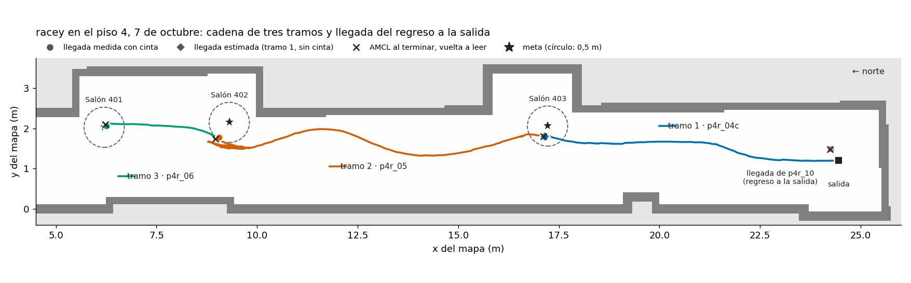

# Pruebas de verificación

La demostración con los vehículos se organizó como una escalera de seis pruebas. Cada una tiene un criterio escrito antes de correrla, y la siguiente solo tiene sentido si la anterior se superó. Los criterios los propusieron los autores y los decidió el director; después de la última fecha de revisión, el 16 de octubre, no se tomaron más datos.

  

Prueba 1 · 22 de septiembre
<h3>Actuación</h3>
El vehículo responde a las órdenes de dirección y tracción.

Superada Los dos vehículos completaron la prueba de actuación entera.

  

Prueba 2 · 2 de octubre
<h3>Odometría</h3>
Error de 10 % o menos sobre un recorrido conocido de 5 m o más.

Superada +3,3 % sobre 14,57 m y −4,6 % sobre 6,68 m, con flexómetro.

  

Prueba 3 · 7 de octubre
<h3>Navegación de un vehículo</h3>
Un recorrido de punto a punto con la llegada verificada a 0,5 m o menos.

Superada Tres tramos encadenados; llegadas medidas a 0,06 m y 0,45 m.

  

Prueba 4 · 22 de septiembre
<h3>Dos vehículos en la misma red</h3>
Los dos vehículos y el coordinador coexisten sin conflicto de nombres.

Superada Se adelantó porque no dependía de la odometría.

  

Prueba 5 · 16 de octubre
<h3>Misión con relevo</h3>
Una misión con relevo de extremo a extremo sobre los dos vehículos, con su registro.

Superada Salón 302 → Salón 402 en 132,5 s.

  

Prueba 6 · 16 de octubre
<h3>Campaña con los vehículos</h3>
Entre 5 y 10 misiones del protocolo completo, con su registro.

Superada 9 misiones del sorteo completadas. <a href="../../resultados/#con-los-vehiculos">Ver resultados</a>

## La odometría, el paso del que dependía todo

El vehículo no tiene codificadores en las ruedas. Su avance sale de comparar barridos del láser, y durante meses esa medida no sirvió. La gráfica muestra la fracción del avance real que registró, medida con flexómetro, en cada entorno. La franja verde es el criterio de la prueba: entre 90 % y 110 %.

En un pasillo recto y uniforme, cada barrido es casi igual al anterior y la información de avance no está en la señal: ningún ajuste del algoritmo la recupera. Por eso la solución fue cambiar de entorno, a un pasillo con hornacinas, casilleros y quiebres.

## La navegación y la precisión de llegada

En la primera sesión en el piso 4 las dos llegadas medidas quedaron a 0,57 y 0,62 m, cortas: la navegación daba la meta por alcanzada a 1,0 m. Con la unidad inercial el margen bajó a 0,5 m, y en la sesión siguiente un vehículo encadenó tres tramos sin que nadie lo tocara.

<figure markdown>

<figcaption>Piso 4, 7 de octubre: tres tramos encadenados (Salón 403, 402 y 401) y el regreso a la salida. Los círculos marcan la tolerancia de 0,5 m.</figcaption>
</figure>

| Tramo | Destino | Tiempo | Recuperaciones | Distancia a la meta | Cómo se midió |
|---|---|---|---|---|---|
| 1 | Salón 403 | 13,5 s | 1 | 0,26 m | estimada |
| 2 | Salón 402 | 27,8 s | 1 | 0,45 m | flexómetro |
| 3 | Salón 401 | 5,2 s | 0 | 0,06 m | flexómetro |
| Regreso | Salida | 62,8 s | 6 | 0,34 m | flexómetro |

!!! warning "Lo que limita la precisión"
    El vehículo no se mueve con órdenes por debajo de 0,40 m/s, así que se aproxima a la meta a esa velocidad y no tiene un régimen de aproximación fina. Es un límite de la plataforma, no del controlador.
