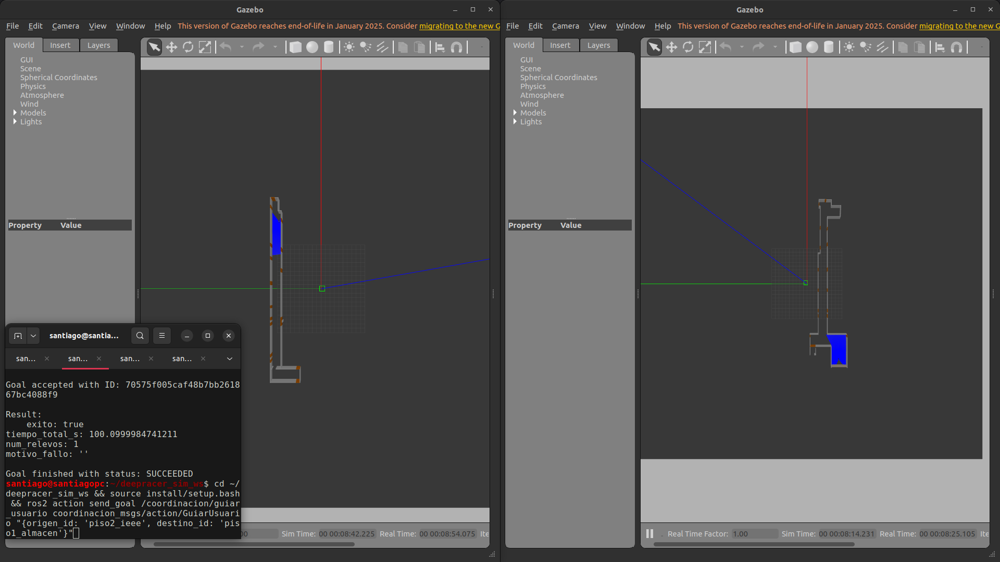

# Resultados

Hubo dos campañas, y se reportan por separado porque miden cosas distintas. La de **simulación** mide el sistema completo con relevo en condiciones controladas. La de los **vehículos** mide hasta dónde llega la plataforma física en el edificio.

## La tasa de éxito

Una misión cuenta como exitosa si termina sin fallar, con un relevo cuando es entre pisos, y con el vehículo a menos de la tolerancia del destino: 0,25 m en simulación y 0,5 m en los vehículos. El punto es la tasa observada; la línea, el intervalo de confianza del 95 % (Wilson).

!!! abstract "Lo que se puede afirmar"
    Con estas muestras, que la tasa de éxito **supera el 70 %**, en simulación y con los vehículos. Nada más estrecho: con 30 misiones el intervalo mide 24 puntos de ancho, y eso solo se reduce con más repeticiones. Los intervalos de las misiones con y sin relevo se solapan, así que no se puede decir que una sea mejor que la otra.

Los cuatro fallos de la simulación se quedaron cortos: a 0,295, 0,284, 0,311 y 0,347 m del destino, frente a 0,25 m. Ninguno fue de coordinación; los cuatro son de precisión en la aproximación final.

## En simulación

**Lo que dicen estos números**

- El robot arranca en **menos de medio segundo** en las 30 misiones.
- La **asignación** del robot tarda tan poco que el reloj de la simulación no la ve. Medida aparte con el reloj del sistema: mediana entre 154 y 175 µs, máximo 306 µs.
- El **error de llegada** tiene mediana de 0,106 m, entre 0,019 y 0,347 m.
- La simulación corrió a tiempo real: factor mínimo de 0,9917 en las 30 misiones.

<figure markdown>

<figcaption>Una misión con relevo en simulación: cada piso corre en su propio proceso, y el coordinador reparte los tramos.</figcaption>
</figure>

## Con los vehículos

Nueve misiones del sorteo, en su orden y sin reubicar los vehículos entre una y otra, entre los pisos 3 y 4 del edificio. Todas con relevo en la escalera.

  

87,6 s

duración mediana de una misión entre pisos

  

0,87 s

mediana desde la solicitud hasta el primer movimiento

  

0,3 ms

en asignar el robot, con el reloj del portátil

  

9 de 9

misiones sin interrupción del guiado en el relevo

!!! warning "Cómo leer estas cifras"
    - En esta campaña la llegada no se midió con flexómetro: la distancia es la que estima la localización del propio vehículo. Como referencia, el 7 de octubre esa localización quedó a 0,10 m o menos del flexómetro en el avance.
    - Las misiones 1 y 2 se completaron en un segundo intento: el primero de la 1 terminó a 0,526 m del destino, fuera de la tolerancia, y el de la 2 sin poder verificar la llegada. Por decisión del equipo, la tasa cuenta una corrida por misión.
    - Antes de la primera misión válida, la navegación de los dos vehículos se detuvo y hubo que reiniciarla; la causa no se estableció.
    - La misión 10 no terminó: el computador del coordinador se apagó por batería.
