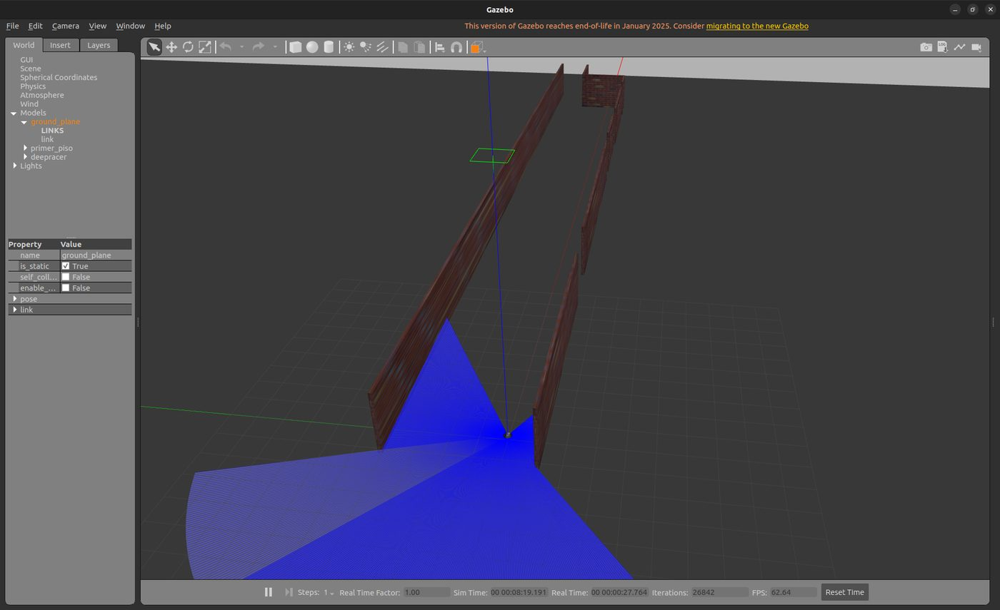
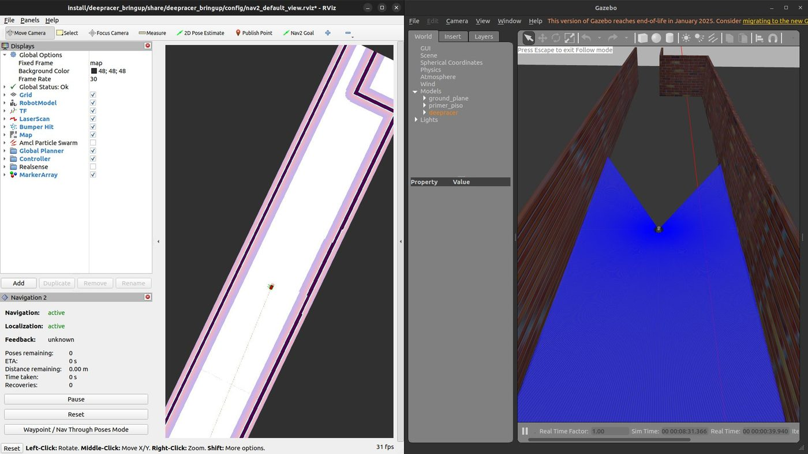
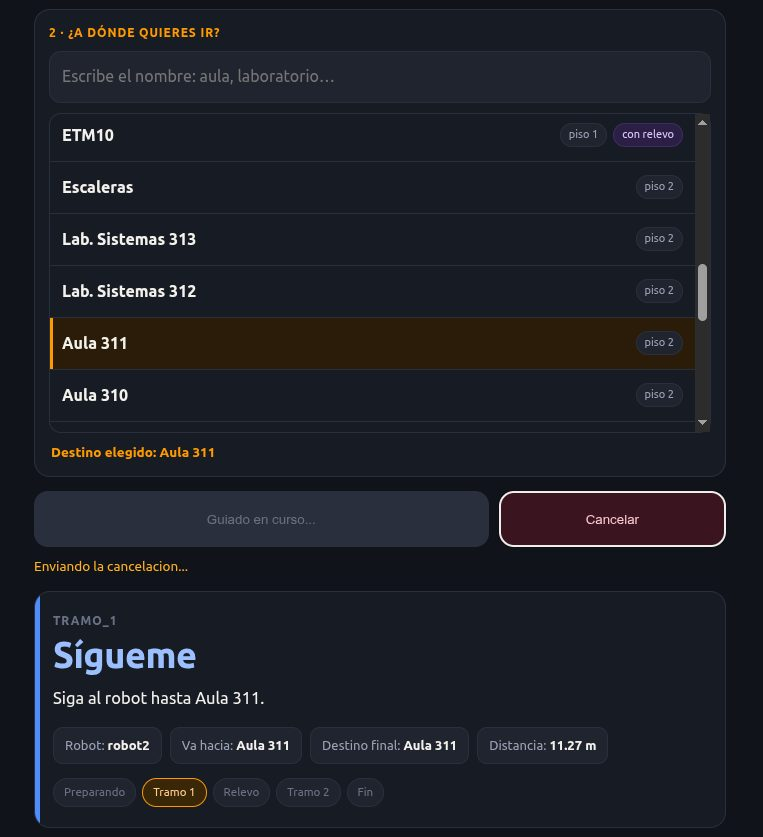
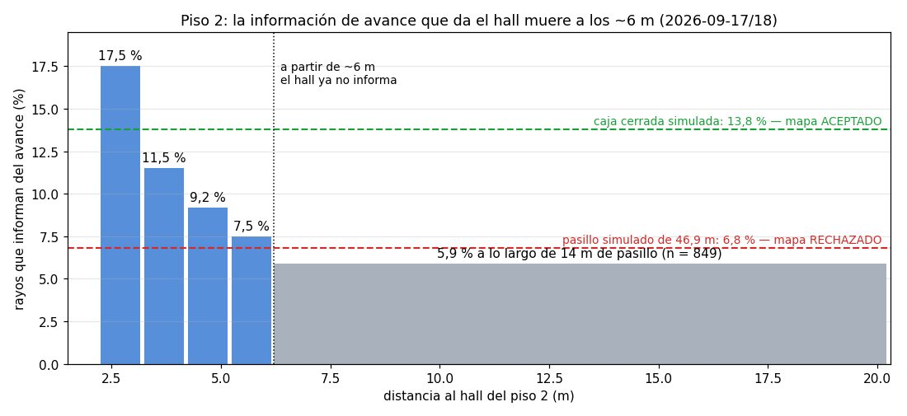
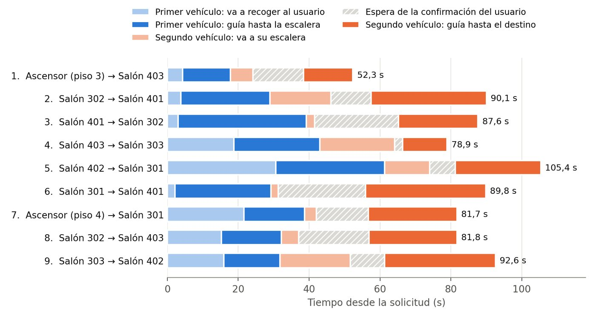

# Semana a semana

Cada semana tiene su página con lo que se hizo, las imágenes y lo que se concluyó. El detalle completo está en el informe de la semana, enlazado al final de cada página.

### Fases 2 y 3 · requisitos y diseño conceptual

<a class="semana-tarjeta" href="s10/">Semana 10 · abrilLimitaciones de la plataforma DonkeyCar</a>
<a class="semana-tarjeta" href="s11/">Semana 11 · abrilModelo propio del DonkeyCar y primera arquitectura</a>
<a class="semana-tarjeta" href="s12/">Semana 12 · abrilAdopción del modelo AWS DeepRacer y migración a ROS 2 Humble</a>

### Fase 4 · desarrollo progresivo de la solución

<a class="semana-tarjeta" href="s13/">Semana 13 · mayoPrimeros entornos y seguidor de paredes</a>
<a class="semana-tarjeta" href="s14/">Semana 14 · mayoSensores en el modelo del primer piso</a>
<a class="semana-tarjeta" href="s15/">Semana 15 · mayoPrimer mapa con SLAM</a>
<a class="semana-tarjeta" href="s16/">Semana 16 · junioReceso de mitad de año</a>

### Fase 5 · integración del sistema y pruebas

<a class="semana-tarjeta" href="s17/">Semana 17 · 3 al 9 de agostoVehículo físico liberado y Nav2 en Humble</a>
<a class="semana-tarjeta" href="s18/">Semana 18 · 10 al 16 de agostoDos agentes aislados y entorno de dos niveles</a>
<a class="semana-tarjeta" href="s19/">Semana 19 · 17 al 23 de agostoDiagnóstico del vehículo y protocolo</a>
<a class="semana-tarjeta" href="s20/">Semana 20 · 24 al 30 de agostoCoordinador, primera misión y relevo en simulación</a>
<a class="semana-tarjeta" href="s21/">Semana 21 · 31 de agosto al 6 de septiembreCampaña de treinta misiones</a>
<a class="semana-tarjeta" href="s22/">Semana 22 · 7 al 13 de septiembreInterfaz en el teléfono e información de avance</a>
<a class="semana-tarjeta" href="s23/">Semana 23 · 14 al 20 de septiembreSegundo vehículo y congelación del código</a>
<a class="semana-tarjeta" href="s24/">Semana 24 · 21 al 27 de septiembreDecisión de la demostración física y navegación real</a>
<a class="semana-tarjeta" href="s25/">Semana 25 · 28 de septiembre al 4 de octubreAislamiento, piso 2 y paso a los pisos 3 y 4</a>
<a class="semana-tarjeta" href="s26/">Semana 26 · 5 al 11 de octubreUnidad inercial, red, llegada verificada y coordinador al portátil</a>

### Fase 6 · campaña, análisis y escritura

<a class="semana-tarjeta" href="s27/">Semana 27 · 12 al 18 de octubreCampaña con los dos vehículos</a>
<a class="semana-tarjeta" href="s28/">Semana 28 · desde el 19 de octubreDocumento final</a>

