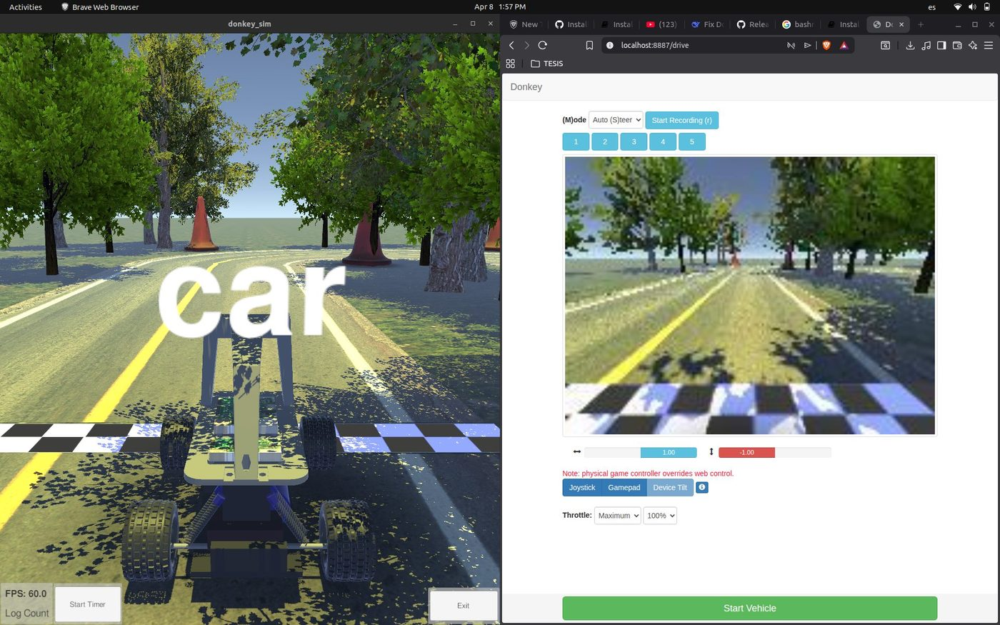

Fases 2 y 3 · requisitos y diseño conceptual

# Semana 10: Limitaciones de la plataforma DonkeyCar

Abril de 2026

## Lo que se hizo

- Se instaló y se manejó el simulador de DonkeyCar: un entorno de Unity con una pista exterior, conducido desde la interfaz web del propio DonkeyCar, con la imagen de la cámara del vehículo.
- El análisis encontró tres limitaciones. El ecosistema DonkeyCar no se actualiza desde hace años y no es compatible con las versiones recientes de ROS 2. Su simulador no se integra con ROS 2, de modo que no permite probar mapeo, localización ni planificación. Y sin ROS 2 en el simulador no se puede montar la comunicación entre robots ni la coordinación central.
- Conclusión de la semana: el hardware DonkeyCar o DeepRacer sigue siendo posible, pero la simulación tiene que salir del ecosistema DonkeyCar hacia un simulador compatible con ROS 2.
- Se fijaron los criterios para elegir simulador: ROS 2 Humble o posterior, vehículos con dirección Ackermann, entornos interiores, SLAM y navegación. Candidatos: CoppeliaSim (el del anteproyecto), Gazebo y RViz como visualizador.
- Se mantuvo ROS 2 Humble sobre Ubuntu 22.04 como base, y la restricción de no intervenir el edificio.

## En imágenes

<figure markdown>
[{ loading=lazy }](img/s10_1.jpg)
<figcaption>Simulador de DonkeyCar con su interfaz web de conducción</figcaption>
</figure>

## Lo que se concluyó

Durante la Semana 10 se profundizó en el análisis técnico de la plataforma propuesta, identificando que el ecosistema de simulación propio del DonkeyCar no es compatible con los requerimientos de desarrollo basado en ROS 2. Esta conclusión orienta la búsqueda hacia herramientas de simulación estándar del ecosistema ROS 2 como CoppeliaSim y Gazebo, que permitan modelar tanto el comportamiento de los vehículos con cinemática Ackermann como el entorno interior de prueba. La exploración iniciada esta semana sienta las bases para la toma de decisiones de la Fase 3, en particular la definición de la arquitectura general del sistema y la selección del entorno de simulación. Estas decisiones se formalizarán en las semanas S11–S12 conforme al cronograma del anteproyecto.

## Para leer en detalle

[Informe en PDF](https://github.com/shdeza12/Collaborative-Mobile-Robot-System-for-Indoor-Navigation-Assistance-in-Multi-Level-Environments/blob/main/Documentos/Entregables/Entregable_semana_10.pdf){ .md-button }

[Todas las semanas](index.md) · [Semana 11 :material-arrow-right:](s11.md)

