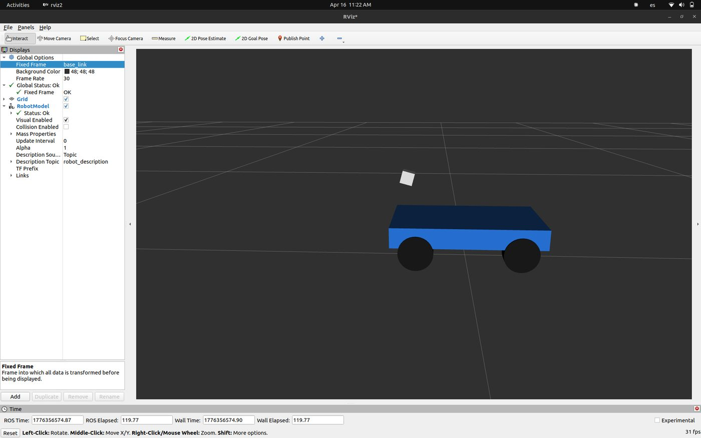
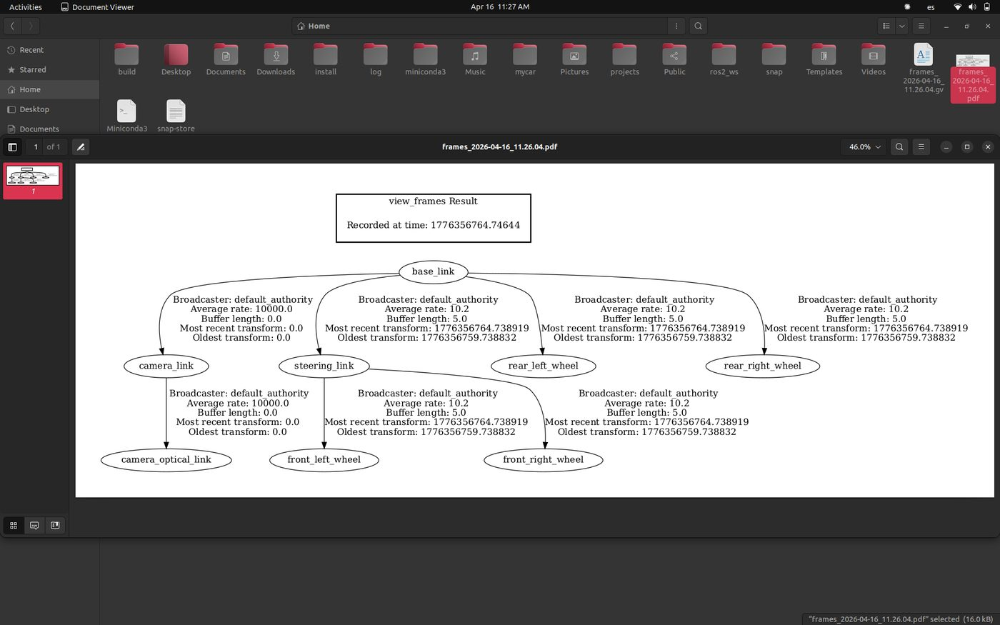
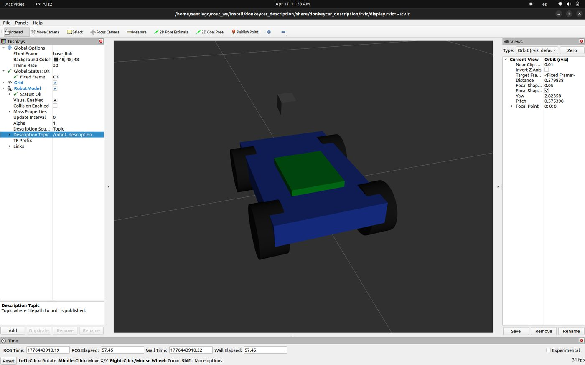
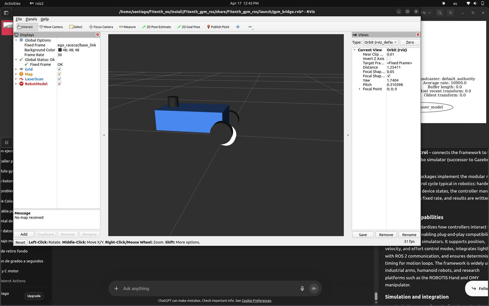
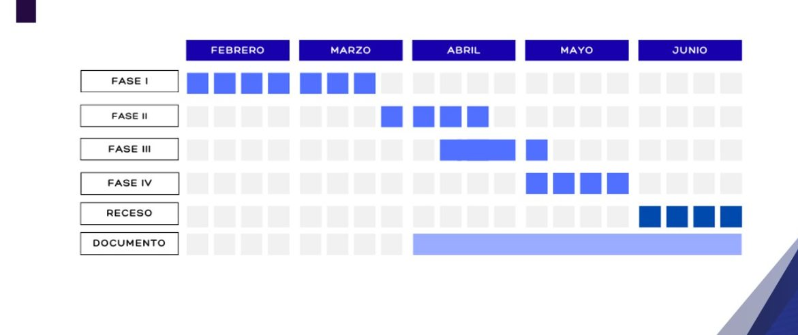

Fases 2 y 3 · requisitos y diseño conceptual

# Semana 11: Modelo propio del DonkeyCar y primera arquitectura

Abril de 2026

## Lo que se hizo

- Se empezó un modelo propio del DonkeyCar para ROS 2 (paquete `donkeycar_description`): el chasis, las cuatro ruedas y la dirección en RViz, con su árbol de transformaciones.
- Se probó el simulador de F1TENTH con RViz como alternativa.
- Decisión de la semana: mantener el chasis tipo DonkeyCar con dirección Ackermann. Como el cambio de piso es por escalera y cada robot atiende un piso, el vehículo no tiene que entrar a un ascensor.
- La maniobra de regreso del vehículo se dejó a planificadores con restricciones de automóvil (TEB o Smac), capaces de dar la vuelta en varios tiempos dentro del pasillo.
- Arquitectura: servidor central, y panel web en HTML y JavaScript que habla con ROS 2 por `rosbridge`.
- Se empezó a modelar el pasillo de la universidad con el editor de edificios de Gazebo, para comprobar en simulación que el radio de giro alcanza.

## En imágenes

<figure markdown>
[{ loading=lazy }](img/s11_1.jpg)
<figcaption>Primer modelo URDF del DonkeyCar en RViz</figcaption>
</figure>

<figure markdown>
[{ loading=lazy }](img/s11_2.jpg)
<figcaption>Árbol de transformaciones (view_frames) del modelo del DonkeyCar</figcaption>
</figure>

<figure markdown>
[{ loading=lazy }](img/s11_3.jpg)
<figcaption>Modelo del DonkeyCar con ruedas y dirección en RViz</figcaption>
</figure>

<figure markdown>
[{ loading=lazy }](img/s11_4.jpg)
<figcaption>Simulador F1TENTH (gym_ros) en RViz, evaluado como alternativa</figcaption>
</figure>

<figure markdown>
[{ loading=lazy }](img/s11_5.jpg)
<figcaption>Cronograma por fases del primer semestre (febrero a junio)</figcaption>
</figure>

## Lo que se concluyó

La definición de la transición por escaleras mediante relevo de guía ha permitido validar la arquitectura física del DonkeyCar, eliminando la necesidad de cambios mecánicos complejos. La próxima semana se procederá al cierre de la Fase 3 con la generación del mapa 2D definitivo mediante técnicas de SLAM sobre el entorno modelado en Gazebo, preparando el terreno para la Fase de Implementación.

## Para leer en detalle

[Informe en PDF](https://github.com/shdeza12/Collaborative-Mobile-Robot-System-for-Indoor-Navigation-Assistance-in-Multi-Level-Environments/blob/main/Documentos/Entregables/Entregable_semana_11.pdf){ .md-button }

[:material-arrow-left: Semana 10](s10.md) · [Todas las semanas](index.md) · [Semana 12 :material-arrow-right:](s12.md)

