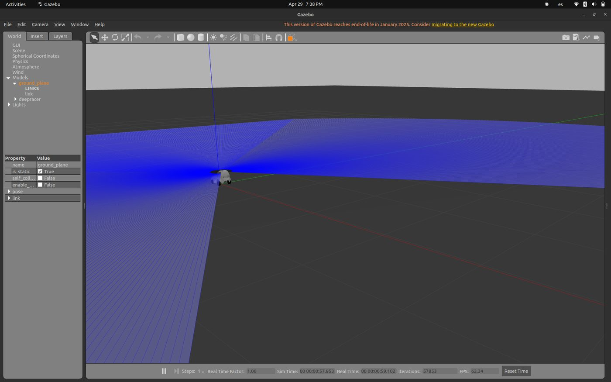
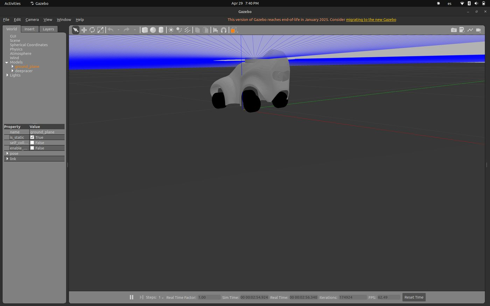
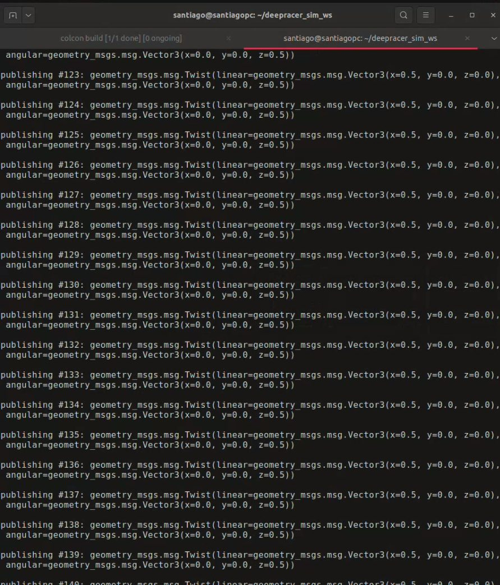
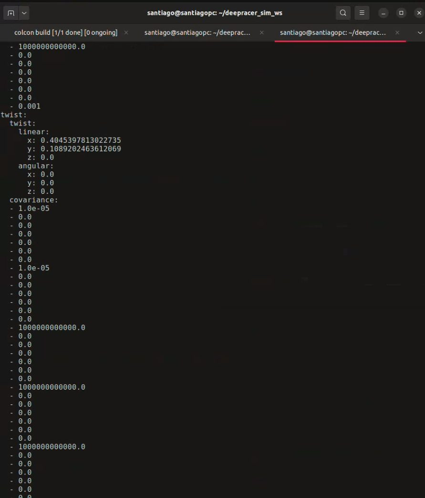
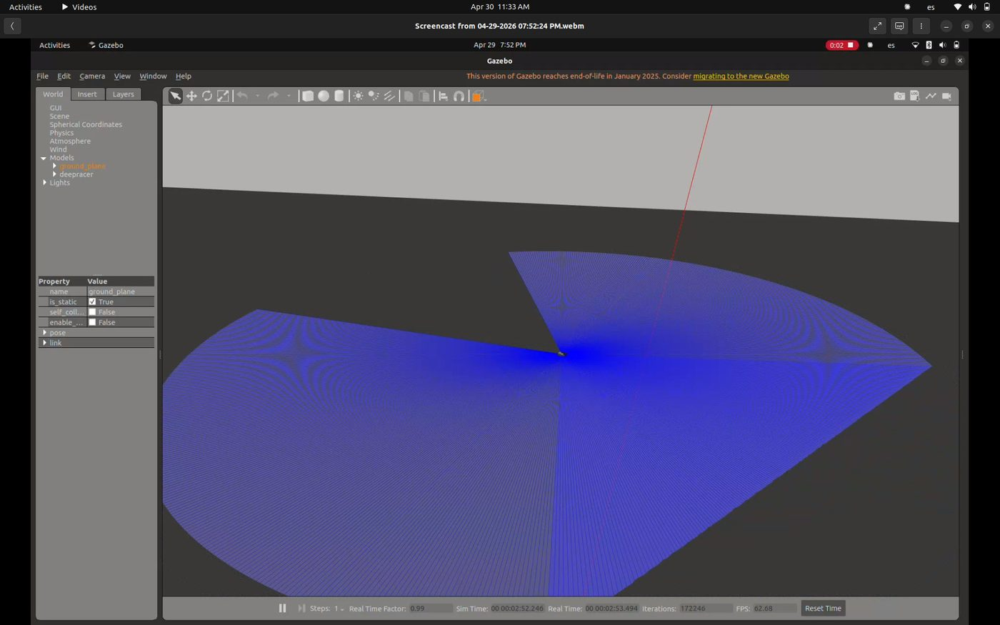
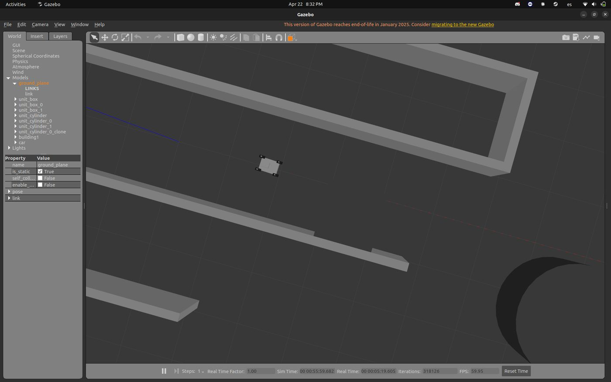

Fases 2 y 3 · requisitos y diseño conceptual

# Semana 12: Adopción del modelo AWS DeepRacer y migración a ROS 2 Humble

Abril de 2026

## Lo que se hizo

- Se cambió el modelo de simulación al AWS DeepRacer por tres razones: no existía un modelo del DonkeyCar para Gazebo con Ackermann, mantenido y funcional en Humble; el DeepRacer es un vehículo Ackermann a escala 1:18 con LiDAR y cámaras; y AWS publicó en código abierto su descripción del vehículo, el complemento de cinemática Ackermann para Gazebo y la configuración de Gazebo Classic.
- Plan de entonces: conservar el chasis del DeepRacer y cambiar su tarjeta Intel por una Raspberry Pi 4 con Humble.
- Migración de Foxy (Ubuntu 20.04) a Humble (Ubuntu 22.04), paquete por paquete. Tres cambios por la evolución de `ros2_control`: `--set-state start` pasa a `active` en dos lanzadores, y `joint_state_controller` pasa a `joint_state_broadcaster`. Los seis paquetes compilaron sin errores, con avisos por una cabecera obsoleta en el complemento Ackermann.
- Validación sobre un mundo vacío: el vehículo aparece con el LiDAR y la cámara publicando, a 62 FPS y con factor de tiempo real 1,00; los siete controladores quedan activos (publicador de estado, cuatro ruedas y dos articulaciones de dirección); el vehículo responde a las órdenes de velocidad; y la odometría da 0,40 m/s para 0,5 m/s ordenados.
- Cierre de la fase de diseño: diagrama de arquitectura, tabla de módulos (percepción, localización, planificación, control, locomoción, comunicación, coordinación e interfaz) y el escenario de relevo en siete pasos. Los dos robots se distinguirían por espacio de nombres (`/robot1`, `/robot2`).
- Primer commit con el código: «Add Robot/: AWS DeepRacer migrated to ROS 2 Humble» (30 de abril).

## En imágenes

<figure markdown>
[{ loading=lazy }](img/s12_1.jpg)
<figcaption>El DeepRacer en Gazebo con el barrido del LiDAR</figcaption>
</figure>

<figure markdown>
[{ loading=lazy }](img/s12_2.jpg)
<figcaption>Vista cercana del vehículo y el abanico del LiDAR</figcaption>
</figure>

<figure markdown>
[{ loading=lazy }](img/s12_3.jpg)
<figcaption>Terminal publicando en /cmd_vel</figcaption>
</figure>

<figure markdown>
[{ loading=lazy }](img/s12_4.jpg)
<figcaption>Terminal con ros2 topic echo /odom</figcaption>
</figure>

<figure markdown>
[{ loading=lazy }](img/s12_5.jpg)
<figcaption>Barrido del LiDAR en una grabación de pantalla</figcaption>
</figure>

<figure markdown>
[{ loading=lazy }](img/s12_6.jpg)
<figcaption>Vehículo de prueba en un entorno de pasillos en Gazebo</figcaption>
</figure>

## Lo que se concluyó

La Fase 3 del proyecto se cierra con el bloqueo técnico de simulación resuelto y la arquitectura del sistema consolidada conceptualmente. La adopción del stack open source de AWS DeepRacer, complementada con el reemplazo de la unidad de cómputo por una Raspberry Pi 4, permite mantener los principios de bajo costo y código abierto del anteproyecto al mismo tiempo que asegura la viabilidad técnica del desarrollo en ROS 2 Humble. La validación experimental realizada esta semana confirma que la cadena completa de control y simulación es funcional: desde la publicación de comandos de velocidad hasta la respuesta física del modelo y la lectura de odometría. Esto establece una base técnica sólida para el inicio inmediato de la Fase 4 en la Semana 13, donde se procederá con el modelado del entorno universitario y la instanciación simultánea de los dos agentes que permitirá validar el comportamiento colaborativo del sistema.

## Para leer en detalle

[Informe en PDF](https://github.com/shdeza12/Collaborative-Mobile-Robot-System-for-Indoor-Navigation-Assistance-in-Multi-Level-Environments/blob/main/Documentos/Entregables/Entregable_semana_12.pdf){ .md-button }

[:material-arrow-left: Semana 11](s11.md) · [Todas las semanas](index.md) · [Semana 13 :material-arrow-right:](s13.md)

