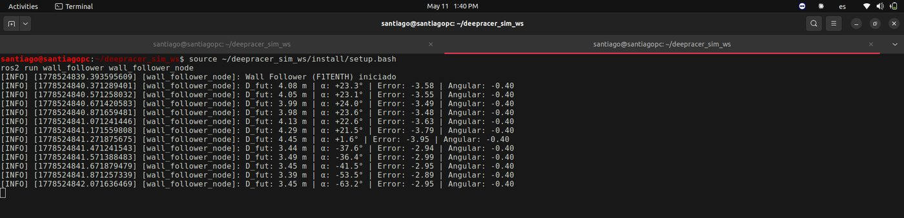
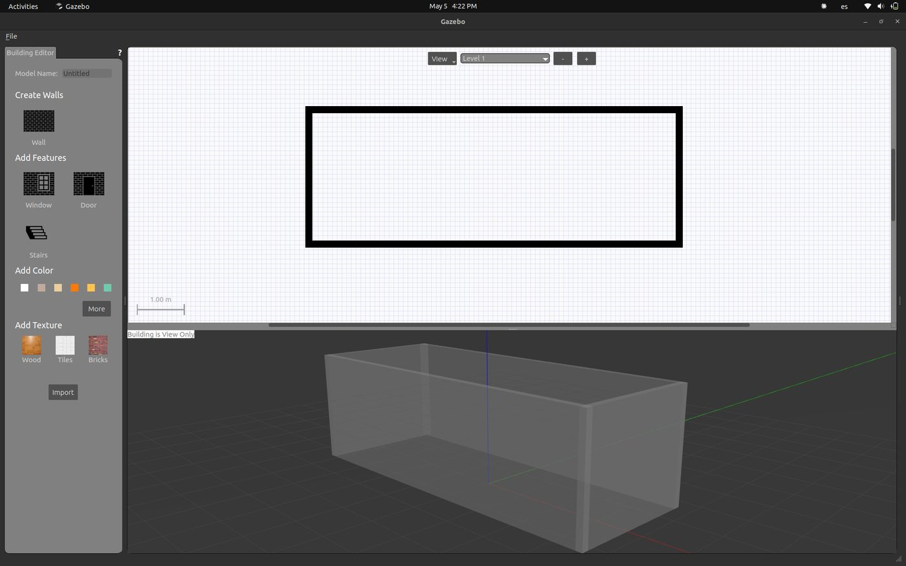
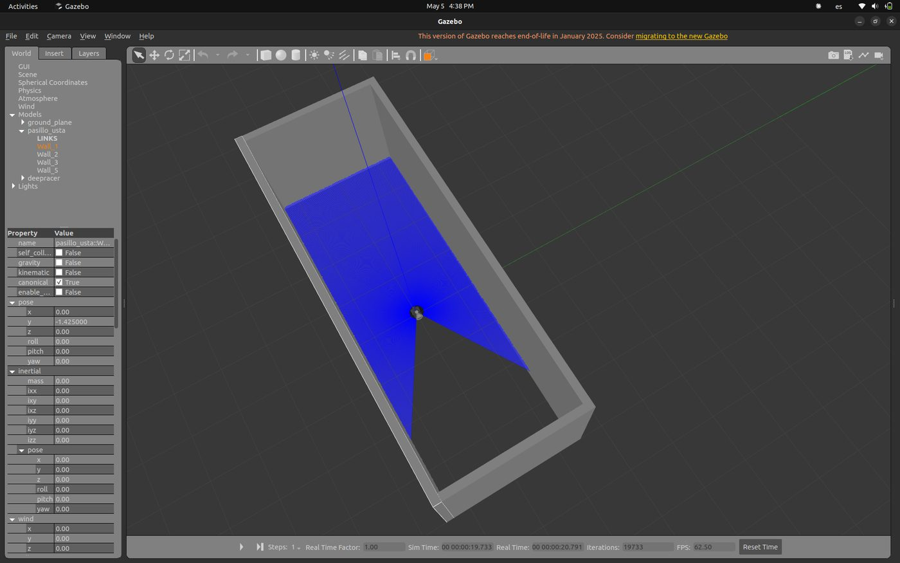
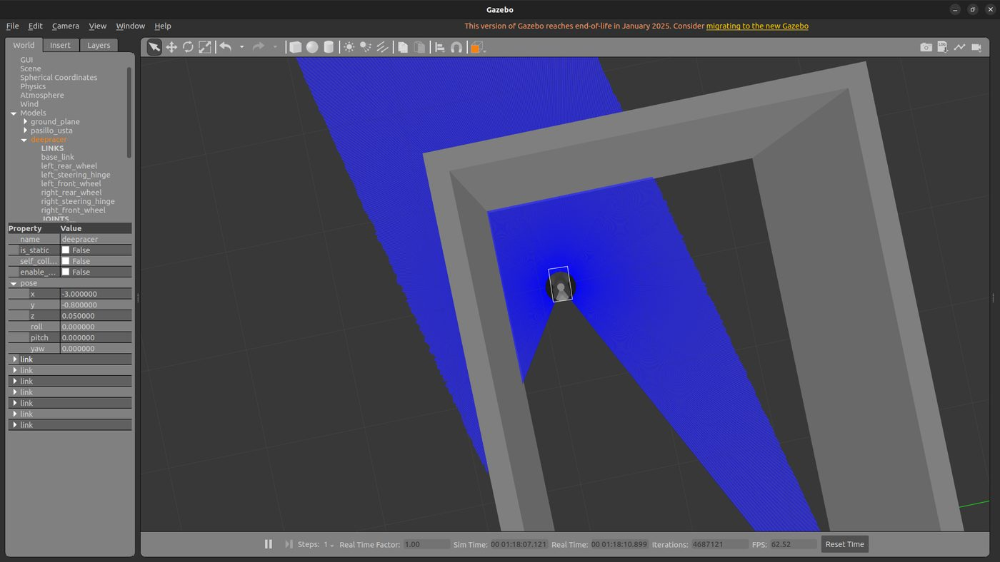
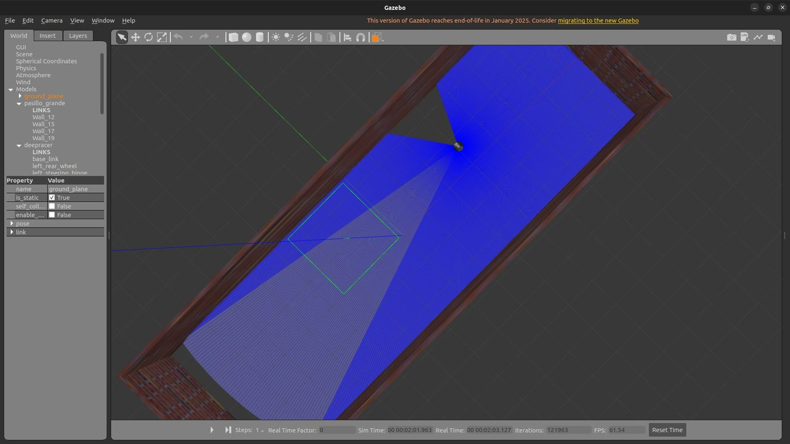

Fase 4 · desarrollo progresivo de la solución

# Semana 13: Primeros entornos y seguidor de paredes

Mayo de 2026

## Lo que se hizo

- Pasillo de la universidad en Gazebo, de 7 × 3 m, hecho con el editor de edificios; después uno ampliado de 15 × 5 m. El DeepRacer migrado se probó dentro, teleoperado.
- Seguidor de paredes, sugerido por la dirección como ejercicio de integración entre el LiDAR y la cinemática Ackermann. Primero con control proporcional-derivativo sobre un rayo lateral, que saturaba y no veía la orientación respecto a la pared. Después con la técnica de dos rayos del curso F1TENTH (objetivo 0,5 m de la pared, anticipación de 1,0 m, 0,5 m/s).
- Resultado: en el pasillo de 7 × 3 m no se estabilizó con ninguna sintonía (giros saturados, círculos y choques), porque el radio de giro deja poco margen en 3 m de ancho. En el de 15 × 5 m convergió por tramos, alrededor de 0,76 m de la pared, y se perdía en los extremos.
- Conclusión: un comportamiento reactivo no anticipa las restricciones de un vehículo Ackermann en espacios estrechos. El trabajo pasa a la navegación con mapa (SLAM, AMCL, puntos de interés y un planificador para automóvil).
- Se evaluó `deepracer-custom-car`, de la comunidad del DeepRacer: lleva el software del vehículo a Raspberry Pi 4 (Humble) o Pi 5 (Jazzy), con soporte del LiDAR, y no trae nada de simulación. Quedó para la fase física.

## En imágenes

<figure markdown>
[{ loading=lazy }](img/s13_1.jpg)
<figcaption>El vehículo dentro del modelo del pasillo</figcaption>
</figure>

<figure markdown>
[{ loading=lazy }](img/s13_2.jpg)
<figcaption>Registro de convergencia del wall-follower</figcaption>
</figure>

<figure markdown>
[{ loading=lazy }](img/s13_3.jpg)
<figcaption>Editor de edificios de Gazebo con el primer muro del pasillo</figcaption>
</figure>

<figure markdown>
[{ loading=lazy }](img/s13_4.jpg)
<figcaption>Modelo del pasillo USTA con el barrido del LiDAR del vehículo</figcaption>
</figure>

<figure markdown>
[{ loading=lazy }](img/s13_5.jpg)
<figcaption>DeepRacer en el pasillo USTA simulado, con su LiDAR</figcaption>
</figure>

<figure markdown>
[{ loading=lazy }](img/s13_6.jpg)
<figcaption>Pasillo grande (15 x 5 m) con texturas y el LiDAR del vehículo</figcaption>
</figure>

## Lo que se concluyó

La Semana 13 entregó tres resultados verificables: el gemelo digital del pasillo de la Universidad Santo Tomás funcional en Gazebo Classic 11, una implementación del wall follower con la técnica F1TENTH evaluada experimentalmente, y la formalización del uso de dos repositorios complementarios para las fases de simulación y de hardware real. El ejercicio del wall follower arrojó resultados parciales: el algoritmo F1TENTH no logró un comportamiento estable en el pasillo original (7 m × 3 m) debido a la combinación entre las restricciones cinemáticas del DeepRacer y el ancho disponible del entorno. En un pasillo ampliado (15 m × 5 m) generado específicamente para evaluar el algoritmo, se observó convergencia parcial hacia la distancia objetivo durante segmentos del recorrido, sin que el comportamiento se mantuviera estable durante el recorrido completo. Este resultado, aunque 11 no produce un demo de wall following plenamente funcional, aporta evidencia técnica relevante respecto a las limitaciones de los comportamientos reactivos sobre vehículos Ackermann en espacios estrechos. La principal lección de la semana es que la línea de exploración hacia el sistema final requiere apartarse del enfoque puramente reactivo y avanzar hacia enfoques que aprovechen información global del entorno. Para la Semana 14 se propone iniciar esta exploración mediante la generación de un mapa 2D del entorno virtual con técnicas de SLAM, evaluando experimentalmente su comportamiento sobre el DeepRacer simulado. Las decisiones sobre las herramientas específicas que conformarán la arquitectura final de navegación se irán tomando progresivamente a partir de los resultados experimentales obtenidos en las semanas siguientes.

## Para leer en detalle

[Informe en PDF](https://github.com/shdeza12/Collaborative-Mobile-Robot-System-for-Indoor-Navigation-Assistance-in-Multi-Level-Environments/blob/main/Documentos/Entregables/Entregable_semana_13.pdf){ .md-button }

[:material-arrow-left: Semana 12](s12.md) · [Todas las semanas](index.md) · [Semana 14 :material-arrow-right:](s14.md)

