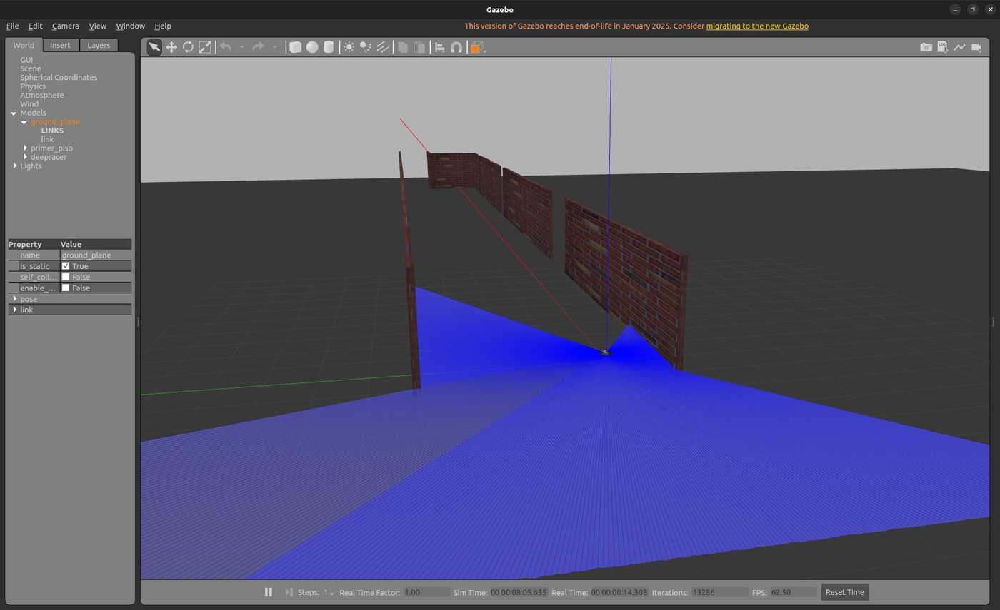
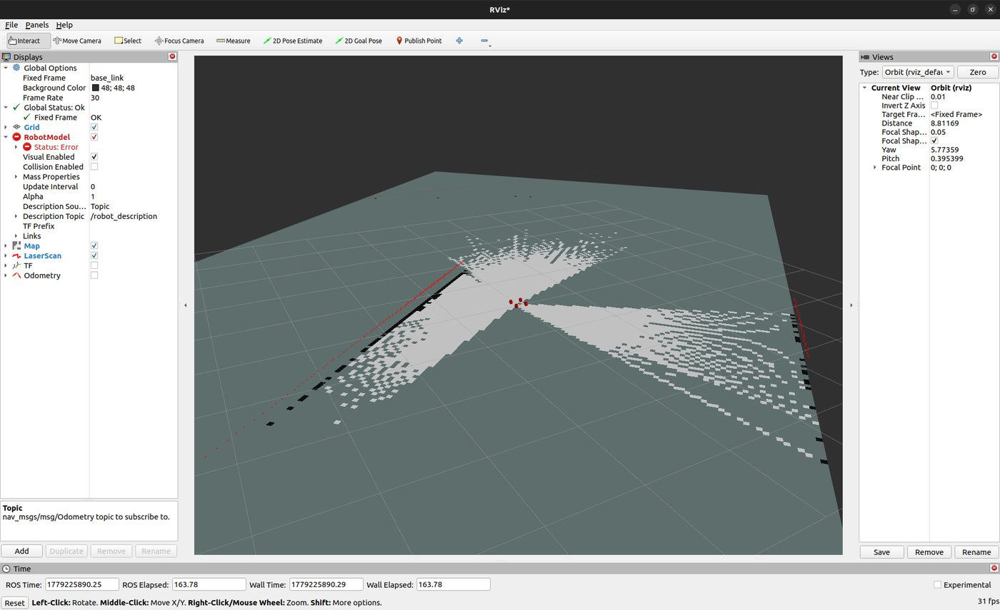
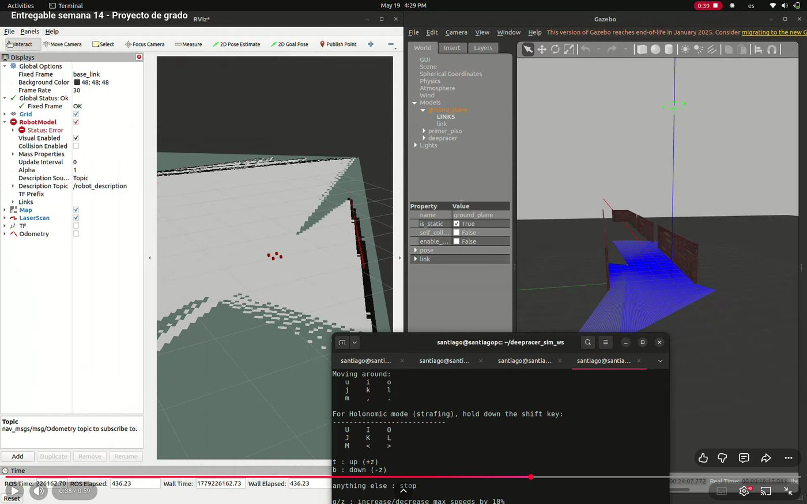

Fase 4 · desarrollo progresivo de la solución

# Semana 14: Sensores en el modelo del primer piso

Mayo de 2026

## Lo que se hizo

- Mundo del primer piso del bloque de pruebas: pasillo de unos 44 m (pared norte de 44,25 m) por unos 5 m, con la pared sur en tramos y las puertas de los salones abiertas.
- Con RViz configurado a mano se comprobaron el LiDAR, la cámara estéreo, la odometría y el árbol de transformaciones, quietos y teleoperando (video de la semana).
- Se anotó que la odometría simulada no tiene deriva, a diferencia de la real, y que el LiDAR del modelo simulado cubre 300°. El LiDAR real resultó ser de 360° (S19).
- Se fijó el papel de cada sensor: el LiDAR para el mapa y la localización; la cámara quedó disponible, y al final el sistema no la usó.

## En video

<figure class="video">
<iframe src="https://www.youtube-nocookie.com/embed/ZPJ0Qw2L5-A" title="Teleoperación del vehículo en el modelo del primer piso, con la respuesta de los sensores en RViz" loading="lazy" allow="encrypted-media; picture-in-picture; fullscreen" allowfullscreen></iframe>
<figcaption>Teleoperación del vehículo en el modelo del primer piso, con la respuesta de los sensores en RViz. <a href="https://youtu.be/ZPJ0Qw2L5-A">Ver en YouTube</a></figcaption>
</figure>

## En imágenes

<figure markdown>
[{ loading=lazy }](img/s14_1.jpg)
<figcaption>El vehículo en el modelo del primer piso</figcaption>
</figure>

<figure markdown>
[{ loading=lazy }](img/s14_2.jpg)
<figcaption>RViz mostrando el LaserScan</figcaption>
</figure>

<figure markdown>
[{ loading=lazy }](img/s14_3.jpg)
<figcaption>RViz, Gazebo y teleoperación por teclado a la vez</figcaption>
</figure>

## Lo que se concluyó

Durante la Semana 14 se completó la validación funcional integral del stack de sensores del DeepRacer dentro del entorno realista primer piso.world. La configuración manual de RViz permitió verificar de forma directa que los tres canales principales de información del vehículo — LiDAR, cámara estéreo y odometría — operan de manera coherente y consistente, tanto en condiciones estáticas como durante el desplazamiento mediante teleoperación. Esta validación cumple las dos actividades del cronograma activas en la semana: corresponde a Implementación de funciones necesarias en el sentido de que se integró y dejó operativo el conjunto de funciones de percepción del vehículo, y corresponde a Evaluación preliminar del comportamiento en el sentido de que se observó cómo se comporta cada sensor en el entorno realista y se documentaron sus características. La principal contribución técnica de la semana es haber dejado el sistema en un estado en el cual las siguientes funciones del proyecto (mapeo SLAM, localización AMCL, planificación con Nav2) pueden implementarse sobre una base verificada, sin acumular dudas sobre el funcionamiento de los sensores subyacentes. Adicionalmente, la observación simultánea de LiDAR y cámara dentro del mismo entorno aporta sustento experimental directo para las decisiones técnicas relativas al rol de cada sensor en el sistema final.

## Para leer en detalle

[Informe en PDF](https://github.com/shdeza12/Collaborative-Mobile-Robot-System-for-Indoor-Navigation-Assistance-in-Multi-Level-Environments/blob/main/Documentos/Entregables/Entregable_semana_14.pdf){ .md-button }

[:material-arrow-left: Semana 13](s13.md) · [Todas las semanas](index.md) · [Semana 15 :material-arrow-right:](s15.md)

