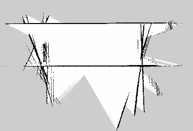

Fase 4 · desarrollo progresivo de la solución

# Semana 15: Primer mapa con SLAM

Mayo de 2026

## Lo que se hizo

- Primer mapa del primer piso con `slam_toolbox`, recorriendo el pasillo teleoperado de ida y vuelta. El informe lo dio por bueno.
- Corrección publicada el 21 de septiembre (fe de erratas): el mapa guardado mide 23,04 × 15,72 m, la mitad del largo y el triple del ancho del pasillo, y su resolución es 0,06 m, no 0,05. El nodo era el síncrono. El mapa estaba deformado por la deriva de la pose. Fue la primera manifestación, sin diagnóstico entonces, de la falta de información de avance en un pasillo recto, que se midió en septiembre (S22).

## En imágenes

<figure markdown>
[{ loading=lazy }](img/s15_1.jpg)
<figcaption>Primer mapa del primer piso con SLAM (23 de mayo). En la semana 17 se invalidó: los ajustes del mapeo de esas semanas nunca se habían ejecutado</figcaption>
</figure>

## Lo que se concluyó

Durante la Semana 15 se implementó la función de mapeo 2D del sistema mediante slam toolbox, obteniendo una representación del entorno primer piso.world que captura correctamente las estructuras geométricas principales del pasillo. El mapa generado fue guardado en el repositorio del proyecto y constituye el primer artefacto de navegación concreto producido en la Fase 4. La evaluación preliminar del comportamiento del algoritmo muestra resultados satisfactorios para las paredes modeladas en el SDF, con la única limitación esperada asociada a las aperturas no cerradas del lado sur del pasillo. Esta limitación es una característica del entorno simulado, no del algoritmo, y quedará documentada como referencia para la evaluación en el entorno físico real. Se inició formalmente la actividad Ajuste progresivo de los elementos desarrollados con el registro de observaciones concretas sobre los parámetros de configuración, que guiarán las iteraciones de las semanas S16 y S17. El sistema queda en condiciones de avanzar hacia la localización con AMCL, siguiente función del stack de navegación previsto en el anteproyecto.

## Para leer en detalle

[Informe en PDF](https://github.com/shdeza12/Collaborative-Mobile-Robot-System-for-Indoor-Navigation-Assistance-in-Multi-Level-Environments/blob/main/Documentos/Entregables/Entregable_semana_15.pdf){ .md-button }

[:material-arrow-left: Semana 14](s14.md) · [Todas las semanas](index.md) · [Semana 16 :material-arrow-right:](s16.md)

