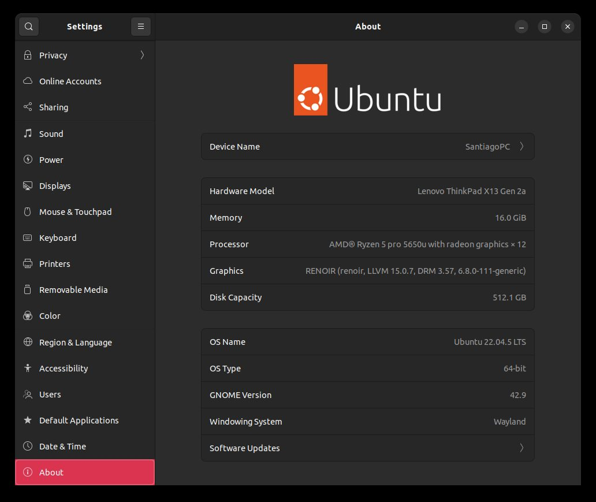

Fase 4 · desarrollo progresivo de la solución

# Semana 16: Receso de mitad de año

Junio de 2026

## Lo que se hizo

- No se emitió entregable; el 16 de agosto se decidió cerrarlo sin emitir. Lo técnico de esas semanas quedó en el repositorio: dos correcciones de compilación del complemento Ackermann para Humble (cabecera de `tf2_geometry_msgs` y una opción de compilador incompatible, 14 de junio) y la causa de un parámetro del mapeo (`max_laser_range` de 12,0 m contra un LiDAR simulado de 10,0 m).
- Receso de mitad de año entre junio y agosto.

## En imágenes

<figure markdown>
[{ loading=lazy }](img/s16_1.jpg)
<figcaption>Características del portátil de desarrollo (Ubuntu 22.04.5, Ryzen 5 PRO 5650U, 16 GB)</figcaption>
</figure>

## Para leer en detalle

Esta semana no tiene informe en el repositorio.

[:material-arrow-left: Semana 15](s15.md) · [Todas las semanas](index.md) · [Semana 17 :material-arrow-right:](s17.md)

