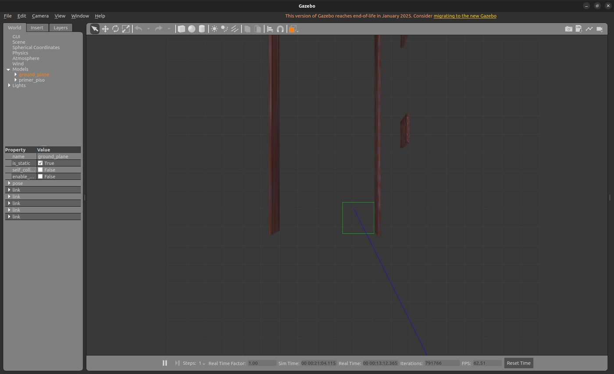
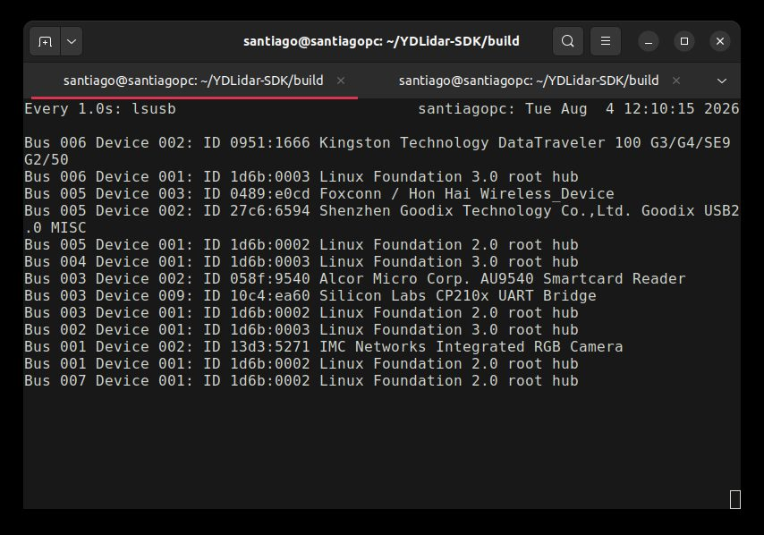
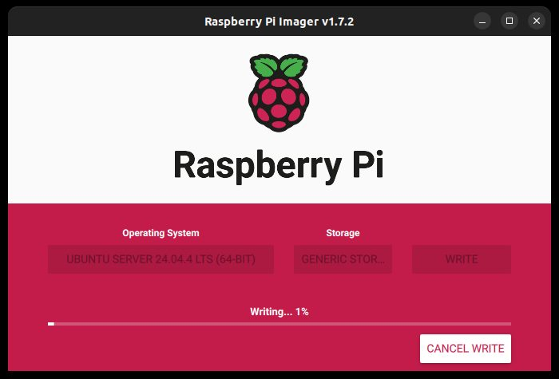
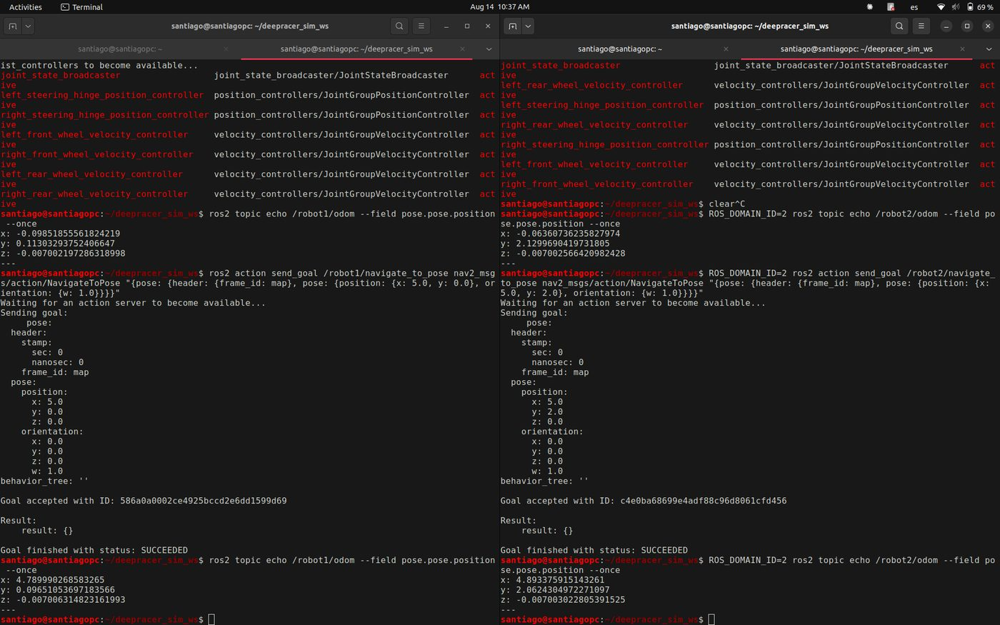

Fase 5 · integración del sistema y pruebas

# Semana 17: Vehículo físico liberado y Nav2 en Humble

3 al 9 de agosto de 2026

## Lo que se hizo

- Cronograma replanificado de S17 a S32, con criterio de cierre por semana; firmado por el director el 14 de agosto.
- Vehículo físico: se instaló `deepracer-custom-car` en una Raspberry Pi 4 y en la tarjeta original del DeepRacer, y se probó la marcha (avance, reversa y giro) desde la interfaz web del vehículo (video). La tarjeta original quedó con Ubuntu Server 24.04 y ROS 2 Jazzy.
- Nav2 y AMCL, desarrollados en el primer semestre sin publicar, se migraron de Foxy a Humble (cinco cambios de nombres y parámetros) y se adaptaron a Ackermann: árboles de comportamiento sin giro en el sitio, sin rotación hacia el rumbo en el controlador, huella corregida de 0,17 × 0,17 m a 0,28 × 0,19 m y planificador Smac con radio mínimo de 0,35 m (el geométrico del modelo es 0,284 m).
- Contrato de interfaces: todo cuelga de un espacio de nombres por robot; el coordinador manda solo por la acción de navegación; la interfaz habla solo con el coordinador.
- Herramienta que verifica el contrato sobre el sistema en marcha; en su primera ejecución encontró que `camera_link` tenía dos padres.
- Corrección: el espacio de trabajo de compilación era una copia del repositorio del fabricante, no un enlace al del proyecto. Los ajustes de SLAM de semanas anteriores nunca se habían ejecutado y el mapa previo quedó invalidado.
- Selección del entorno de evaluación y pregunta de investigación escritas.

## En imágenes

<figure markdown>
[{ loading=lazy }](img/s17_1.jpg)
<figcaption>Mundo primer_piso_v2 en Gazebo para el simulador multi-robot</figcaption>
</figure>

<figure markdown>
[{ loading=lazy }](img/s17_2.jpg)
<figcaption>lsusb con el puente CP210x del LiDAR conectado</figcaption>
</figure>

<figure markdown>
[{ loading=lazy }](img/s17_3.jpg)
<figcaption>Grabación de Ubuntu Server 24.04 con Raspberry Pi Imager, antes de saber que la tarjeta es Intel</figcaption>
</figure>

<figure markdown>
[{ loading=lazy }](img/s17_4.jpg)
<figcaption>Dos simuladores independientes en paralelo</figcaption>
</figure>

<figure markdown>
[{ loading=lazy }](img/s17_5.jpg)
<figcaption>Los dos robots alcanzando objetivos distintos</figcaption>
</figure>

<figure markdown>
[{ loading=lazy }](img/s17_6.jpg)
<figcaption>`robot1` con geometría en Gazebo</figcaption>
</figure>

## Lo que se concluyó

1. Durante la Semana 17 el proyecto obtuvo su primer resultado sobre hardware real: el vehículo AWS DeepRacer quedó liberado de su firmware original, con el entorno de cómputo instalado sobre dos plataformas y con su locomoción verificada desde la interfaz web, según consta en el registro audiovisual referenciado. Esto eleva el objetivo específico OE2 al 40 % y deja como únicos pendientes el sensado con el LiDAR físico y el control desde ROS 2.
2. En el frente de simulación se consolidó y publicó el stack de navegación autónoma, cerrando siete semanas de trabajo que permanecían sin versionar, y se definió el contrato de interfaces ROS 2 que constituye el hito H1 y habilita todo el desarrollo multi-robot posterior. Su aplicación sobre el código se inició de forma incremental y verificada, con una prueba de regresión satisfactoria.
3. Se detectó y corrigió, además, un defecto de trazabilidad en el entorno de compilación que mantenía desconectado el código versionado del código ejecutado. Su consecuencia — la invalidación de la evidencia cartográfica previa — se declara de forma explícita en este informe y obliga a repetir el mapeo. Se considera un hallazgo de valor: revela que ninguna corrección de parámetros anterior a esta semana había surtido efecto real sobre la simulación.
4. Finalmente, el cronograma de actividades del segundo periodo deja el proyecto con las ventanas temporales precisadas sobre la marcha del desarrollo y con un criterio de cierre verificable para cada semana, conservando íntegras las actividades contempladas en el anteproyecto.

## Para leer en detalle

[Informe en PDF](https://github.com/shdeza12/Collaborative-Mobile-Robot-System-for-Indoor-Navigation-Assistance-in-Multi-Level-Environments/blob/main/Documentos/Entregables/Entregable_semana_17.pdf){ .md-button } [Fuente en LaTeX](https://github.com/shdeza12/Collaborative-Mobile-Robot-System-for-Indoor-Navigation-Assistance-in-Multi-Level-Environments/blob/main/Documentos/Entregables/Entregable_semana_17.tex){ .md-button }

Evidencia de la semana:

- [Aplicación del contrato de interfaces — bitácora de trabajo](https://github.com/shdeza12/Collaborative-Mobile-Robot-System-for-Indoor-Navigation-Assistance-in-Multi-Level-Environments/blob/main/Documentos/Evidencia/S17_aplicacion_contrato.md)
- [Dos simuladores aislados — validación de factibilidad de H1](https://github.com/shdeza12/Collaborative-Mobile-Robot-System-for-Indoor-Navigation-Assistance-in-Multi-Level-Environments/blob/main/Documentos/Evidencia/S17_dos_simuladores.md)
- [Línea base — un robot, antes de aplicar el contrato de interfaces](https://github.com/shdeza12/Collaborative-Mobile-Robot-System-for-Indoor-Navigation-Assistance-in-Multi-Level-Environments/blob/main/Documentos/Evidencia/S17_linea_base.md)
- [Nav2 con namespaces — dos robots navegando a la vez](https://github.com/shdeza12/Collaborative-Mobile-Robot-System-for-Indoor-Navigation-Assistance-in-Multi-Level-Environments/blob/main/Documentos/Evidencia/S17_nav2_namespaces.md)

[:material-arrow-left: Semana 16](s16.md) · [Todas las semanas](index.md) · [Semana 18 :material-arrow-right:](s18.md)

