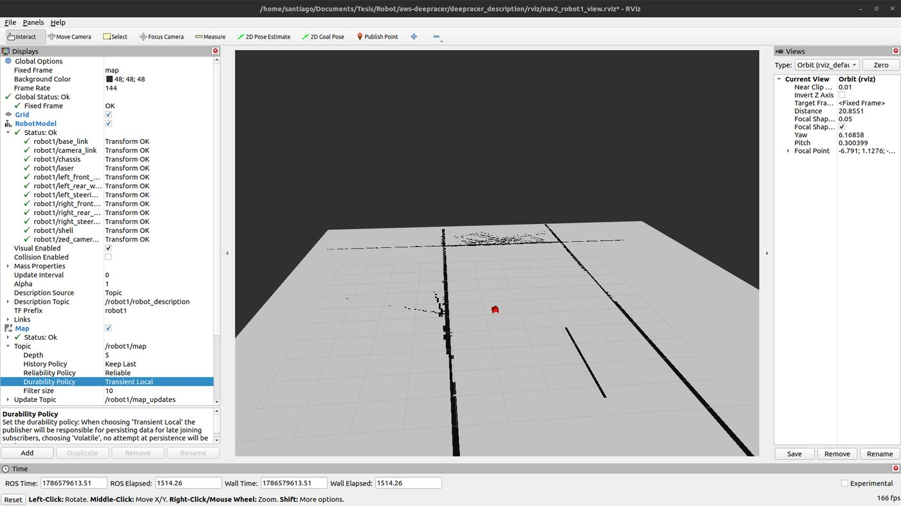
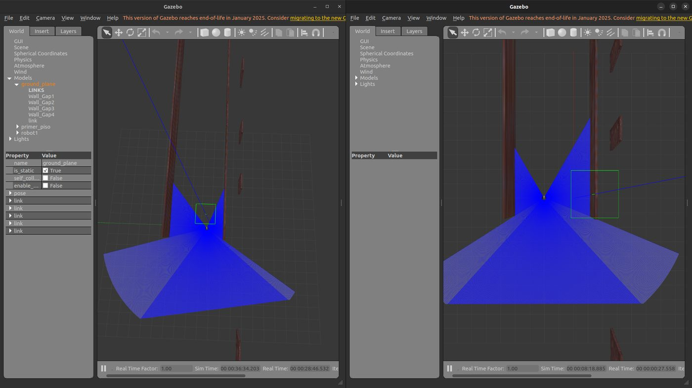
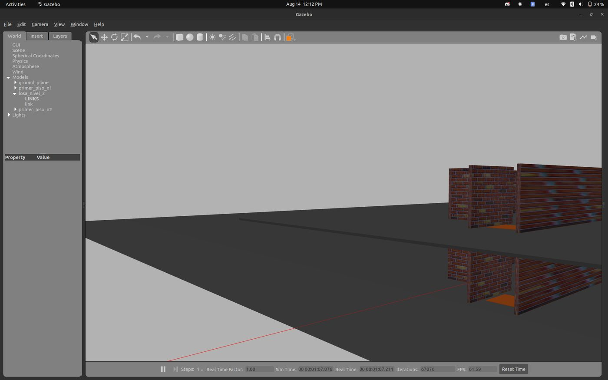
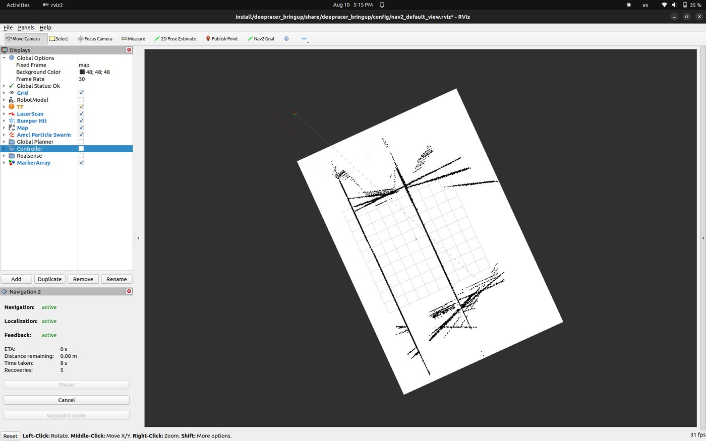
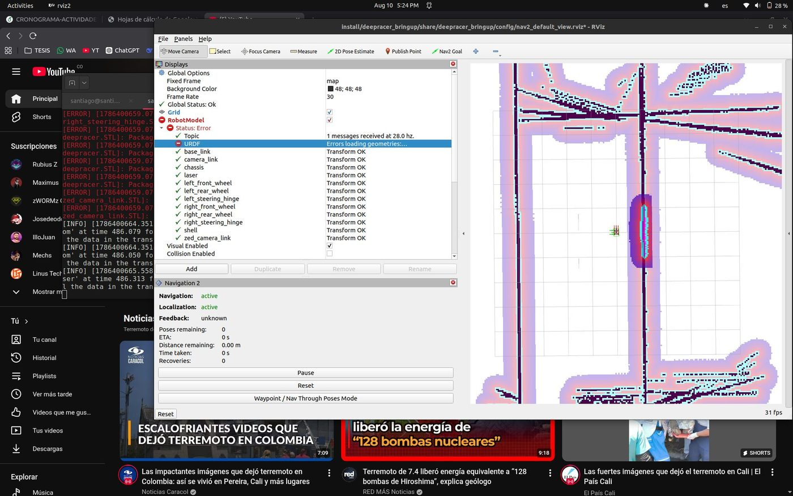
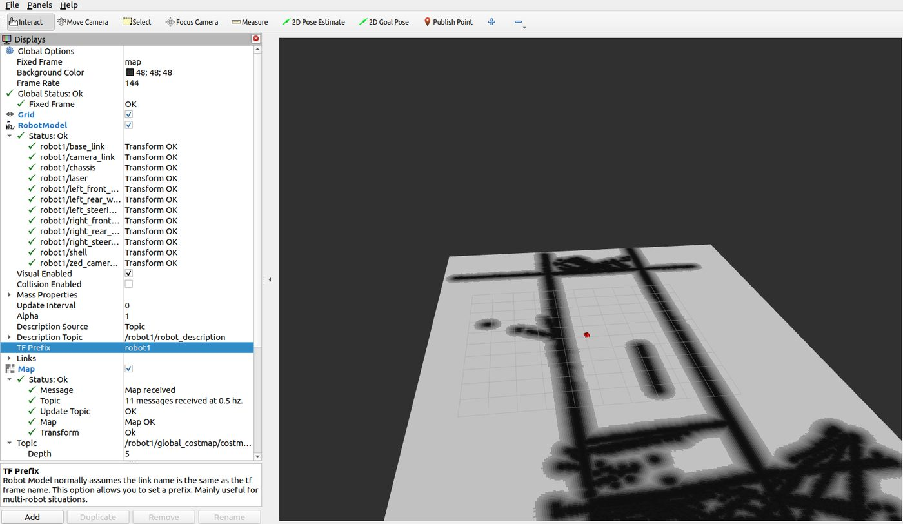

Fase 5 · integración del sistema y pruebas

# Semana 18: Dos agentes aislados y entorno de dos niveles

10 al 16 de agosto de 2026

## Lo que se hizo

- Dos robots en simulación: en un solo Gazebo no es posible, porque la integración de Gazebo con ROS 2 en Humble aplica a todos los complementos el espacio de nombres del primer modelo. Se pasó a un simulador por vehículo.
- Nav2 y AMCL bajo espacio de nombres, con los marcos prefijados. Aislamiento de mando comprobado con cuatro evidencias independientes.
- Entorno de dos niveles: la planta del primer piso extraída como modelo reutilizable, dos instancias a 3,0 m de separación vertical, una losa para el nivel superior y una marca de transición de 1,5 × 1,5 m en las mismas coordenadas de los dos niveles. Navegación autónoma en el nivel superior.
- Corrección del mapa de navegación: cubría el 35,5 % del largo, medía 15,0 m de ancho contra 5,3 m reales, y 2688 de sus 3618 celdas ocupadas (74 %) no tenían pared detrás. Se reemplazó por un mapa derivado de la geometría del mundo (`generar_mapa_desde_mundo.py`). Un mapa 2D es un corte del mundo, así que el del nivel superior es igual y no hubo que levantarlo.
- Norma adoptada: el éxito que informa Nav2 no es evidencia, porque compara contra su propia localización.
- Reproducibilidad: verificador de instalación y verificador de coherencia del repositorio.

## Avance de los objetivos al cierre de la semana

Arquitectura40 %

Plataforma robótica40 %

Interfaz0 %

Evaluación0 %

En color claro, lo que avanzó esta semana. Las cifras son las del informe de la semana 18.

## En imágenes

<figure markdown>
[{ loading=lazy }](img/s18_1.jpg)
<figcaption>Modelo del vehículo representado correctamente en la herramienta de visualización, bajo el prefijo de marcos del primer agente.</figcaption>
</figure>

<figure markdown>
[{ loading=lazy }](img/s18_2.jpg)
<figcaption>Dos procesos de simulación independientes ejecutándose de forma simultánea, cada uno con un vehículo.</figcaption>
</figure>

<figure markdown>
[{ loading=lazy }](img/s18_3.jpg)
<figcaption>Entorno de evaluación con las dos plantas instanciadas y la zona de transición señalizada en cada nivel.</figcaption>
</figure>

<figure markdown>
[{ loading=lazy }](img/s18_4.jpg)
<figcaption>RViz con el mapa y Nav2 en la simulación</figcaption>
</figure>

<figure markdown>
[{ loading=lazy }](img/s18_5.jpg)
<figcaption>Mapa de costos de Nav2 alrededor del vehículo simulado</figcaption>
</figure>

<figure markdown>
[{ loading=lazy }](img/s18_6.jpg)
<figcaption>robot1 en RViz con sus marcos con prefijo y su mapa de costos</figcaption>
</figure>

## Lo que se concluyó

1. Durante la Semana 18 quedaron cerrados los dos hitos que bloqueaban la totalidad del desarrollo posterior. El hito H1 se cerró con dos agentes robóticos ejecutando pilas de navegación completas de forma simultánea, cada uno bajo su propio espacio de nombres, con aislamiento de mando demostrado mediante cuatro evidencias independientes y con desplazamiento verificado contra la odometría del simulador. El hito H2b se cerró con un entorno de evaluación de dos niveles verticales reales, sobre cuyo nivel superior se navegó de forma autónoma con la altura constante a 1,9 micrómetros.
2. Se detectó y corrigió un defecto en el mapa de navegación cuya consecuencia no era estética: el 74 % de sus celdas ocupadas no correspondía a ninguna pared real, lo que interrumpía la planificación en tramos libres del pasillo. La corrección se resolvió derivando el mapa de la geometría del entorno simulado, con lo cual la deriva de localización descendió de 0,323 m a un intervalo entre 0,045 m y 0,100 m. De este hallazgo se derivó un criterio metodológico que rige el resto del proyecto: un resultado satisfactorio informado por la propia pila de navegación no constituye evidencia.
3. Una actividad planificada quedó suprimida por comprobación y no por falta de tiempo: el levantamiento de un mapa propio del nivel superior. Un mapa de ocupación bidimensional es un corte horizontal, de modo que los cortes de ambos niveles resultan idénticos píxel a píxel.
4. El diagnóstico de hardware y la matriz de requisitos no se ejecutaron y se trasladan a la Semana 19. Se declara de forma explícita: de las tres condiciones del criterio de cierre de la semana, se cumplieron dos.
5. El balance de la semana no se expresa en avance porcentual de los objetivos específicos, que permanecen en sus valores previos, sino en el estado del camino crítico. Los cuatro primeros eslabones de la cadena que conduce a la evaluación del objetivo específico 4 están cerrados, y los cuatro restantes se encuentran, por primera vez, sin dependencias previas sin resolver.

## Para leer en detalle

[Informe en PDF](https://github.com/shdeza12/Collaborative-Mobile-Robot-System-for-Indoor-Navigation-Assistance-in-Multi-Level-Environments/blob/main/Documentos/Entregables/Entregable_semana_18.pdf){ .md-button } [Fuente en LaTeX](https://github.com/shdeza12/Collaborative-Mobile-Robot-System-for-Indoor-Navigation-Assistance-in-Multi-Level-Environments/blob/main/Documentos/Entregables/Entregable_semana_18.tex){ .md-button }

Evidencia de la semana:

- [S18 — Entorno de dos niveles: construcción y validación](https://github.com/shdeza12/Collaborative-Mobile-Robot-System-for-Indoor-Navigation-Assistance-in-Multi-Level-Environments/blob/main/Documentos/Evidencia/S18_entorno_dos_niveles.md)

[:material-arrow-left: Semana 17](s17.md) · [Todas las semanas](index.md) · [Semana 19 :material-arrow-right:](s19.md)

