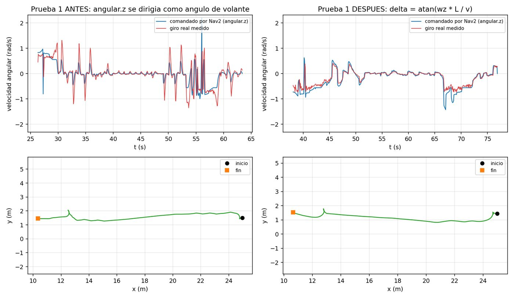
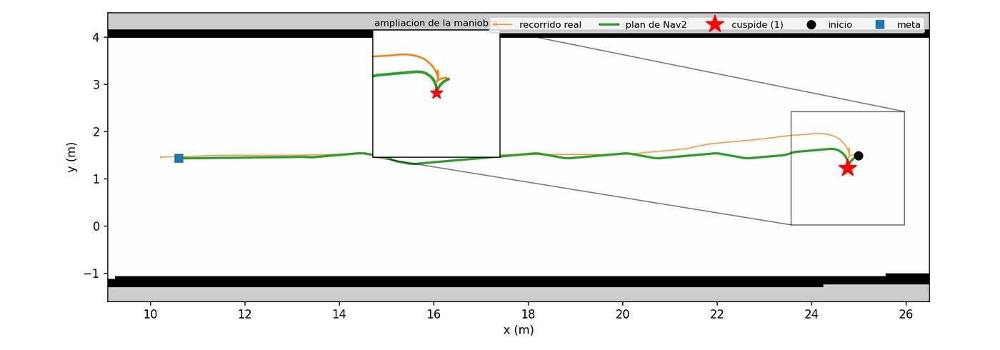
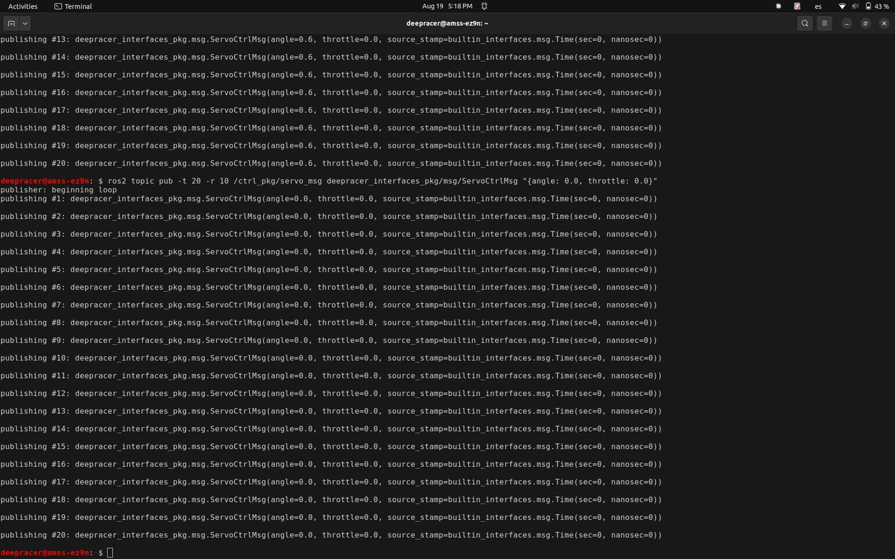
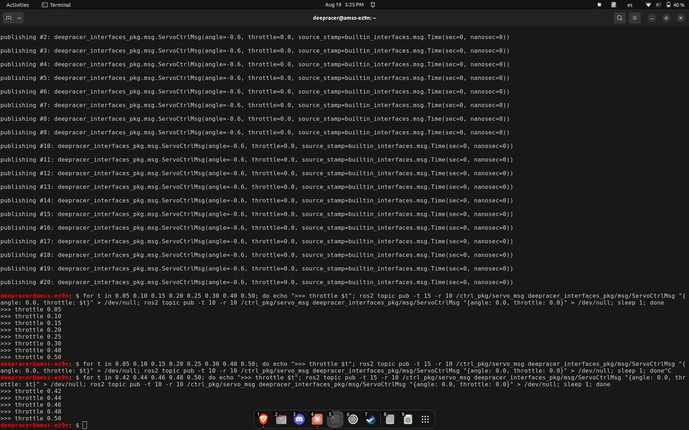
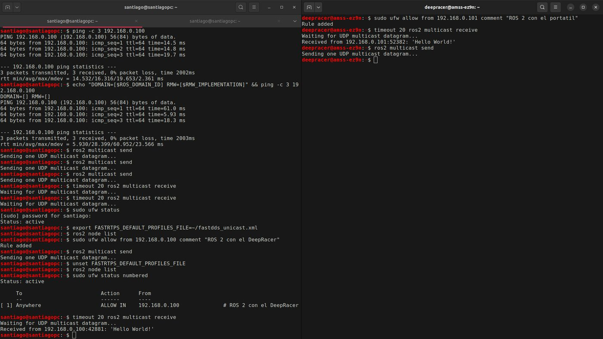

Fase 5 · integración del sistema y pruebas

# Semana 19: Diagnóstico del vehículo y protocolo

17 al 23 de agosto de 2026

## Lo que se hizo

- Vehículo físico, con la tarjeta original: el LiDAR repite una pared con 2,8 mm de dispersión (23 mm contra la cinta, como cota). La dirección y la tracción responden a órdenes publicadas desde ROS 2.
- El LiDAR del kit es otro modelo que el diagnosticado al principio (360°, 360 muestras, 0,15 a 12 m, 6,80 Hz). El servicio del vehículo se reiniciaba en bucle porque el lanzador llamaba a un ejecutable con otro nombre, y el servicio informaba estar activo sin estarlo.
- Dos distribuciones: cinco tipos de mensaje idénticos entre Humble y Jazzy y la acción de navegación distinta. La configuración de Nav2 difiere en seis puntos, tres de ellos silenciosos. La simulación no puede pasar a Jazzy porque la integración de Gazebo con `ros2_control` no está publicada allí: las dos distribuciones son una condición permanente del proyecto.
- Corrección de fondo: el complemento de simulación y el nodo del vehículo trataban la velocidad angular como un ángulo de volante. Se corrigió con el modelo de bicicleta (ángulo = arctan(ω·L/v)); el error de seguimiento bajó a la mitad.
- Matriz de requisitos (34 en ese momento) y protocolo experimental del cuarto objetivo, escrito antes de instrumentar.
- Mundo definitivo de dos pisos con quince destinos (20 de agosto), y luego un mundo por piso: el LiDAR de un piso veía paredes del otro en 61 de 1701 posiciones (23 de agosto).
- Los dos agentes navegaron a la vez el 25 de agosto, hacia sus puntos de transferencia.

## Avance de los objetivos al cierre de la semana

Arquitectura55 %+15

Plataforma robótica50 %+10

Interfaz0 %

Evaluación5 %+5

En color claro, lo que avanzó esta semana. Las cifras son las del informe de la semana 19.

## En video

<figure class="video">
<iframe src="https://www.youtube-nocookie.com/embed/6SABSgCxVEw" title="Maniobra de volteo en simulación, con RViz y Gazebo" loading="lazy" allow="encrypted-media; picture-in-picture; fullscreen" allowfullscreen></iframe>
<figcaption>Maniobra de volteo en simulación, con RViz y Gazebo. <a href="https://youtu.be/6SABSgCxVEw">Ver en YouTube</a></figcaption>
</figure>

## En imágenes

<figure markdown>
[{ loading=lazy }](img/s19_1.jpg)
<figcaption>Giro comandado contra giro real, antes y después de la corrección</figcaption>
</figure>

<figure markdown>
[{ loading=lazy }](img/s19_2.jpg)
<figcaption>El plan con su cúspide sobre el mapa</figcaption>
</figure>

<figure markdown>
[{ loading=lazy }](img/s19_3.jpg)
<figcaption>Maniobra en RViz y Gazebo a la vez</figcaption>
</figure>

<figure markdown>
[{ loading=lazy }](img/s19_4.jpg)
<figcaption>Órdenes de servo publicadas en amss-ez9n desde ROS 2</figcaption>
</figure>

<figure markdown>
[{ loading=lazy }](img/s19_5.jpg)
<figcaption>Barrido de tracción en amss-ez9n para encontrar el umbral de arranque</figcaption>
</figure>

<figure markdown>
[{ loading=lazy }](img/s19_6.jpg)
<figcaption>Reglas de ufw y prueba de multidifusión entre el portátil y el vehículo</figcaption>
</figure>

## Lo que se concluyó

1. La Semana 19 cumplió tres de sus cuatro condiciones de cierre dentro del plazo y la cuarta tres días después, quedando en 4 de 4 con el arrastre declarado. Se publicaron los dos artefactos documentales que el proyecto debía al cronograma: la matriz de 34 requisitos con trazabilidad a objetivos y pruebas, que cierra el riesgo R5 y desbloquea el objetivo específico 1, y el protocolo experimental del objetivo específico 4, redactado antes de instrumentar cualquier cosa.
2. El diagnóstico del vehículo físico sustituyó afirmaciones por mediciones. El sensor LiDAR repite una misma pared con 2,8 mm de dispersión y observa planas las superficies planas, que es lo que exige el algoritmo de localización; la diferencia de 23 mm contra la cinta métrica se informa como cota superior y no como error del instrumento, porque el montaje no permite separar la exactitud del desplazamiento del origen de medida. La capa de servos del vehículo respondió de forma proporcional en dirección y tracción, con lo cual la cuantización binaria observada quedó localizada como defecto propio y reparable, y no como limitación del hardware.
3. Se corrigió un defecto dimensional que habría falseado la campaña experimental completa. La componente angular del comando de velocidad se interpretaba como un ángulo de dirección en lugar de como una velocidad angular, produciendo una ganancia de volante que variaba por un factor de cuatro a lo largo del rango de velocidad. El error de seguimiento se redujo a la mitad en las dos corridas de validación y se confirmó en un escenario distinto del empleado para validar, obteniendo el mejor seguimiento de las seis corridas disponibles.
4. Dos afirmaciones previas del proyecto resultaron incorrectas y se rectificaron. El sensor diagnosticado el 19 de agosto no es el sensor del kit del vehículo, de modo que la corrección del modelo geométrico de simulación va en sentido contrario al que se había escrito: la simulación observa más rayos que el vehículo, no menos. Y el fallo que bloqueaba la Semana 20 no tenía tres causas apiladas sino una sola, un nombre de ejecutable, con lo que esa semana dejó de estar bloqueada por el sensado.
5. Se estableció que la convivencia de dos distribuciones de ROS 2 es una condición permanente y no transitoria, porque la simulación no puede migrar: el paquete que la integra con la capa de control no está publicado para la distribución del vehículo. En consecuencia, la portabilidad declarada del proyecto se sostiene como portabilidad de código fuente y es falsa como interoperabilidad dentro de un mismo grafo, distinción que condiciona el diseño del nodo de coordinación.
6. Los objetivos específicos 1, 2 y 4 avanzaron a 55 %, 50 % y 5 % respectivamente. El avance del objetivo 4 es deliberadamente pequeño: existe la definición de qué medir y no existe todavía ninguna medida.

## Para leer en detalle

[Informe en PDF](https://github.com/shdeza12/Collaborative-Mobile-Robot-System-for-Indoor-Navigation-Assistance-in-Multi-Level-Environments/blob/main/Documentos/Entregables/Entregable_semana_19.pdf){ .md-button } [Fuente en LaTeX](https://github.com/shdeza12/Collaborative-Mobile-Robot-System-for-Indoor-Navigation-Assistance-in-Multi-Level-Environments/blob/main/Documentos/Entregables/Entregable_semana_19.tex){ .md-button }

Evidencia de la semana:

- [S19 — `cmd_vel` se interpretaba como ángulo de dirección, no como velocidad angular](https://github.com/shdeza12/Collaborative-Mobile-Robot-System-for-Indoor-Navigation-Assistance-in-Multi-Level-Environments/blob/main/Documentos/Evidencia/S19_conversion_cmdvel_ackermann.md)
- [El LiDAR original del kit Evo — el bloqueante de S20 era un nombre mal escrito](https://github.com/shdeza12/Collaborative-Mobile-Robot-System-for-Indoor-Navigation-Assistance-in-Multi-Level-Environments/blob/main/Documentos/Evidencia/S19_lidar_original_evo.md)
- [Spike de hardware, preguntas 1 y 2 — el LiDAR real y el mando por ROS 2](https://github.com/shdeza12/Collaborative-Mobile-Robot-System-for-Indoor-Navigation-Assistance-in-Multi-Level-Environments/blob/main/Documentos/Evidencia/S19_spike_p1_p2_hardware.md)
- [Spike de hardware, pregunta 4 — ¿qué cambia entre ROS 2 Humble y Jazzy?](https://github.com/shdeza12/Collaborative-Mobile-Robot-System-for-Indoor-Navigation-Assistance-in-Multi-Level-Environments/blob/main/Documentos/Evidencia/S19_spike_p4_humble_jazzy.md)

[:material-arrow-left: Semana 18](s18.md) · [Todas las semanas](index.md) · [Semana 20 :material-arrow-right:](s20.md)

