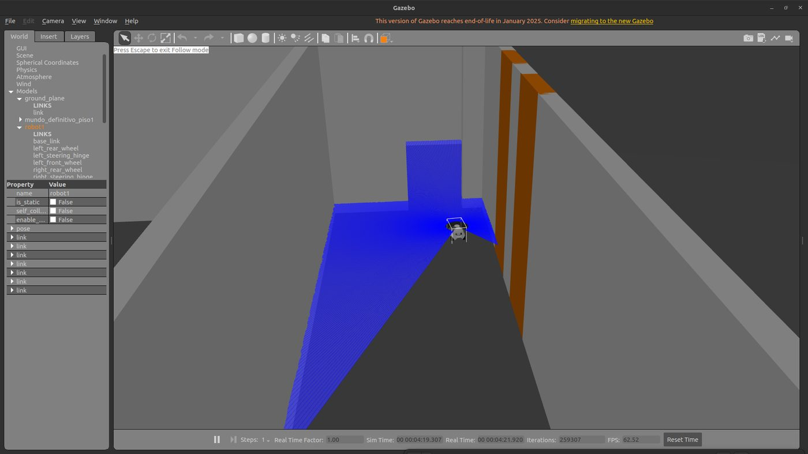
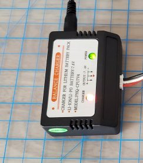
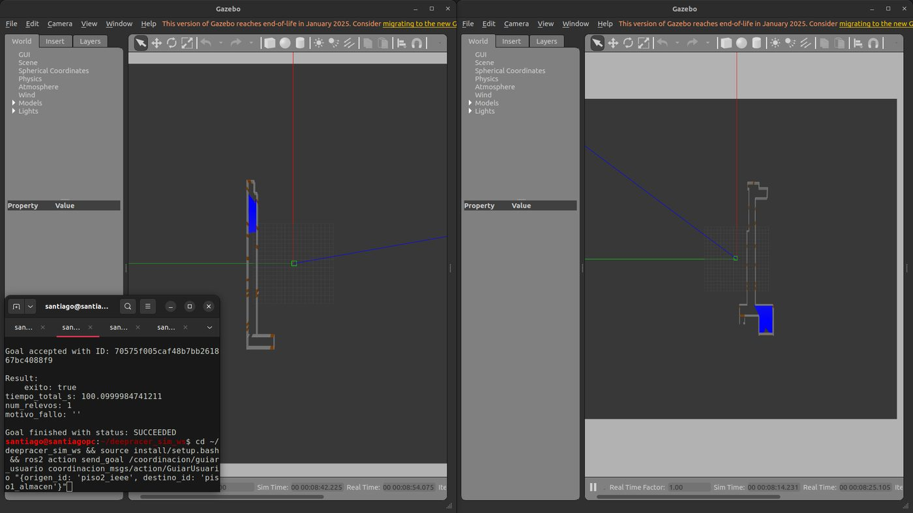

Fase 5 · integración del sistema y pruebas

# Semana 20: Coordinador, primera misión y relevo en simulación

24 al 30 de agosto de 2026

## Lo que se hizo

- El mapa del nivel inferior dejaba escapar el espacio libre por los 16 vanos de las puertas (el planificador trazó una diagonal de 38 m a través de paredes). Se sellaron los vanos. El nivel superior, una planta en S de 35 paredes, recibió sus dieciséis destinos (Jonny).
- Paquete de mensajes propios (estado de robot, punto de interés, estado de misión y acción de guiado) y coordinador en dos piezas: el planificador sin ROS y el nodo.
- La prueba exhaustiva del planificador pasaba con treinta planes que mandaban al mismo robot dos veces al mismo punto; se corrigió.
- Defectos de llegada: el rumbo final dejaba la llegada a 0,413 m; la media vuelta salía del planificador que busca una pose; el ruido de odometría declarado a AMCL era 0,2; la tolerancia de parada tenía margen cero; un desfase de AMCL de 1,473 m a lo largo del pasillo.
- Registro de misión en cuatro piezas: esquema comprobable por máquina, marcas y veredicto como funciones puras, grabación sellada con el reloj de simulación y error de llegada calculado contra la odometría del robot que llegó. El tiempo de asignación medía cero: marcas idénticas con el reloj de simulación.
- 26 de agosto: el fallo al cargar controladores era un reintento sobre una operación no idempotente; con `spawner` y 60 s, 18 arranques dobles sin fallo (Jonny).
- 29 de agosto: primera misión de extremo a extremo, con una segunda de control. 30 de agosto: primera misión con relevo entre los dos pisos, llegadas a 0,128 y 0,077 m.
- Vehículo, 28 de agosto: el LiDAR ya convive con el software del fabricante (enlace al ejecutable correcto, sin tocar los archivos del fabricante); odometría láser en tres idas y vueltas; primer mando desde ROS 2 por el tópico de servos; mapa del laboratorio de 8,45 × 6,90 m.

## Avance de los objetivos al cierre de la semana

Arquitectura55 %

Plataforma robótica50 %

Interfaz0 %

Evaluación25 %+20

En color claro, lo que avanzó esta semana. Las cifras son las del informe de la semana 20.

## En imágenes

<figure markdown>
[{ loading=lazy }](img/s20_1.jpg)
<figcaption>Vehículo en el pasillo simulado con su LiDAR</figcaption>
</figure>

<figure markdown>
[{ loading=lazy }](img/s20_2.jpg)
<figcaption>Cargador de balance de la batería de tracción del vehículo</figcaption>
</figure>

<figure markdown>
[{ loading=lazy }](img/s20_3.jpg)
<figcaption>Misión con relevo en los dos mundos, terminada con exito: true y un relevo</figcaption>
</figure>

## Lo que se concluyó

1. La Semana 20 cumplió la mitad de software de su criterio de cierre por encima de lo pedido. El criterio exigía que una solicitud produjera la asignación del agente correcto con sus tiempos registrados; se ejecutaron dos solicitudes con destinos en niveles distintos, porque una sola no permite distinguir una asignación correcta de una respuesta constante. Los dos agentes asignados fueron distintos y correctos, y ambos registros quedaron validados contra un esquema de datos congelado, con el veredicto calculado contra la odometría del simulador y no contra el resultado que informa la pila de navegación.
2. La mitad de hardware quedó cumplida a medias, y se declara sin promediarla con la anterior. El mapa del laboratorio está guardado; la verificación, tal como está redactada, no es aplicable a un banco físico, porque la herramienta compara contra un modelo del entorno que un laboratorio real no tiene. No se ajustaron los umbrales para que el criterio pasara: eso convertiría la verificación en un trámite, y lo que corresponde es reescribir el criterio.
3. El proyecto pasó de tener agentes que navegan a tener un sistema que decide. Existe el lenguaje de mensajes propio, verificado por transporte real entre nodos y no por compilación; existe el nodo de coordinación, con la lógica de relevo separada del cableado de forma que sus 992 planes se verifican sin levantar un solo simulador; y existe el nivel superior con sus dieciséis destinos, sin el cual la asignación habría acertado por no tener alternativa.
4. Se cerró el hito H3 con los dos agentes navegando de forma simultánea a sus respectivos puntos de transferencia, con errores de 0,281 m y 0,143 m contra odometría, y la ausencia de degradación por concurrencia se volvió a comprobar a escala de campaña, sobre recorridos de 84 y 90 m. Se advierte de forma explícita que el coste de la concurrencia en reloj de pared no se midió, y que dos corridas de idéntica duración en tiempo simulado no prueban ausencia de contención.
5. La semana produjo tres hallazgos que cambian trabajo futuro. El más grave es que el tiempo de asignación, una de las cuatro métricas del objetivo específico 4, es hoy estructuralmente inmedible, porque el coordinador publica la etapa y el agente en el mismo mensaje y no existe estado intermedio: la métrica valdría cero en las treinta corridas de la campaña. La corrección es acotada y debe entrar antes de la Semana 24. El segundo es que el archivo de registro no puede aportar el factor de tiempo real cuando se sella con reloj de simulación, ya corregido en la herramienta de grabación. El tercero proviene del vehículo real: su odometría láser cierra un circuito de 18,4 m con un 0,18 % de deriva y aun así estima un 2,9 % largo contra flexómetro, porque el error de escala se cancela entre ida y vuelta. Sin la referencia externa, ese dato habría pasado por una validación exitosa.
6. Queda un bloqueo que gobierna lo que sigue y que no es de código: la misión con relevo no puede ejecutarse porque cada agente vive en un dominio de comunicaciones distinto y un nodo de ROS 2 vive en uno solo. El protocolo de relevo está escrito y verificado como función pura, y no tiene por dónde ejecutarse. Es el trabajo que abre la Semana 21, y estaba anticipado por escrito cinco días antes, al advertir que el aislamiento por dominio no resolvía el problema del marco de referencia sino que aplazaba la colisión al punto del proyecto donde más caro sale.

## Para leer en detalle

[Informe en PDF](https://github.com/shdeza12/Collaborative-Mobile-Robot-System-for-Indoor-Navigation-Assistance-in-Multi-Level-Environments/blob/main/Documentos/Entregables/Entregable_semana_20.pdf){ .md-button } [Fuente en LaTeX](https://github.com/shdeza12/Collaborative-Mobile-Robot-System-for-Indoor-Navigation-Assistance-in-Multi-Level-Environments/blob/main/Documentos/Entregables/Entregable_semana_20.tex){ .md-button }

Evidencia de la semana:

- [Asignación del agente por nivel — primera ejecución completa de RF-25](https://github.com/shdeza12/Collaborative-Mobile-Robot-System-for-Indoor-Navigation-Assistance-in-Multi-Level-Environments/blob/main/Documentos/Evidencia/S20_asignacion_por_nivel.md)
- [Frente B — el vehículo real: sensado bajo la pila, odometría láser, mapa del laboratorio y teleoperación](https://github.com/shdeza12/Collaborative-Mobile-Robot-System-for-Indoor-Navigation-Assistance-in-Multi-Level-Environments/blob/main/Documentos/Evidencia/S20_frente_b_hardware.md)
- [S20 — Hito H3: los dos agentes navegan a la vez, cada uno sobre su piso](https://github.com/shdeza12/Collaborative-Mobile-Robot-System-for-Indoor-Navigation-Assistance-in-Multi-Level-Environments/blob/main/Documentos/Evidencia/S20_hito_h3_dos_agentes.md)
- [S20 — El marco `map` se prefija con el namespace](https://github.com/shdeza12/Collaborative-Mobile-Robot-System-for-Indoor-Navigation-Assistance-in-Multi-Level-Environments/blob/main/Documentos/Evidencia/S20_marco_map_prefijado.md)
- [S20 — Rutas largas: robot2 en el piso 2, y la concurrencia medida a 90 m](https://github.com/shdeza12/Collaborative-Mobile-Robot-System-for-Indoor-Navigation-Assistance-in-Multi-Level-Environments/blob/main/Documentos/Evidencia/S20_rutas_largas_y_concurrencia.md)

[:material-arrow-left: Semana 19](s19.md) · [Todas las semanas](index.md) · [Semana 21 :material-arrow-right:](s21.md)

