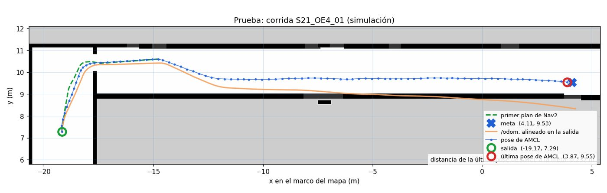

Fase 5 · integración del sistema y pruebas

# Semana 21: Campaña de treinta misiones

31 de agosto al 6 de septiembre de 2026

## Lo que se hizo

- Campaña en simulación adelantada tres semanas: treinta misiones sorteadas con semilla fija en cuatro estratos, corridas el 4 y el 5 de septiembre. Veredicto válido, cero descartes, 26 de 30 éxitos; error de llegada mediano 0,106 m; los cuatro fallos se quedaron cortos (0,284 a 0,347 m).
- Tres grabaciones salieron sin factor de tiempo real y se regrabaron (instrumento, no resultado).
- Desbloqueos: dos coordinadores vivos se robaban la meta; la comprobación previa medía la posición de aparición en vez de la localización; un remapeo de reloj no llegaba a los controladores.
- Vehículo: pasillo de pruebas de 20,08 m medido y marcado; la primera pasada de mapeo dio un mapa curvo y se detuvo; las grabaciones salían vacías porque el grabador y los programas del fabricante tenían dueños distintos, y la memoria compartida exige el mismo dueño en los dos extremos.
- Interfaz web empezada el 2 de septiembre por Jonny, en JavaScript sin bibliotecas sobre `rosbridge` (`roslib.js` descartado por implementar las acciones de ROS 1).

## Avance de los objetivos al cierre de la semana

Arquitectura80 %

Plataforma robótica55 %

Interfaz35 %

Evaluación85 %+30

En color claro, lo que avanzó esta semana. Las cifras son las del informe de la semana 21.

## En imágenes

<figure markdown>
[{ loading=lazy }](img/s21_1.jpg)
<figcaption>Una misión de la campaña en simulación: el primer plan del navegador, la pose estimada y la odometría cruda, cuya separación es la deriva que la localización corrige contra el mapa</figcaption>
</figure>

## Lo que se concluyó

1. El aporte del proyecto pasó de estar demostrado a estar medido. La campaña de treinta misiones sorteadas se ejecutó con veredicto válido y sin descartes, y las cuatro métricas del objetivo 4 tienen valor propio con intervalo de confianza. La continuidad del servicio entre niveles —la variable de respuesta principal— da 14 de 14.
2. Los límites del resultado se declaran junto con el resultado. Con N = 30 lo defendible es que la tasa de éxito supera el 70 %, no que valga 86,7 %; y el contraste entre condiciones no sostiene ninguna conclusión. Es un límite de diseño, conocido antes de correr y no descubierto después.
3. Los cuatro fallos son un solo modo y no son de coordinación. Todos son llegadas cortas dentro de los 10 cm del criterio, atribuibles a la inobservabilidad longitudinal del pasillo ya caracterizada, no a la asignación ni al relevo.
4. La campaña auditó su propio instrumento. Un fallo que ocultaba la pérdida de la medición de RTF y devolvía éxito costó tres corridas. Está corregido en el origen, con una prueba de regresión que se validó demostrando que falla contra el código anterior.
5. Se sostuvo la distinción entre fallo de instrumento y fallo de resultado. Se regrabaron tres misiones no medidas y no se repitió ninguna misión por su resultado, incluida la que volvió a fallar.
6. El punto de decisión de hardware queda abierto, y esa es la respuesta correcta. G2 se intentó y su regla de parada, escrita antes de salir, impidió producir seis mediciones carentes de significado contra un mapa defectuoso. La causa probable —la batería— está medida, no supuesta.
7. Tres defectos que fallaban en silencio se diagnosticaron esta semana: dos coordinadores compitiendo por la misma acción, una compuerta que medía aparcamiento en lugar de localización, y una regla de propiedad de procesos que dejaba grabaciones vacías sin emitir ningún error. Los tres habrían contaminado la campaña de haberse quedado sin resolver.

## Para leer en detalle

[Informe en PDF](https://github.com/shdeza12/Collaborative-Mobile-Robot-System-for-Indoor-Navigation-Assistance-in-Multi-Level-Environments/blob/main/Documentos/Entregables/Entregable_semana_21.pdf){ .md-button } [Fuente en LaTeX](https://github.com/shdeza12/Collaborative-Mobile-Robot-System-for-Indoor-Navigation-Assistance-in-Multi-Level-Environments/blob/main/Documentos/Entregables/Entregable_semana_21.tex){ .md-button }

Evidencia de la semana:

- [Banco del tiempo de asignación (RF-22) — la cifra que el bag no puede dar](https://github.com/shdeza12/Collaborative-Mobile-Robot-System-for-Indoor-Navigation-Assistance-in-Multi-Level-Environments/blob/main/Documentos/Evidencia/S21_banco_tiempo_asignacion.md)
- [El bloqueo de dominios DDS: no es estructural, y hay dos salidas medidas](https://github.com/shdeza12/Collaborative-Mobile-Robot-System-for-Indoor-Navigation-Assistance-in-Multi-Level-Environments/blob/main/Documentos/Evidencia/S21_bloqueo_dominios.md)
- [G2, tres días antes: lo que habría quemado la mañana del viernes](https://github.com/shdeza12/Collaborative-Mobile-Robot-System-for-Indoor-Navigation-Assistance-in-Multi-Level-Environments/blob/main/Documentos/Evidencia/S21_preparacion_G2.md)
- [El relevo entre pisos, ejecutado — el aporte declarado deja de ser un plan](https://github.com/shdeza12/Collaborative-Mobile-Robot-System-for-Indoor-Navigation-Assistance-in-Multi-Level-Environments/blob/main/Documentos/Evidencia/S21_relevo_ejecutado.md)

[:material-arrow-left: Semana 20](s20.md) · [Todas las semanas](index.md) · [Semana 22 :material-arrow-right:](s22.md)

