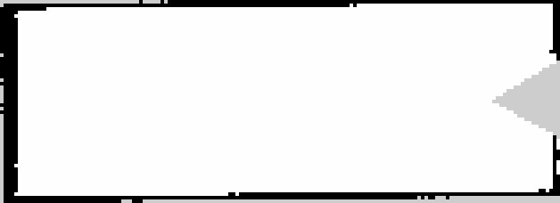
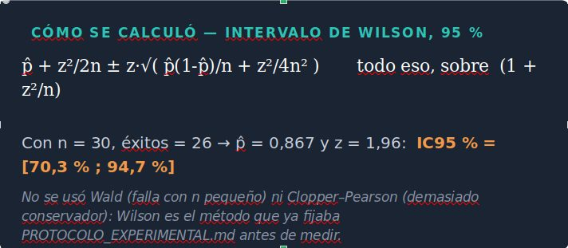
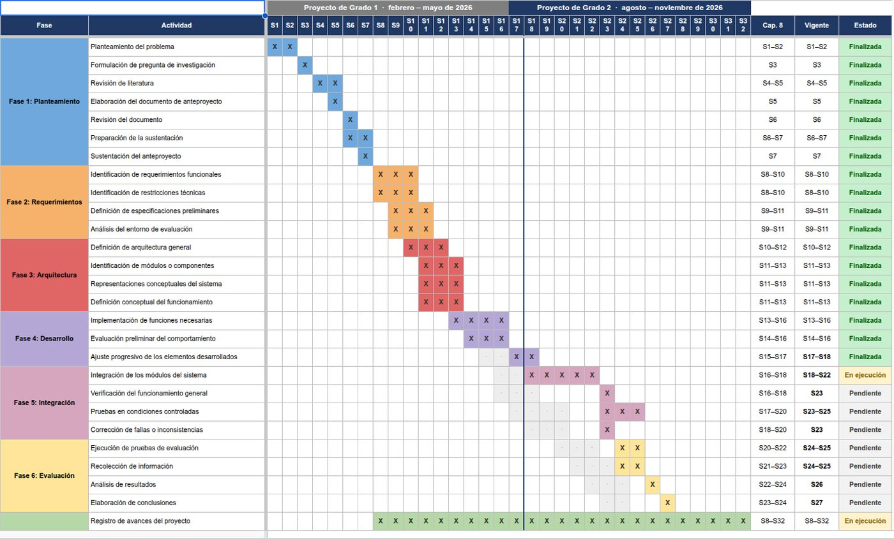
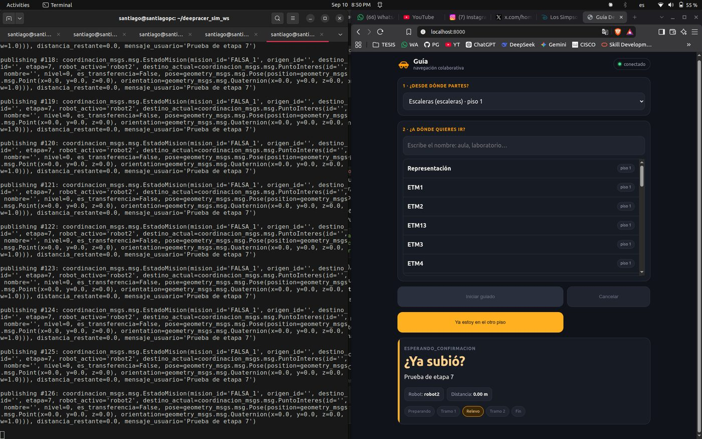

Fase 5 · integración del sistema y pruebas

# Semana 22: Interfaz en el teléfono e información de avance

7 al 13 de septiembre de 2026

## Lo que se hizo

- La interfaz operó una misión desde un teléfono real en la red de los vehículos, con los puertos de la página y del puente abiertos solo a esa subred.
- Confirmación de cambio de piso, a partir de las cinco situaciones de usuario que planteó el director: el segundo tramo arrancaba con el usuario todavía en el otro piso.
- La cancelación no funcionaba (sin función de respuesta en el servidor de acción).
- 8 de septiembre: cuatro mapas del pasillo rechazados. Se midió el mecanismo: en un pasillo recto el avance no está en el dato del LiDAR. En una caja cerrada simulada de 7,70 × 2,70 m el mapa salió bien (98,1 % en X, 95,0 % en Y): el primer mapa aceptado del proyecto, y la condición pasa a ser medible (estructura dentro del alcance del sensor).
- Revisión del protocolo: el criterio binario de continuidad no puede fallar; se reformula como invariante con el intervalo del relevo como medida.
- El primer objetivo quedó completo (10 de 10).

## Avance de los objetivos al cierre de la semana

Arquitectura100 %+20

Plataforma robótica55 %

Interfaz90 %+55

Evaluación85 %

En color claro, lo que avanzó esta semana. Las cifras son las del informe de la semana 22.

## En imágenes

<figure markdown>
[{ loading=lazy }](img/s22_1.jpg)
<figcaption>Izquierda: la pasada más suave (2046), que produce un mapa de 1166 m de extensión. Derecha: una pasada conducida (2029). El movimiento brusco no explica la diferencia.</figcaption>
</figure>

<figure markdown>
[{ loading=lazy }](img/s22_2.jpg)
<figcaption>Primer mapa aceptado por la cadena SLAM del proyecto, sobre la caja cerrada en simulación. La verdad de terreno es exacta porque procede del propio simulador.</figcaption>
</figure>

<figure markdown>
[{ loading=lazy }](img/s22_3.jpg)
<figcaption>Cálculo del intervalo de Wilson de la tasa de éxito (26 de 30)</figcaption>
</figure>

<figure markdown>
[{ loading=lazy }](img/s22_4.jpg)
<figcaption>Cronograma en Gantt de los dos semestres con el estado de cada actividad</figcaption>
</figure>

<figure markdown>
[{ loading=lazy }](img/s22_5.jpg)
<figcaption>Interfaz web durante una misión: tramo 1, «Sígueme»</figcaption>
</figure>

<figure markdown>
[{ loading=lazy }](img/s22_6.jpg)
<figcaption>Interfaz web pidiendo confirmar el cambio de piso («¿Ya subió?»)</figcaption>
</figure>

## Lo que se concluyó

1. El sistema está completo de extremo a extremo, y hay registro de ello. Una persona pidió una misión desde un teléfono y el sistema la ejecutó con relevo entre niveles sin intervención. El criterio de cierre de la semana se cumplió con un registro validado, no con una declaración.
2. Un requisito nuevo protege al usuario de un éxito falso. RF-28 impide que la misión se complete con la persona en el piso equivocado, y su regresión verifica que la etapa nueva no altera ninguna métrica ya medida.
3. El punto de decisión de hardware sigue abierto, pero la salida no fue estéril. La hipótesis que se traía quedó refutada por la medida, y el mecanismo real —que la información de avance no está en el dato del sensor en un pasillo uniforme— quedó caracterizado con cifras.
4. El proyecto tiene por primera vez un mapa aceptado con SLAM. Con él, la condición para que la cadena funcione deja de ser una conjetura y pasa a ser un criterio medible antes de salir a campo.
5. R12 queda cerrado con mecanismo y con caso de control. La misión anómala se explica por una guarda de 3,16 cm en el controlador, y el contraejemplo que lo confirma está en la misma grabación. Ninguna corrida se repitió.
6. La variable de respuesta principal del objetivo 4 no puede dar "no". Sus 30 verificaciones en verde no son evidencia. No se corrige inventando una ruta de fallo: se corrige reescribiendo la afirmación para que se apoye en una magnitud que sí discrimina, y declarando el resto como invariante estructural.
7. El objetivo 1 queda cerrado y el objetivo 3 pasa del 35 al 90 %. El avance agregado supera al calendario por primera vez, con la advertencia de que lo que va adelantado es la implementación y lo que va atrasado es el documento.

## Para leer en detalle

[Fuente en LaTeX](https://github.com/shdeza12/Collaborative-Mobile-Robot-System-for-Indoor-Navigation-Assistance-in-Multi-Level-Environments/blob/main/Documentos/Entregables/Entregable_semana_22.tex){ .md-button }

Evidencia de la semana:

- [R12 — La misión de 85 cúspides, explicada](https://github.com/shdeza12/Collaborative-Mobile-Robot-System-for-Indoor-Navigation-Assistance-in-Multi-Level-Environments/blob/main/Documentos/Evidencia/S22_R12_85_cuspides.md)
- [RF-28 — Confirmación del usuario en la transición entre pisos](https://github.com/shdeza12/Collaborative-Mobile-Robot-System-for-Indoor-Navigation-Assistance-in-Multi-Level-Environments/blob/main/Documentos/Evidencia/S22_RF28_confirmacion.md)
- [Barrido del protocolo: qué criterios no pueden fallar](https://github.com/shdeza12/Collaborative-Mobile-Robot-System-for-Indoor-Navigation-Assistance-in-Multi-Level-Environments/blob/main/Documentos/Evidencia/S22_barrido_criterios_infalsables.md)
- [El mapa del pasillo no sale, y la causa no es cómo se mueve el carro](https://github.com/shdeza12/Collaborative-Mobile-Robot-System-for-Indoor-Navigation-Assistance-in-Multi-Level-Environments/blob/main/Documentos/Evidencia/S22_mapeo_pasillo_fallido.md)

[:material-arrow-left: Semana 21](s21.md) · [Todas las semanas](index.md) · [Semana 23 :material-arrow-right:](s23.md)

