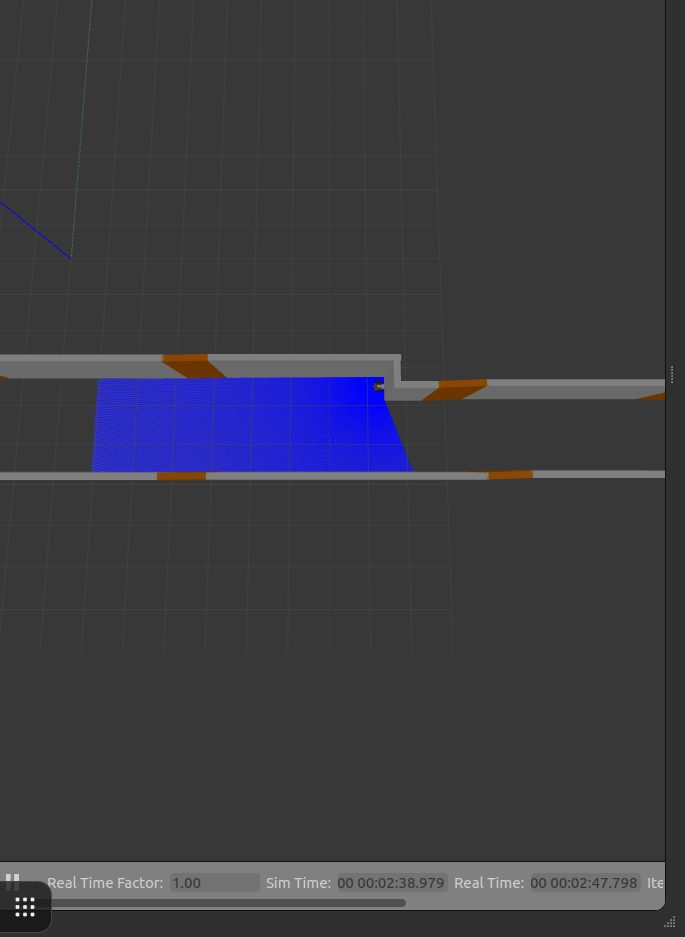

Fase 5 · integración del sistema y pruebas

# Semana 23: Segundo vehículo y congelación del código

14 al 20 de septiembre de 2026

## Lo que se hizo

- Cancelación corregida por Jonny (13 de septiembre): el vehículo vuelve a su escalera. Verificada con una corrida cancelada y una de control.
- 14 de septiembre: llega el segundo vehículo, en intervención técnica desde agosto. Comunicación entre los dos vehículos: 600 de 600 mensajes, ida y vuelta de 7,61 ms de mediana y 20,76 ms de percentil 95. El cortafuegos de los vehículos bloqueaba el tráfico entre ellos.
- Información de avance medida en los pasillos reales de los pisos 1 y 2: insuficiente.
- 17 de septiembre: banda muerta de tracción, toda orden por debajo de 0,40 m/s daba potencia cero. Una orden movió los dos vehículos (el tópico de servos no tiene espacio de nombres): desde entonces se enciende uno a la vez hasta aislarlos.
- 18 de septiembre: código congelado (`v0.4-implementacion-congelada`) y mapa del trabajo restante, con una sola ruta crítica: la odometría en el vehículo.

## Avance de los objetivos al cierre de la semana

Arquitectura100 %

Plataforma robótica65 %+10

Interfaz100 %+10

Evaluación85 %

En color claro, lo que avanzó esta semana. Las cifras son las del informe de la semana 23.

## En imágenes

<figure markdown>
[{ loading=lazy }](img/s23_1.jpg)
<figcaption>La información de avance cae del 17,5 % junto al hall al 5,9 % a partir de 6,2 m</figcaption>
</figure>

<figure markdown>
[{ loading=lazy }](img/s23_2.jpg)
<figcaption>Vista superior del pasillo simulado con el LiDAR</figcaption>
</figure>

## Lo que se concluyó

1. El código quedó congelado el 18 de septiembre con los objetivos 1 y 3 completos. Lo pendiente de los objetivos 2 y 4 depende de la plataforma física.
2. El requisito de comunicación entre vehículos (RF-15) se verificó el mismo día en que llegó el segundo vehículo: latencia mediana de 7,61 ms frente a un límite de 100 ms, sin pérdida de mensajes.
3. El objetivo 3 quedó completo con la verificación de la cancelación de misiones (RF-29): el vehículo regresó a 0,121 m de la escalera, dentro del criterio de 0,25 m.
4. La información de avance en los pasillos reales es de 5,1 % en el piso 1 y 5,9 % en el piso 2, por debajo del 6,8 % del pasillo simulado cuyo mapa falló. Queda descartado que el vehículo construya el mapa del pasillo recorriéndolo, y la única ruta crítica es publicar su odometría.
5. La corrida física completa que exigía el criterio de cierre no se realizó, y esa parte del criterio se declara no cumplida.

## Para leer en detalle

[Informe completo](https://github.com/shdeza12/Collaborative-Mobile-Robot-System-for-Indoor-Navigation-Assistance-in-Multi-Level-Environments/blob/main/Documentos/Entregables/Entregable_semana_23.md){ .md-button } [Fuente en LaTeX](https://github.com/shdeza12/Collaborative-Mobile-Robot-System-for-Indoor-Navigation-Assistance-in-Multi-Level-Environments/blob/main/Documentos/Entregables/Entregable_semana_23.tex){ .md-button }

Evidencia de la semana:

- [La escala de tracción, medida sobre el carro: dos defectos en vez de uno](https://github.com/shdeza12/Collaborative-Mobile-Robot-System-for-Indoor-Navigation-Assistance-in-Multi-Level-Environments/blob/main/Documentos/Evidencia/S23_campo_traccion_RF14.md)
- [El pasillo real no le da a rf2o de dónde sacar el avance: 5,1 % medido](https://github.com/shdeza12/Collaborative-Mobile-Robot-System-for-Indoor-Navigation-Assistance-in-Multi-Level-Environments/blob/main/Documentos/Evidencia/S23_informacion_avance_piso1.md)
- [El piso 2 tampoco: 5,9 % medido, y la predicción que lo esperaba mejor falló](https://github.com/shdeza12/Collaborative-Mobile-Robot-System-for-Indoor-Navigation-Assistance-in-Multi-Level-Environments/blob/main/Documentos/Evidencia/S23_informacion_avance_piso2.md)
- [Los 46 registros se rehacen desde los bags y dan lo mismo](https://github.com/shdeza12/Collaborative-Mobile-Robot-System-for-Indoor-Navigation-Assistance-in-Multi-Level-Environments/blob/main/Documentos/Evidencia/S23_reproducibilidad_de_los_registros.md)

[:material-arrow-left: Semana 22](s22.md) · [Todas las semanas](index.md) · [Semana 24 :material-arrow-right:](s24.md)

