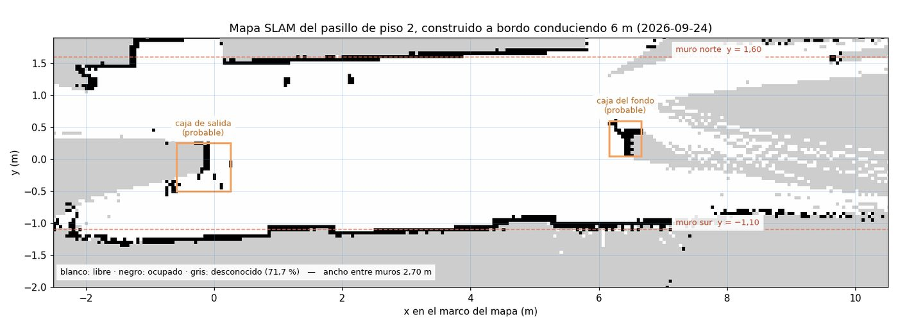
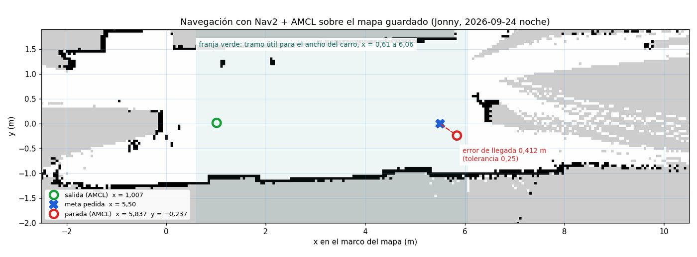
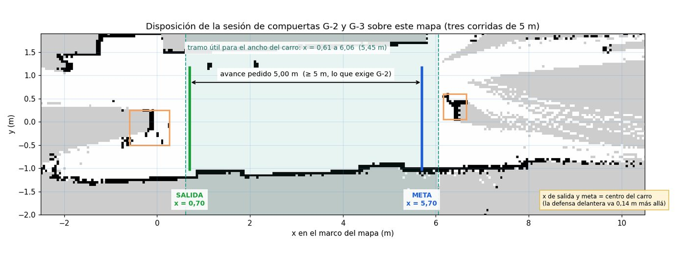
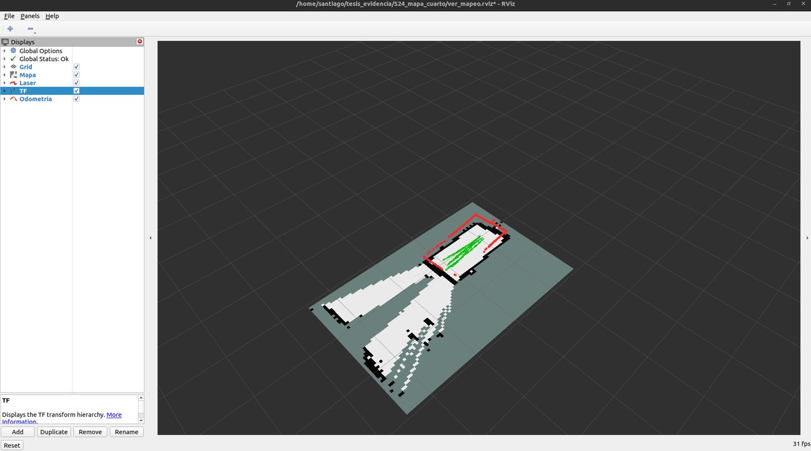
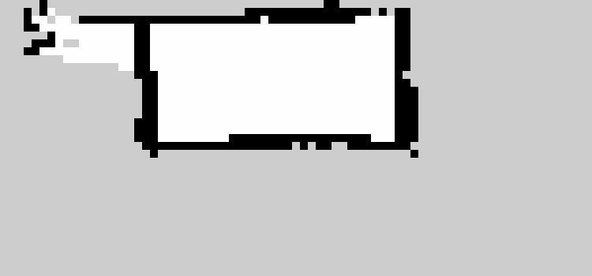
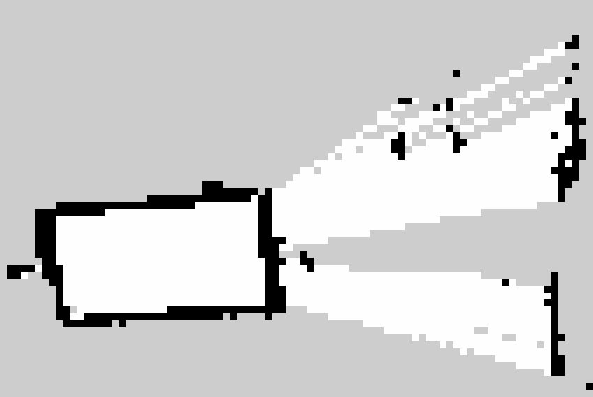

Fase 5 · integración del sistema y pruebas

# Semana 24: Decisión de la demostración física y navegación real

21 al 27 de septiembre de 2026

## Lo que se hizo

- 21 de septiembre: se decide intentar la demostración física con los dos vehículos. El acta fija seis pruebas de verificación con criterio, fecha y reversión.
- La «avería» del segundo vehículo era de permisos: los programas del fabricante corren como administrador y la memoria compartida no deja intercambiar datos con otro usuario.
- Con los dos vehículos encendidos, cada grabación recogía el LiDAR del otro: se retiraron las cinco grabaciones del 28 de agosto.
- 24 de septiembre, siete pasos sobre el vehículo: odometría con rf2o (tres recorridos de 3,00 m con flexómetro, entre 96,3 y 101,9 %); SLAM a bordo en un cuarto; mapa del pasillo del piso 2 con 6,093 y 6,032 m registrados para 6,00 m; y esa noche Jonny llevó el vehículo con Nav2 y AMCL de forma autónoma sobre ese mapa.
- Guía para las pruebas de odometría y de llegada, y diseño del aislamiento entre vehículos.

## Avance de los objetivos al cierre de la semana

Arquitectura100 %

Plataforma robótica65 %

Interfaz100 %

Evaluación85 %

En color claro, lo que avanzó esta semana. Las cifras son las del informe de la semana 24.

## En imágenes

<figure markdown>
[{ loading=lazy }](img/s24_1.jpg)
<figcaption>Mapa del pasillo de piso 2 en metros, con los dos muros y las dos cajas probables</figcaption>
</figure>

<figure markdown>
[{ loading=lazy }](img/s24_2.jpg)
<figcaption>La navegación sobre el mapa guardado: salida, meta pedida y parada</figcaption>
</figure>

<figure markdown>
[{ loading=lazy }](img/s24_3.jpg)
<figcaption>Disposición de la sesión de pruebas sobre el mapa</figcaption>
</figure>

<figure markdown>
[{ loading=lazy }](img/s24_4.jpg)
<figcaption>Mapa del cuarto construido por el vehículo, en RViz</figcaption>
</figure>

<figure markdown>
[{ loading=lazy }](img/s24_5.jpg)
<figcaption>El cuarto de 1,60 × 0,76 m, con el lóbulo de la izquierda</figcaption>
</figure>

<figure markdown>
[{ loading=lazy }](img/s24_6.jpg)
<figcaption>Primer intento: trazos barridos sin una pared recta, la firma de una pose que deriva</figcaption>
</figure>

## Lo que se concluyó

1. En la misma semana en que se decidió intentar la demostración física, Nav2 guió al vehículo real de forma autónoma sobre un mapa construido por el propio vehículo.
2. Los fallos de comunicación con el vehículo, que venían de tres semanas atrás, tenían una sola causa: los permisos de usuario de los procesos. Corregida esa causa, el 22 de septiembre se alcanzaron las compuertas G-1 y G-4.
3. La odometría del vehículo quedó dentro del ±10 % en las tres pasadas de 3 m (razón media 0,982). Falta la medición sobre 5 m con flexómetro que exige la compuerta G-2.
4. Nav2 guía al vehículo, pero la parada queda a 0,412 m de la meta, por encima de la tolerancia de 0,25 m, a causa de la banda muerta de la tracción. Los directores deben decidir la tolerancia de llegada antes de la campaña.
5. La sesión de pruebas de G-2 y G-3 está documentada y ensayada en simulación. La interferencia entre los dos vehículos, que impide operar el sistema completo, tiene una solución diseñada y probada en el portátil (9 de 9 pruebas), pendiente de confirmar en los vehículos.

## Para leer en detalle

[Informe completo](https://github.com/shdeza12/Collaborative-Mobile-Robot-System-for-Indoor-Navigation-Assistance-in-Multi-Level-Environments/blob/main/Documentos/Entregables/Entregable_semana_24.md){ .md-button } [Fuente en LaTeX](https://github.com/shdeza12/Collaborative-Mobile-Robot-System-for-Indoor-Navigation-Assistance-in-Multi-Level-Environments/blob/main/Documentos/Entregables/Entregable_semana_24.tex){ .md-button }

Evidencia de la semana:

- [RF-16 sobre hardware: el mismo código fuente compila y corre en Humble y en Jazzy](https://github.com/shdeza12/Collaborative-Mobile-Robot-System-for-Indoor-Navigation-Assistance-in-Multi-Level-Environments/blob/main/Documentos/Evidencia/S24_RF16_compilacion_jazzy_hardware.md)
- [RF-11 no se mide por `/cmd_vel`: el vehículo no tiene ese tópico, y `servo_pkg` dejó de atender](https://github.com/shdeza12/Collaborative-Mobile-Robot-System-for-Indoor-Navigation-Assistance-in-Multi-Level-Environments/blob/main/Documentos/Evidencia/S24_actuacion_bloqueada_servo.md)
- [RF-11 · análisis previo al campo: la cadena `/cmd_vel` no puede mover el carro a las velocidades que Nav2 tiene configuradas](https://github.com/shdeza12/Collaborative-Mobile-Robot-System-for-Indoor-Navigation-Assistance-in-Multi-Level-Environments/blob/main/Documentos/Evidencia/S24_analisis_previo_RF11.md)
- [S24 · la rampa de tracción sobre el `amss-ez9n`: trece corridas, y el control que las invalida como velocidad](https://github.com/shdeza12/Collaborative-Mobile-Robot-System-for-Indoor-Navigation-Assistance-in-Multi-Level-Environments/blob/main/Documentos/Evidencia/S24_campo_traccion_ez9n.md)
- [Compuerta G-4: los dos vehículos y el coordinador en el mismo grafo](https://github.com/shdeza12/Collaborative-Mobile-Robot-System-for-Indoor-Navigation-Assistance-in-Multi-Level-Environments/blob/main/Documentos/Evidencia/S24_compuerta_G4_dos_en_el_grafo.md)
- [El conjunto de datos de OE4, consolidado: 30 corridas que regeneran sus propias métricas](https://github.com/shdeza12/Collaborative-Mobile-Robot-System-for-Indoor-Navigation-Assistance-in-Multi-Level-Environments/blob/main/Documentos/Evidencia/S24_consolidacion_datos_oe4.md)
- [La tarjeta sí publica imagen, pero a 160 × 120 y sin calibrar](https://github.com/shdeza12/Collaborative-Mobile-Robot-System-for-Indoor-Navigation-Assistance-in-Multi-Level-Environments/blob/main/Documentos/Evidencia/S24_desempate_camara_vehiculo.md)
- [S24 — Dejar los dos carros listos para la pasada de odometría](https://github.com/shdeza12/Collaborative-Mobile-Robot-System-for-Indoor-Navigation-Assistance-in-Multi-Level-Environments/blob/main/Documentos/Evidencia/S24_dos_carros_listos.md)
- [Fe de erratas del informe de la semana 15, y cierre del riesgo R6](https://github.com/shdeza12/Collaborative-Mobile-Robot-System-for-Indoor-Navigation-Assistance-in-Multi-Level-Environments/blob/main/Documentos/Evidencia/S24_fe_de_erratas_S15.md)
- [S24 · Los tres mapas del cuarto sobre hardware, y la medida que se sale del cuarto](https://github.com/shdeza12/Collaborative-Mobile-Robot-System-for-Indoor-Navigation-Assistance-in-Multi-Level-Environments/blob/main/Documentos/Evidencia/S24_mapas_cuarto_extintor.md)
- [El vehículo se conduce solo seis metros y construye el mapa mientras lo hace](https://github.com/shdeza12/Collaborative-Mobile-Robot-System-for-Indoor-Navigation-Assistance-in-Multi-Level-Environments/blob/main/Documentos/Evidencia/S24_mapeo_6m_hardware.md)
- [Peldaños 6 y 7: Nav2 navega el vehículo sobre un mapa guardado](https://github.com/shdeza12/Collaborative-Mobile-Robot-System-for-Indoor-Navigation-Assistance-in-Multi-Level-Environments/blob/main/Documentos/Evidencia/S24_nav2_navegacion_mapa_guardado.md)
- [Peldaño 2 sobre hardware: la odometría publica Y mide](https://github.com/shdeza12/Collaborative-Mobile-Robot-System-for-Indoor-Navigation-Assistance-in-Multi-Level-Environments/blob/main/Documentos/Evidencia/S24_peldano2_odometria_hardware.md)
- [Sonda de actuación sobre `amss-ez9n`: ¿la avería del nodo de servos es de un vehículo o de la plataforma?](https://github.com/shdeza12/Collaborative-Mobile-Robot-System-for-Indoor-Navigation-Assistance-in-Multi-Level-Environments/blob/main/Documentos/Evidencia/S24_sonda_actuacion_amss_ez9n.md)
- [El vehículo publica TF por primera vez: `base_link → laser` medido contra flexómetro](https://github.com/shdeza12/Collaborative-Mobile-Robot-System-for-Indoor-Navigation-Assistance-in-Multi-Level-Environments/blob/main/Documentos/Evidencia/S24_tf_hardware_peldano_1.md)

[:material-arrow-left: Semana 23](s23.md) · [Todas las semanas](index.md) · [Semana 25 :material-arrow-right:](s25.md)

