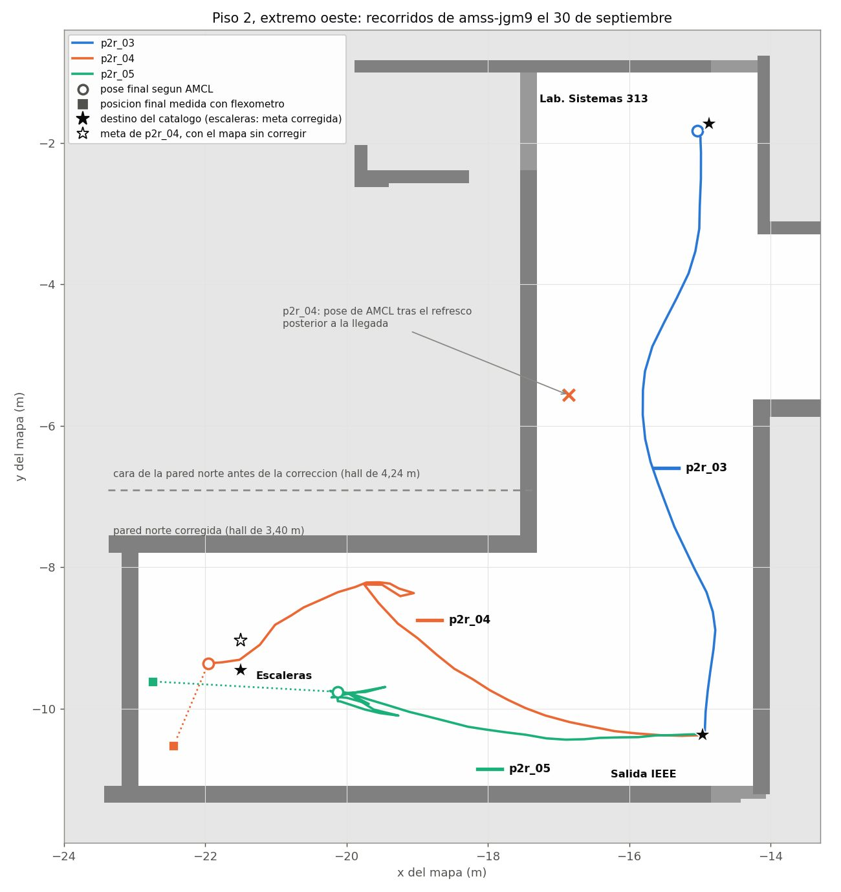
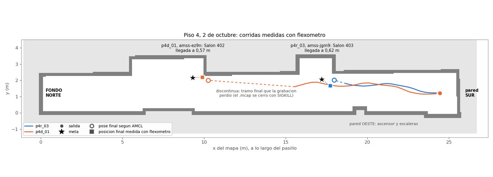
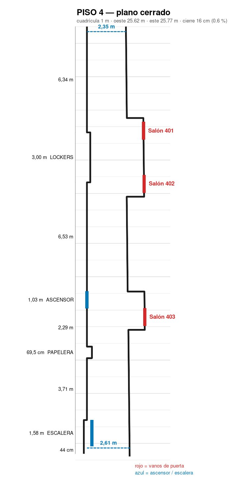
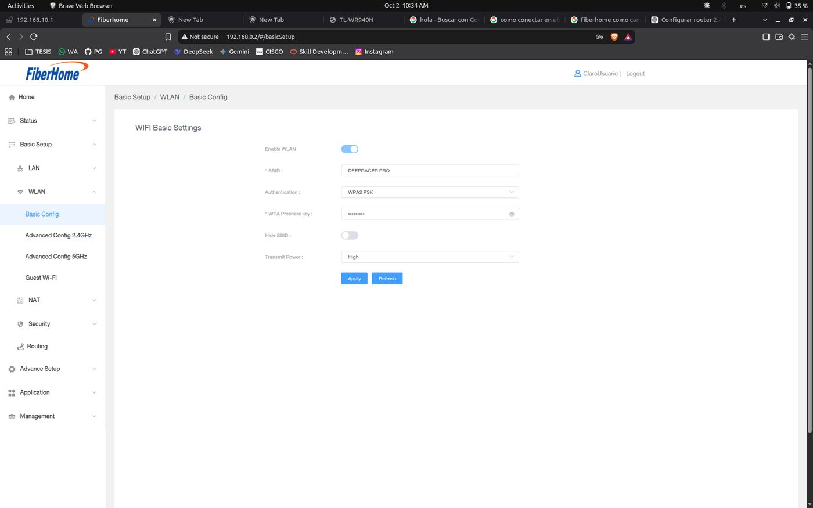
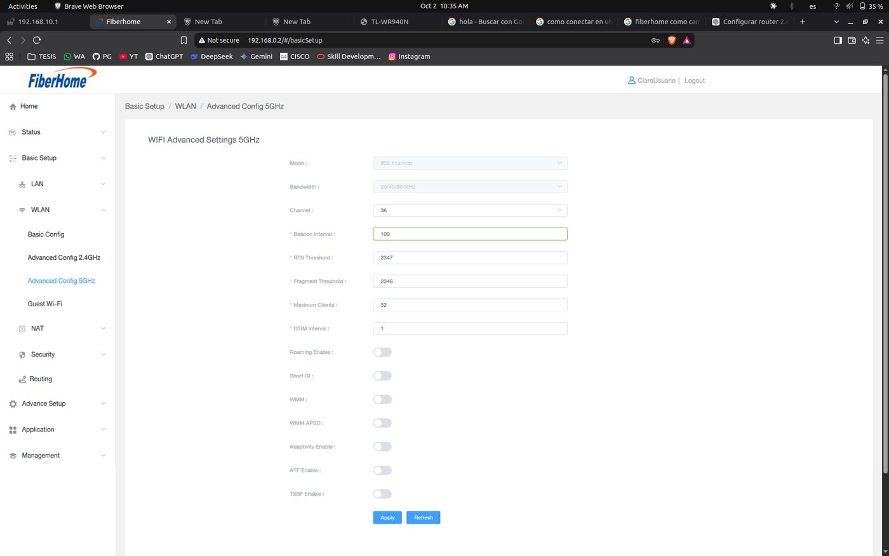
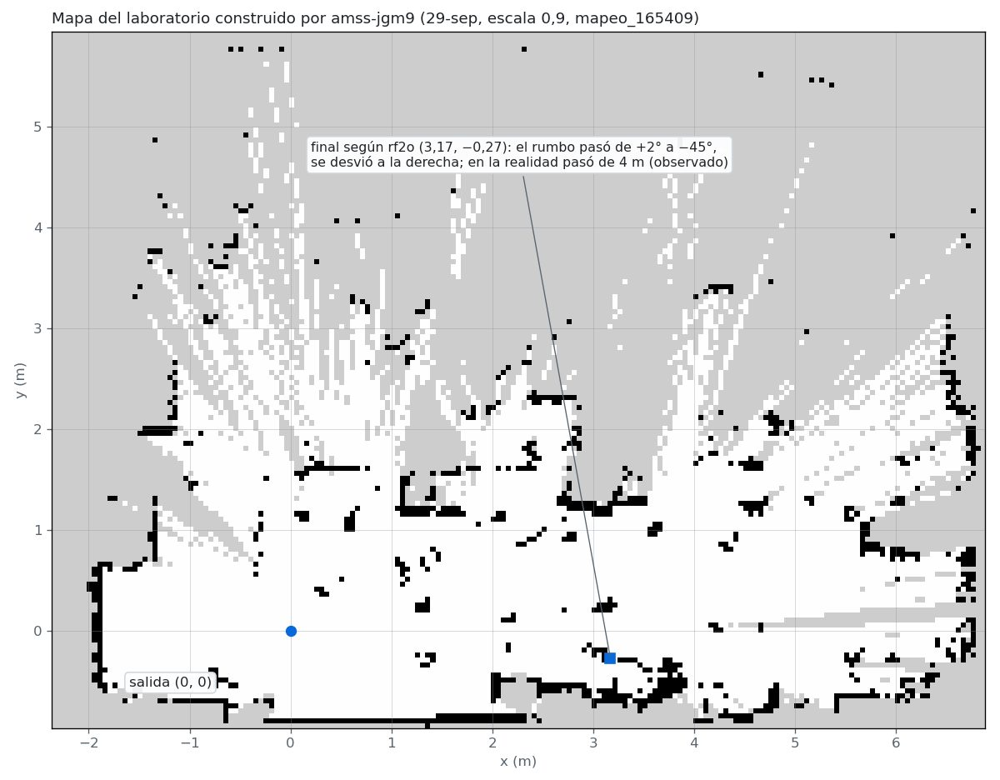

Fase 5 · integración del sistema y pruebas

# Semana 25: Aislamiento, piso 2 y paso a los pisos 3 y 4

28 de septiembre al 4 de octubre de 2026

## Lo que se hizo

- 28 de septiembre: el director fija el sitio, el número de corridas de la campaña con los vehículos y la tolerancia de llegada (0,5 m en los vehículos, 0,25 m en simulación). Esa noche, los dos vehículos aislados con una partición de comunicaciones cada uno.
- Ajustes de Nav2 en el vehículo: el puente ya no da potencia cero por debajo de 0,40 m/s; parche de rf2o (con la transformada del láser vacía invertía la odometría); margen de llegada de 1,0 m.
- 30 de septiembre, hall del piso 2: llegadas a 1,43 y 1,26 m, rf2o con el 73 % del avance, y el hall medía 3,40 m contra 4,24 m del modelo (25 % mayor). Las demás medidas del modelo nunca se habían comprobado.
- Cambio de sitio a los pisos 3 y 4, levantados con flexómetro por Jonny (2 de octubre), con su catálogo de puntos.
- 2 de octubre, piso 4: odometría con +3,3 % sobre 14,57 m y −4,6 % sobre 6,68 m; llegadas a 0,57 y 0,62 m, cortas por el margen de 1,0 m.

## Avance de los objetivos al cierre de la semana

Arquitectura100 %

Plataforma robótica79 %

Interfaz100 %

Evaluación89 %

En color claro, lo que avanzó esta semana. Las cifras son las del informe de la semana 25.

## En imágenes

<figure markdown>
[{ loading=lazy }](img/s25_1.jpg)
<figcaption>Recorridos según AMCL de p2r_03, p2r_04 y p2r_05 sobre el mapa corregido, con la pose final de AMCL y la posición medida con flexómetro</figcaption>
</figure>

<figure markdown>
[{ loading=lazy }](img/s25_2.jpg)
<figcaption>Recorridos de AMCL de p4r_03 y p4d_01 en el piso 4, con la pose final de AMCL y la posición medida con flexómetro</figcaption>
</figure>

<figure markdown>
[{ loading=lazy }](img/s25_3.jpg)
<figcaption>Plano del piso 4 levantado con flexómetro</figcaption>
</figure>

<figure markdown>
[{ loading=lazy }](img/s25_4.jpg)
<figcaption>Red DEEPRACER-PRO configurada en el punto de acceso del piso</figcaption>
</figure>

<figure markdown>
[{ loading=lazy }](img/s25_5.jpg)
<figcaption>Ajustes de 5 GHz del punto de acceso</figcaption>
</figure>

<figure markdown>
[{ loading=lazy }](img/s25_6.jpg)
<figcaption>Mapa del laboratorio, con la salida y el final de la marcha según rf2o</figcaption>
</figure>

## Lo que se concluyó

1. Los dos vehículos pueden estar encendidos a la vez sin interferirse: cada uno recibe solo sus órdenes y su LiDAR.
2. El modelo del piso 2 no correspondía al edificio: el hall mide 3,40 m y el modelo daba 4,24 m. Los pisos 3 y 4, levantados con flexómetro, cierran con un error de 0,32 % y 0,62 %.
3. En el piso 4 la odometría cumplió el criterio de G-2 en las dos corridas medidas, con +3,3 % sobre 14,57 m y −4,6 % sobre 6,68 m, frente al 73 % del recorrido que registró en el hall del piso 2.
4. G-3 no se alcanzó: las llegadas quedaron a 0,57 m y 0,62 m, cortas, porque Nav2 se detiene dentro de su margen de 1,0 m. El error de AMCL en la llegada fue de 0,42 m y 0,43 m.
5. Las fallas que impidieron más corridas fueron de operación: la carga de la tarjeta, la red inalámbrica, la batería y la escala de velocidad de cada vehículo.

## Para leer en detalle

[Informe completo](https://github.com/shdeza12/Collaborative-Mobile-Robot-System-for-Indoor-Navigation-Assistance-in-Multi-Level-Environments/blob/main/Documentos/Entregables/Entregable_semana_25.md){ .md-button } [Fuente en LaTeX](https://github.com/shdeza12/Collaborative-Mobile-Robot-System-for-Indoor-Navigation-Assistance-in-Multi-Level-Environments/blob/main/Documentos/Entregables/Entregable_semana_25.tex){ .md-button }

Evidencia de la semana:

- [Aislamiento de los dos vehículos (bloque A, 28 de septiembre)](https://github.com/shdeza12/Collaborative-Mobile-Robot-System-for-Indoor-Navigation-Assistance-in-Multi-Level-Environments/blob/main/Documentos/Evidencia/S25_aislamiento_dos_carros.md)
- [Sesión de compuertas G-2 y G-3 con `amss-ez9n` (29 de septiembre, noche)](https://github.com/shdeza12/Collaborative-Mobile-Robot-System-for-Indoor-Navigation-Assistance-in-Multi-Level-Environments/blob/main/Documentos/Evidencia/S25_campana_c1_deepy.md)
- [Ensayo de B0 con `amss-jgm9` (29 de septiembre)](https://github.com/shdeza12/Collaborative-Mobile-Robot-System-for-Indoor-Navigation-Assistance-in-Multi-Level-Environments/blob/main/Documentos/Evidencia/S25_ensayo_laboratorio.md)
- [Sesión de G-2 y G-3 con `amss-jgm9` en el piso 2 (30 de septiembre, noche)](https://github.com/shdeza12/Collaborative-Mobile-Robot-System-for-Indoor-Navigation-Assistance-in-Multi-Level-Environments/blob/main/Documentos/Evidencia/S25_pasillo_piso2_amss-jgm9.md)
- [Primera sesión en los pisos 3 y 4 (2 de octubre)](https://github.com/shdeza12/Collaborative-Mobile-Robot-System-for-Indoor-Navigation-Assistance-in-Multi-Level-Environments/blob/main/Documentos/Evidencia/S25_pisos34_campo.md)

[:material-arrow-left: Semana 24](s24.md) · [Todas las semanas](index.md) · [Semana 26 :material-arrow-right:](s26.md)

