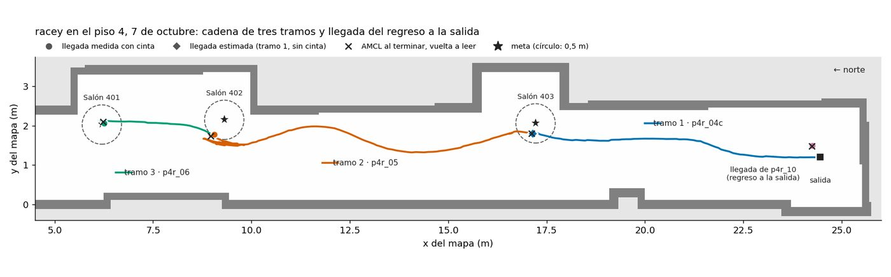
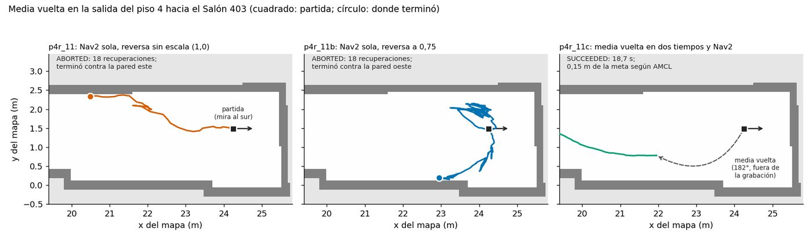
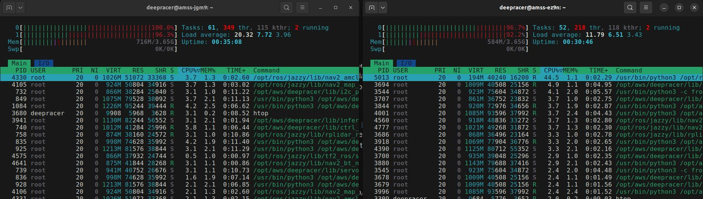
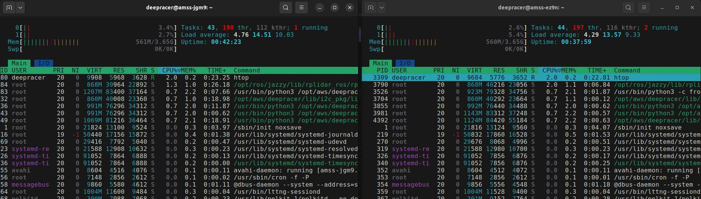

Fase 5 · integración del sistema y pruebas

# Semana 26: Unidad inercial, red, llegada verificada y coordinador al portátil

5 al 11 de octubre de 2026

## Lo que se hizo

- 5 de octubre: los directores aceptan los pisos 3 y 4; entre misiones el vehículo sale desde donde terminó la anterior, y vuelve a su escalera solo al cancelar.
- Unidad inercial Bosch BMI160 de la tarjeta integrada en los dos vehículos: giros de 90° medidos como +90,17° y +88,38°; filtro que toma el avance de rf2o y el giro de la unidad inercial.
- Red (Jonny): los vehículos no podían transmitir en 5 GHz por falta de la base regulatoria; con ella, ida y vuelta de 5,99 ms de mediana. Un bucle de capa 2 duplicaba el 47 % del tráfico.
- 7 de octubre, piso 4: cadena de tres tramos sin intervención, llegadas medidas a 0,06 y 0,45 m (prueba de llegada superada). Reversa reducida al 75 % y media vuelta en varios tiempos.
- 8 de octubre: el otro vehículo recorre el piso 3. Primer intento del relevo con los dos vehículos: la tarjeta llegó a cargas de 22 a 33 y Nav2 no arrancaba. Descubrimiento local en cada vehículo.
- 9 de octubre: coordinador y grabador al portátil, en un contenedor con Jazzy, con topología en estrella. Comprobada en el laboratorio: tarjetas al 54 y 59 % en reposo y al 68 y 74 % navegando.

## Avance de los objetivos al cierre de la semana

Arquitectura100 %

Plataforma robótica79 %

Interfaz100 %

Evaluación89 %

En color claro, lo que avanzó esta semana. Las cifras son las del informe de la semana 26.

## En imágenes

<figure markdown>
[{ loading=lazy }](img/s26_1.jpg)
<figcaption>Cadena de tres tramos de racey en el piso 4 y llegada del regreso a la salida, con las llegadas medidas, la estimada y la posición de AMCL</figcaption>
</figure>

<figure markdown>
[{ loading=lazy }](img/s26_2.jpg)
<figcaption>Trayectorias de la media vuelta en la salida del piso 4: p4r_11, p4r_11b y p4r_11c</figcaption>
</figure>

<figure markdown>
[{ loading=lazy }](img/s26_3.jpg)
<figcaption>htop en racey (izquierda) y deepy (derecha) a las 11:21, con la cadena arrancando</figcaption>
</figure>

<figure markdown>
[{ loading=lazy }](img/s26_4.jpg)
<figcaption>htop en racey (izquierda) y deepy (derecha) a las 11:28, con la cadena detenida</figcaption>
</figure>

## Lo que se concluyó

1. G-3 se alcanzó: con la IMU integrada, `amss-jgm9` encadenó tres tramos en el piso 4 sin intervención y sus llegadas medidas quedaron a 0,06 m, 0,34 m y 0,45 m de la meta, con una tolerancia de 0,5 m.
2. La IMU mide el giro del vehículo con un error de hasta 1,3 % y deriva 0,3° por minuto o menos, frente a los 5,9° por minuto de la odometría del LiDAR sola.
3. El requisito RF-15 cumple sobre 5 GHz entre los dos vehículos, con 5,99 ms de latencia mediana y 11,12 ms en el percentil 95.
4. G-5 no se corrió: con el coordinador en un vehículo y los dos navegando, las tarjetas se saturaron. Con el coordinador en el portátil, el sistema completo corre con las tarjetas al 68 % y al 74 % navegando.
5. El vehículo da media vuelta en dos tiempos en los pasillos del edificio: 182° en la salida del piso 4, y 160° y 167° en el piso 3 con la maniobra protegida por el LiDAR y el mapa.

## Para leer en detalle

[Informe completo](https://github.com/shdeza12/Collaborative-Mobile-Robot-System-for-Indoor-Navigation-Assistance-in-Multi-Level-Environments/blob/main/Documentos/Entregables/Entregable_semana_26.md){ .md-button } [Fuente en LaTeX](https://github.com/shdeza12/Collaborative-Mobile-Robot-System-for-Indoor-Navigation-Assistance-in-Multi-Level-Environments/blob/main/Documentos/Entregables/Entregable_semana_26.tex){ .md-button }

Evidencia de la semana:

- [Un bucle de capa 2 duplicaba el 47 % del tráfico, y el `ping` decía 0 % de pérdida (7 de octubre)](https://github.com/shdeza12/Collaborative-Mobile-Robot-System-for-Indoor-Navigation-Assistance-in-Multi-Level-Environments/blob/main/Documentos/Evidencia/S26_bucle_capa2_y_red_dos_AP.md)
- [Integración de la IMU en los dos vehículos y ensayo del coordinador (5 de octubre, noche)](https://github.com/shdeza12/Collaborative-Mobile-Robot-System-for-Indoor-Navigation-Assistance-in-Multi-Level-Environments/blob/main/Documentos/Evidencia/S26_integracion_imu_vehiculos.md)
- [Carga y ajustes del sistema completo con los dos vehículos en el laboratorio (9 de octubre, noche)](https://github.com/shdeza12/Collaborative-Mobile-Robot-System-for-Indoor-Navigation-Assistance-in-Multi-Level-Environments/blob/main/Documentos/Evidencia/S26_laboratorio_carga_dos_vehiculos.md)
- [Piso 3 con deepy, primeras medias vueltas del agente e intento de G-5 (8 de octubre, tarde)](https://github.com/shdeza12/Collaborative-Mobile-Robot-System-for-Indoor-Navigation-Assistance-in-Multi-Level-Environments/blob/main/Documentos/Evidencia/S26_piso3_deepy_y_saturacion.md)
- [Cadena del piso 4 con racey y media vuelta en la salida (7 de octubre, tarde)](https://github.com/shdeza12/Collaborative-Mobile-Robot-System-for-Indoor-Navigation-Assistance-in-Multi-Level-Environments/blob/main/Documentos/Evidencia/S26_piso4_cadena_media_vuelta.md)
- [Pruebas de la IMU en los dos vehículos (5 de octubre)](https://github.com/shdeza12/Collaborative-Mobile-Robot-System-for-Indoor-Navigation-Assistance-in-Multi-Level-Environments/blob/main/Documentos/Evidencia/S26_pruebas_imu.md)
- [La WiFi de los dos vehículos no podía transmitir en 5 GHz (5 de octubre)](https://github.com/shdeza12/Collaborative-Mobile-Robot-System-for-Indoor-Navigation-Assistance-in-Multi-Level-Environments/blob/main/Documentos/Evidencia/S26_red_5ghz_regulatorio.md)
- [La simulación de dos robots después de la actualización de ROS del 6 de octubre](https://github.com/shdeza12/Collaborative-Mobile-Robot-System-for-Indoor-Navigation-Assistance-in-Multi-Level-Environments/blob/main/Documentos/Evidencia/S26_simulacion_tras_actualizacion_ros.md)

[:material-arrow-left: Semana 25](s25.md) · [Todas las semanas](index.md) · [Semana 27 :material-arrow-right:](s27.md)

