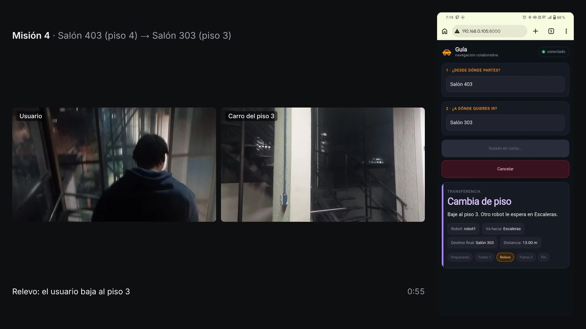

Fase 6 · campaña, análisis y escritura

# Semana 28: Documento final

Desde el 19 de octubre de 2026

## Lo que se hizo

- 19 de octubre: los dos vehículos nivelados con el código vigente (textos con tildes y puntos de interés repetidos con su piso); la prueba del coordinador con vehículos simulados pasó 19 de 19 escenarios dentro de cada uno.
- Documento final: resultados del sistema completo, conclusiones, trabajos futuros y resumen redactados con la campaña, y el recorrido del trabajo desde el DonkeyCar.
- Video de la campaña: el POV del usuario y la pantalla de su teléfono en el mismo instante, con la pantalla sincronizada con el coordinador a ±0,3 s; en los relevos de las misiones 4, 5 y 9, los dos POV lado a lado.
- Corrección: el portátil de la misión 10 se apagó unos 30 s después de la solicitud, no a los 18 s.
- Prueba del sitio del proyecto, con una página por semana.

## Avance de los objetivos al cierre de la semana

Arquitectura100 %

Plataforma robótica100 %

Interfaz100 %

Evaluación100 %

En color claro, lo que avanzó esta semana. Las cifras son las del informe de la semana 28.

## En imágenes

<figure markdown>
[{ loading=lazy }](img/s28_1.jpg)
<figcaption>Relevo de la misión 4 en el video</figcaption>
</figure>

## Lo que se concluyó

1. El documento final tiene redactados los resultados del sistema completo con los dos vehículos y las conclusiones de los cuatro objetivos, y compila sin errores en 91 páginas.
2. El intervalo del relevo en los vehículos mide la reacción del sistema solo cuando el segundo vehículo tiene que ir a su escalera; cuando ya está en ella, mide la confirmación de la persona.
3. El video de la campaña muestra las nueve misiones con la interfaz del usuario sincronizada a ±0,3 s con el coordinador.
4. El dato de la misión 10 publicado en la semana 27 estaba equivocado: el portátil se apagó unos 30 s después de la solicitud, no a los 18 s.

## Para leer en detalle

[Informe completo](https://github.com/shdeza12/Collaborative-Mobile-Robot-System-for-Indoor-Navigation-Assistance-in-Multi-Level-Environments/blob/main/Documentos/Entregables/Entregable_semana_28.md){ .md-button } [Fuente en LaTeX](https://github.com/shdeza12/Collaborative-Mobile-Robot-System-for-Indoor-Navigation-Assistance-in-Multi-Level-Environments/blob/main/Documentos/Entregables/Entregable_semana_28.tex){ .md-button }

Evidencia de la semana:

- [Video de la campaña con los dos vehículos, sincronizado con la pantalla del teléfono (19 y 20 de octubre)](https://github.com/shdeza12/Collaborative-Mobile-Robot-System-for-Indoor-Navigation-Assistance-in-Multi-Level-Environments/blob/main/Documentos/Evidencia/S28_video_campana.md)

[:material-arrow-left: Semana 27](s27.md) · [Todas las semanas](index.md)

