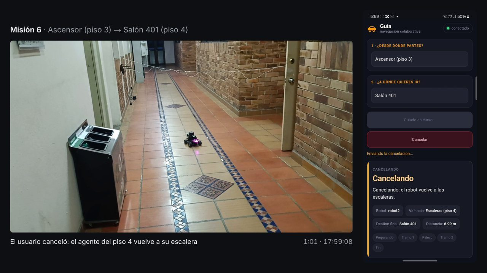

Fase 6 · campaña, análisis y escritura

# Semana 29: Documento recortado y video de las pruebas

26 de octubre al 1 de noviembre de 2026

## Lo que se hizo

- 26 de octubre: la simulación de dos robots, en el portátil: 3 de 3 misiones con relevo. La versión recortada del documento, en paralela a la vigente. Un solo director en todo el repositorio y la pregunta problema con su texto oficial.
- 27 de octubre: revisión del documento con las anotaciones de los autores: «agente» para los robots, edificios Gregorio y Catalayud, texto impersonal, bibliografía de 61 a 41 referencias, anexos con los videos y con el repositorio. La restricción de condiciones controladas quedó verificada, y con ella los 36 requisitos. Propuesta de presentación para la presustentación.
- 29 de octubre: video de las pruebas del 23 de octubre, con la pantalla del teléfono sincronizada. Al sincronizarlo se midió que la página mostró la llegada hasta 46,0 s después que el coordinador, en tres misiones anteriores a las 17:54; la causa no se estableció.
- 1 de noviembre: preliminares del documento y corrección de la evidencia del 23 de octubre. El documento recortado queda en 77 páginas.

## Avance de los objetivos al cierre de la semana

Arquitectura100 %

Plataforma robótica100 %

Interfaz100 %

Evaluación100 %

En color claro, lo que avanzó esta semana. Las cifras son las del informe de la semana 29.

## En imágenes

<figure markdown>
[{ loading=lazy }](img/s29_1.jpg)
<figcaption>Misión 6 en el video: el agente del piso 4 vuelve a su escalera y el teléfono muestra «Cancelando»</figcaption>
</figure>

## Lo que se concluyó

1. Los ajustes de la página funcionaron con el teléfono y los dos vehículos, en una misión de bajada y una de subida completadas con relevo.
2. La cancelación funciona en los vehículos: en las seis cancelaciones hechas después de corregir la media vuelta, el vehículo volvió a su escalera, a entre 0,074 y 0,337 m, dentro de la tolerancia de 0,5 m. Las medias vueltas rechazadas pasaron de 8 de 15 a 0 de 10.
3. La página mostró el final de tres misiones entre 10,47 y 46,00 s después que el coordinador, todas antes de las 17:54, y de las ocho siguientes con 2,00 s o menos. La causa no se estableció.
4. La versión recortada del documento tiene 77 páginas, dentro del rango que pide el director, y los 36 requisitos están verificados.

## Para leer en detalle

[Informe completo](https://github.com/shdeza12/Collaborative-Mobile-Robot-System-for-Indoor-Navigation-Assistance-in-Multi-Level-Environments/blob/main/Documentos/Entregables/Entregable_semana_29.md){ .md-button } [Fuente en LaTeX](https://github.com/shdeza12/Collaborative-Mobile-Robot-System-for-Indoor-Navigation-Assistance-in-Multi-Level-Environments/blob/main/Documentos/Entregables/Entregable_semana_29.tex){ .md-button }

Evidencia de la semana:

- [La simulación de dos robots en el portátil, 26 de octubre](https://github.com/shdeza12/Collaborative-Mobile-Robot-System-for-Indoor-Navigation-Assistance-in-Multi-Level-Environments/blob/main/Documentos/Evidencia/S29_simulacion_relevo_portatil.md)
- [Video de las pruebas del 23 de octubre, sincronizado con la pantalla del teléfono (29 de octubre)](https://github.com/shdeza12/Collaborative-Mobile-Robot-System-for-Indoor-Navigation-Assistance-in-Multi-Level-Environments/blob/main/Documentos/Evidencia/S29_video_pagina_cancelacion.md)

[:material-arrow-left: Semana 28](s28.md) · [Todas las semanas](index.md)

