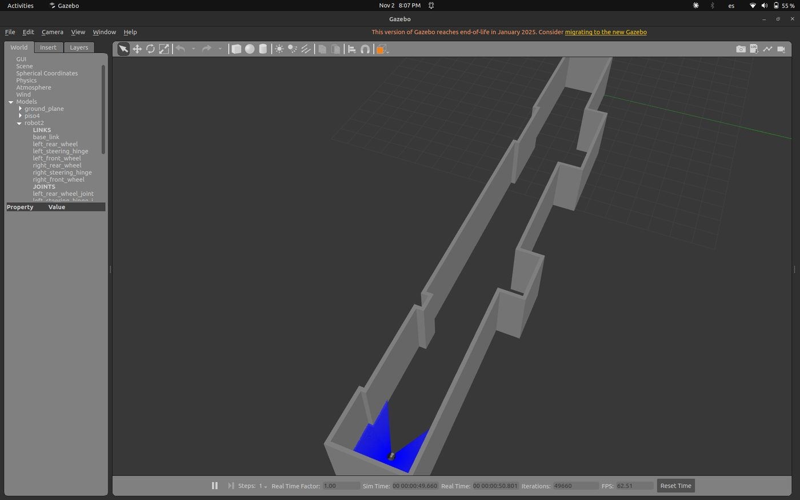
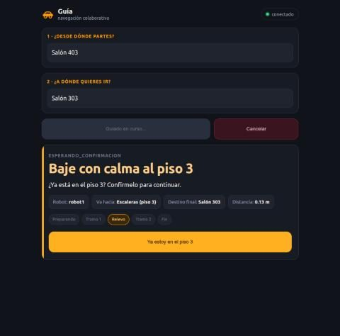

Fase 6 · campaña, análisis y escritura

# Semana 30: Sesión con los jurados y simulación en los pisos 3 y 4

2 al 8 de noviembre de 2026

## Lo que se hizo

- 2 de noviembre: los mundos de los pisos 3 y 4 de Catalayud corrieron en simulación, cada agente en su Gazebo, con los mismos mapas y destinos que los agentes físicos: 13 misiones encadenadas, 10 completadas y 3 canceladas a propósito, también con la media vuelta y la llegada de los agentes físicos. Es una comprobación, no una campaña.
- 2 de noviembre: guion de la sesión de una hora con los jurados, con ensayo, recorrido de cuatro misiones y plan alternativo. Con agentes falsos se comprobó que una segunda misión con otra en curso hace fallar la primera, por lo que la sesión usa un solo teléfono.
- 2 de noviembre: la comprobación entró al documento recortado, en el paso a Catalayud, con las capturas de los dos pisos simulados. El documento queda en 78 páginas.
- 2 de noviembre: la presentación lleva dos clips de 30 s o menos: el relevo de la misión 4 con los agentes físicos y el final de la misión 3 de la campaña en simulación, en un solo piso, porque la grabación de esa campaña no muestra un relevo en movimiento. La presentación queda en 41 diapositivas y 18 min 30 s.
- 3 de noviembre: la red pasó a tener sección propia en el documento, con la justificación de la red Wi-Fi propia y figuras de su montaje y de la carga de las tarjetas. Las medidas del 9 de octubre en campo quedaron en la evidencia. El requisito de latencia no se repitió con un agente en cada piso, y el documento lo declara. El documento queda en 99 páginas y el recortado, en 79.
- 3 de noviembre: las figuras de la interfaz en el documento, la presentación y el sitio pasaron a ser cuadros de las pruebas del 23 de octubre, con el catálogo de destinos y el mensaje de confirmación según el sentido: «Baje con calma al piso 3» y «Suba con calma al piso 4».
- 3 de noviembre: la presentación ganó una diapositiva sobre la red y queda en 42 diapositivas y 19 min 20 s.
- 3 de noviembre: la sección de la red se reescribió en las dos versiones del documento, con las mismas cifras, y la medida de 3,75 ms entre los dos agentes en el mismo piso entró al texto. Los autores deciden no repetir el requisito de latencia con un agente en cada piso: con uno en cada piso quedan las medidas de ida y vuelta contra el enrutador. El documento queda en 99 páginas y el recortado, en 80.
- 3 de noviembre: el sitio pasó a usar el título del documento y sus términos: el usuario, los agentes y los agentes físicos. Las páginas semanales aplican lo mismo al publicar la cronología, los informes y la evidencia, que quedan como se escribieron.
- 3 de noviembre: el documento y la presentación quedaron con los mismos términos que el sitio: «el usuario» en lugar de «la persona» y «piso» en lugar de «planta» y «nivel», salvo en los objetivos oficiales y en la métrica que sale de ellos. El glosario define al usuario, y la tabla de términos quedó en el repositorio.
- 3 de noviembre: versión definitiva del documento. La recortada pasó a ser la única, con la dedicatoria que faltaba frente a la plantilla y una línea más de trabajos futuros, sobre más agentes por piso y misiones simultáneas. Queda en 79 páginas, con las dedicatorias de los dos autores en una misma página.
- 3 de noviembre: el ensayo y la sesión con los jurados incluyen ver en RViz la misión 3 grabada en el agente del piso 4. El visor se probó con una grabación del agente del piso 3 del 8 de octubre; grabar con la cadena completa queda para el ensayo.
- 4 de noviembre: revisión del documento, en una versión aparte, después de leer y medir siete tesis en español de temas parecidos. Las ideas quedaron enlazadas dentro de la oración, con menos repeticiones. Las conclusiones pasaron a un párrafo por objetivo, sin defectos ya corregidos. Las referencias son de 2021 en adelante, salvo 14 antiguas muy relevantes, y sus fichas se comprobaron contra Crossref. Salió la tesis de Jiménez Muñoz, que no trata de pisos. Queda en 62 páginas numeradas y 81 hojas, a la espera de que los autores la lean.
- 4 de noviembre: la portada del sitio muestra la foto de los dos agentes físicos, sin fondo, y el documento en revisión la incluye en los componentes del agente.
- 5 de noviembre: se capturó el grafo real de nodos con `rqt_graph`, con el sistema completo en simulación en los pisos 3 y 4 y una misión con relevo en curso: 69 nodos. Con los agentes físicos no se puede ver completo desde el portátil. Por su tamaño va como archivo aparte, en el anexo C del documento en revisión, y el diagrama sigue en el capítulo como vista de los nodos principales.
- 5 de noviembre: la revisión pasó a ser el único documento (`main.tex`), para que lo lea el director, con el grafo dentro del anexo C, además del archivo aparte. La versión anterior queda en la etiqueta de git `documento-antes-revision-2026-11-04`. Son 63 páginas numeradas y 81 hojas.
- 5 de noviembre: todas las figuras y tablas quedaron fijas entre párrafos, y no parten ninguno; las tablas, centradas, y los pies de figura, con la descripción de lo que muestran. Lo que explicaban pasó al texto.

## En imágenes

<figure markdown>
[{ loading=lazy }](img/s30_1.jpg)
<figcaption>El mundo del piso 3 de Catalayud en Gazebo, con robot1 en su salida, frente a la escalera, y el barrido del láser en azul</figcaption>
</figure>

<figure markdown>
[{ loading=lazy }](img/s30_2.jpg)
<figcaption>El mundo del piso 4 de Catalayud en Gazebo, con robot2 en su salida, frente a la escalera, y el barrido del láser en azul</figcaption>
</figure>

<figure markdown>
[{ loading=lazy }](img/s30_3.jpg)
<figcaption>RViz con la grabación del agente del piso 3 en el piso 3</figcaption>
</figure>

<figure markdown>
[{ loading=lazy }](img/s30_4.jpg)
<figcaption>Grafo de nodos y tópicos con el sistema completo en simulación</figcaption>
</figure>

<figure markdown>
[{ loading=lazy }](img/s30_5.jpg)
<figcaption>La página durante una misión con relevo en simulación, en el piso 3 de Catalayud: el título «Baje con calma al piso 3» y el botón de confirmación</figcaption>
</figure>

## Para leer en detalle

Esta semana no tiene informe en el repositorio.

Evidencia de la semana:

- [Una misión grabada, vista en RViz en el portátil (3 de noviembre)](https://github.com/shdeza12/Collaborative-Mobile-Robot-System-for-Indoor-Navigation-Assistance-in-Multi-Level-Environments/blob/main/Documentos/Evidencia/S30_grabacion_en_rviz.md)
- [Grafo real de nodos con todo corriendo (5 de noviembre)](https://github.com/shdeza12/Collaborative-Mobile-Robot-System-for-Indoor-Navigation-Assistance-in-Multi-Level-Environments/blob/main/Documentos/Evidencia/S30_grafo_rqt.md)
- [Segunda misión con otra en curso y cancelación sin el teléfono (1 de noviembre)](https://github.com/shdeza12/Collaborative-Mobile-Robot-System-for-Indoor-Navigation-Assistance-in-Multi-Level-Environments/blob/main/Documentos/Evidencia/S30_segunda_mision_y_cancelacion.md)
- [Simulación en los pisos 3 y 4 de Catalayud (2 de noviembre)](https://github.com/shdeza12/Collaborative-Mobile-Robot-System-for-Indoor-Navigation-Assistance-in-Multi-Level-Environments/blob/main/Documentos/Evidencia/S30_simulacion_catalayud.md)

[:material-arrow-left: Semana 29](s29.md) · [Todas las semanas](index.md)

